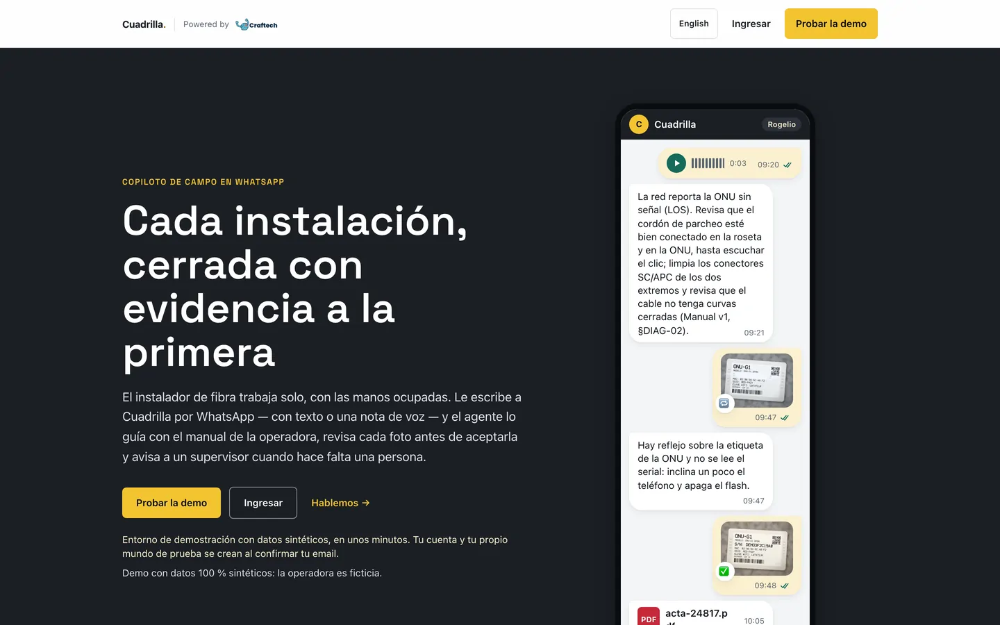
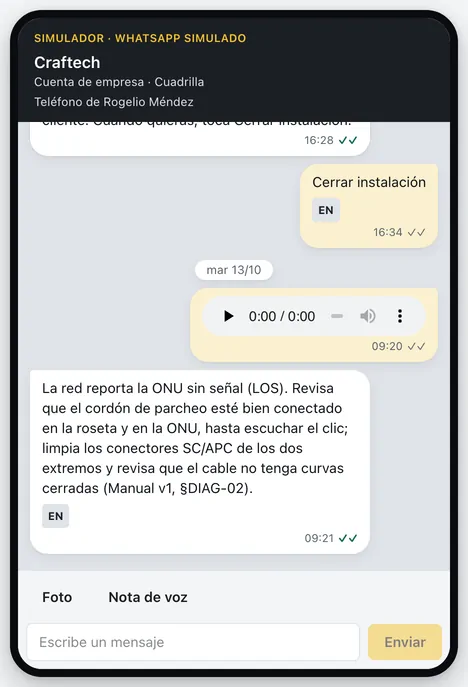
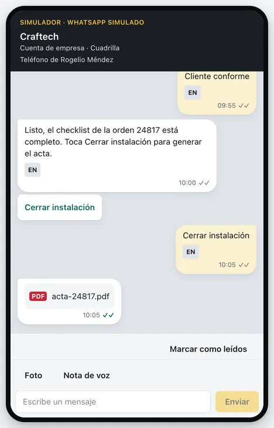
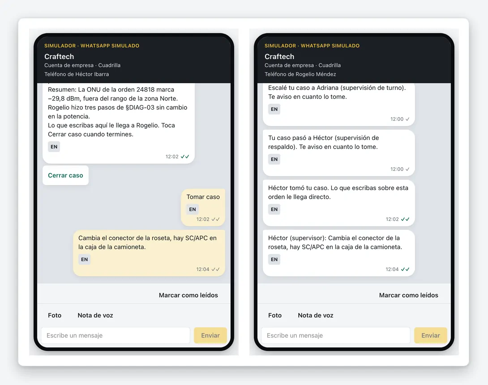
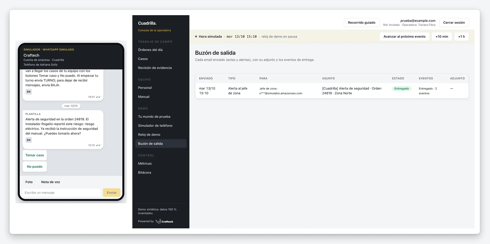
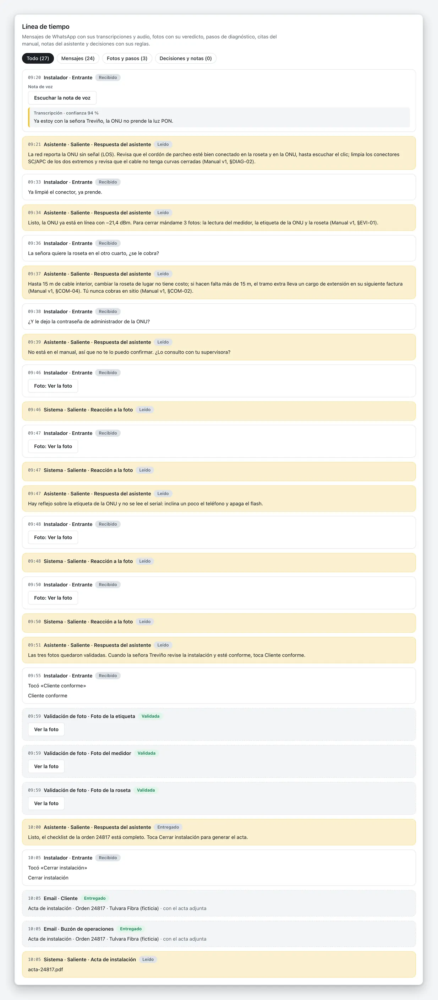
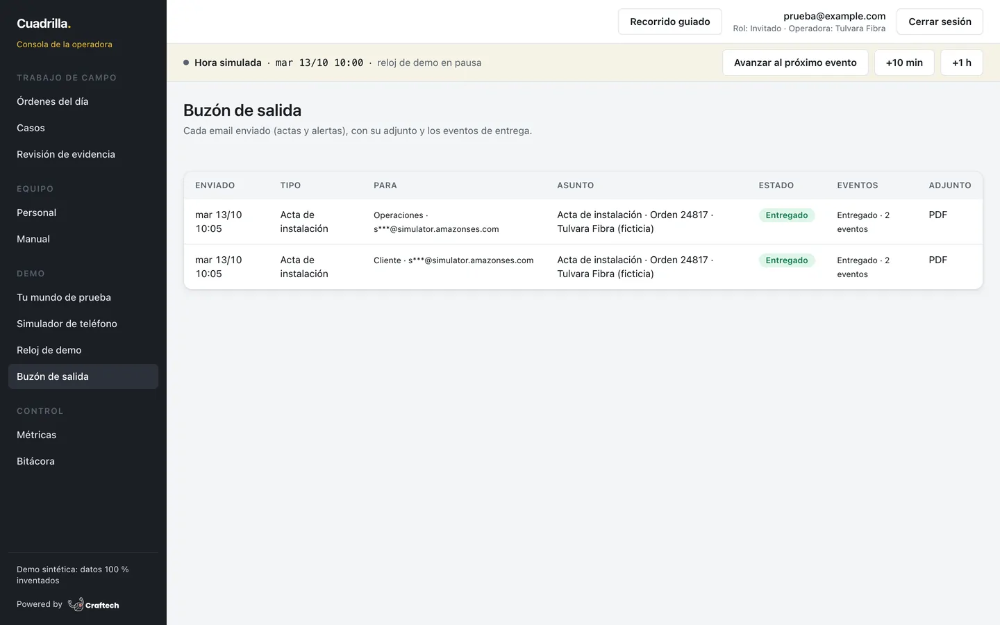
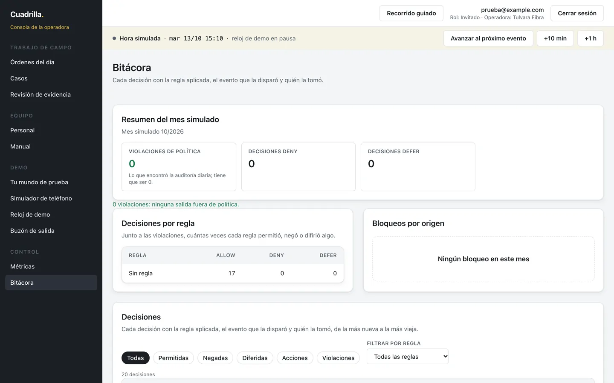
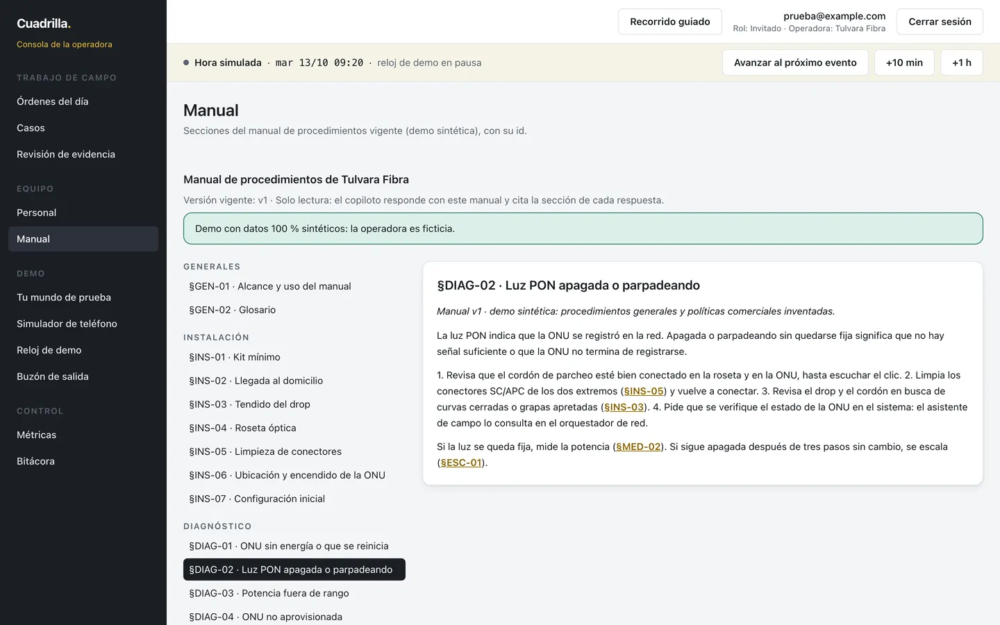
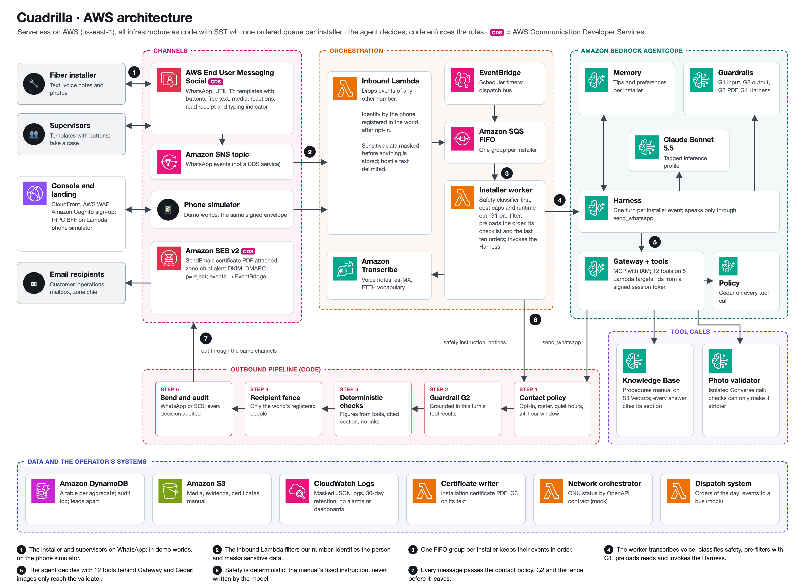

# Cuadrilla · Powered by Craftech

**A field copilot on WhatsApp for fiber (FTTH) installers of a Latin American ISP.**

**Live product:** https://cuadrilla.demo.craftech.io · **Try it:** create an account at
https://cuadrilla.demo.craftech.io/signup (email + verification code, about a minute) and you get your own
isolated demo world.

<p align="center">
  
</p>

A fiber installer works alone at the customer's home, on a ladder or under a desk, with busy hands.
When the ONU does not light up, a photo is missing or something looks dangerous, today they call a
supervisor who may not answer, guess from memory, or leave and come back another day. Cuadrilla sits
in the chat the installer already uses: they write or send a voice note on **WhatsApp**, and an AI
agent reads their work order and the equipment status, walks them through the operator's procedures
manual (always citing the section), checks every evidence photo, escalates to the right supervisor
when it cannot help, gives the manual's fixed safety instruction the moment a hazard is reported and,
at the end, issues the installation certificate. Supervisors and operations follow every order, case
and decision in a web console.

## Contents

- [Who it is for](#who-it-is-for) · [How it works](#how-it-works) · [Screenshots](#screenshots)
- [Architecture](#architecture) · [AWS services](#aws-services) · [The agent](#the-agent)
- [What is real and what is simulated](#what-is-real-and-what-is-simulated)
- [How to test it](#how-to-test-it) · [Guided tours](#guided-tours)
- [Development](#development) · [Deploy from scratch](#deploy-from-scratch) · [Privacy](#privacy)
- [Submission notes](#submission-notes)

## Who it is for

- **ISPs and field-service contractors that install fiber at scale** and lose time and repeat visits
  to incomplete evidence, questions nobody answers on site and escalations that stall.
- **Installers**, who get answers in Spanish on WhatsApp, by text or voice, without installing
  anything new.
- **Supervisors and zone chiefs**, who keep every decision: the agent proposes and escalates, a
  person takes the case, and a person validates evidence by hand when it comes to that.

## How it works

1. **Start of the day.** At 07:30 each installer gets the orders-of-the-day template with a "Ver
   órdenes" (view orders) button; the day's schedule comes from the dispatch system.
2. **Voice or text on site.** "La ONU no prende la luz PON" (the ONU's PON light is off): the voice
   note is transcribed (Amazon Transcribe, `es-MX`, with an FTTH vocabulary), the message is marked
   read with WhatsApp's typing indicator right away, and the agent reads the work order and the ONU's
   optical power from the network orchestrator.
3. **Guidance from the manual, cited.** Every procedure or policy answer comes from the operator's
   manual in a Bedrock Knowledge Base and cites its section (for example §DIAG-02). What the manual
   does not cover is said plainly and offered as an escalation; the agent never invents a policy.
4. **Every photo checked.** Each evidence photo (meter, ONU label, rosette) is validated in an
   isolated multimodal call plus deterministic checks; the installer gets ✅ or 🔁 with an actionable
   reason (glare, out of focus, wrong item). The checklist only advances with a passing validation.
5. **Escalation ladder.** When the agent cannot solve it (three troubleshooting steps without
   success, a topic outside the manual), it opens a case: the supervisor on duty gets a WhatsApp
   template with "Tomar caso" (take the case); if nobody takes it in time, the case moves to the
   backup supervisor and then to the zone chief by email. A supervisor's reply reaches the installer
   over a bridge, and the agent resumes afterwards.
6. **Safety first, deterministic.** "Cable pelado en el poste" (bare cable on the pole) triggers a
   lexical classifier before any guardrail or model: the installer receives the manual's fixed
   instruction (§SEG-01, never written by the model), and the supervisor and the zone chief are
   alerted in parallel.
7. **Installation certificate.** "Cerrar instalación" (close installation) produces the certificate
   PDF, sent by email to the customer and to the operations mailbox and by WhatsApp to the installer.

Guarantees enforced in code, not in the prompt: a contact policy (rules `CP-*`: allow list and
opt-in, quiet hours, the shift roster, the 24-hour WhatsApp window, approved templates, cited answers,
no foreign links, no request for sensitive data) decides every outgoing message; the agent speaks
only to the installer of its session; identity always comes from the registered phone, never from the
model; every incoming message is treated as hostile (masked, delimited and filtered before the model
sees it); every outgoing text is grounded against what the agent read in that turn; every decision is
audited.

## Screenshots

Captured from the product with a deterministic synthetic world (fictitious operator, people and
data). The product speaks Spanish (Mexico) to the field staff; the console shows an "EN" gloss on
every message.

| Voice note → answer citing the manual | Photo rejected for glare, then accepted | Certificate PDF on WhatsApp |
|---|---|---|
|  |  |  |

| Escalation: the backup supervisor takes the case and replies over the bridge |
|---|
|  |

| Safety: fixed instruction, supervisor alert and zone-chief email |
|---|
|  |

| Work order timeline in the console | Outbox with the delivered certificate emails |
|---|---|
|  |  |

| Decision log: every message with the rules that allowed it | Manual section the answer cites |
|---|---|
|  |  |

## Architecture



The diagram is generated from `docs/assets/architecture/architecture.html`
(`npm run diagram:architecture`).

- **Serverless only**, infrastructure as code with SST v4 on AWS (`us-east-1`), a single stage
  (`poc`) deployed only by CI. The inference profile, the guardrails, the Knowledge Base on Amazon S3
  Vectors, the Transcribe vocabulary, the WAF web ACLs and the SES identity are declared in code too.
- **One ordered queue per installer** (Amazon SQS FIFO, one message group per installer): inbound
  messages, voice transcription, agent turns, ladder timeouts and supervisor replies for the same
  installer are processed one at a time, in order, without duplicates.
- **Timers are Amazon EventBridge Scheduler schedules** (ladder timeouts, start of the day); the
  dispatch mock publishes to an EventBridge bus like a real dispatch system would.
- **Identity never comes from the model**: a person is identified by a phone registered in their
  world, after opt-in; tools take every id from a signed session token.
- **Each account's world is isolated** by operator and clock; demo worlds are capped, expire and have
  per-world usage limits inside a stage-wide cost ceiling with a runtime cut.
- **Observability is logs only**: JSON logs with a correlation id and no personal data, kept 30 days;
  spend is capped before it happens and the operator switches a runtime cut on or off.

Design documents (in Spanish): `docs/design-brief.md`, `docs/architecture.md`,
`docs/architecture-integrations.md`, `docs/adr/`, `docs/flows-catalog.md`, `docs/tool-catalog.md`,
`docs/test-plan.md`; glossary in `CONTEXT.md`. Serve them with
`python3 -m http.server 8099 --bind 127.0.0.1` and open `http://localhost:8099/docs/viewer.html`.

## AWS services

| Area | Services |
|---|---|
| Messaging (AWS Communication Developer Services) | **AWS End User Messaging Social** (WhatsApp), **Amazon SES v2** |
| Agent | Amazon Bedrock AgentCore (Harness, Gateway, Policy, Memory), Amazon Bedrock (Claude Sonnet 5.5 through an application inference profile, Guardrails, Knowledge Bases), Amazon S3 Vectors, Amazon Titan Text Embeddings v2 |
| Voice | Amazon Transcribe (`es-MX`, custom vocabulary); Amazon Polly only to generate the synthetic voice notes of the seed |
| Orchestration | AWS Lambda, Amazon SQS FIFO, Amazon EventBridge (Scheduler and bus), Amazon SNS (carries WhatsApp events; not a Communication Developer Service) |
| Data | Amazon DynamoDB (one table per aggregate), Amazon S3 |
| Web and identity | Amazon CloudFront, AWS WAF, Amazon Cognito (own sign-up with email code, SRP sign-in), Amazon Route 53, AWS Certificate Manager |
| Operations | Amazon CloudWatch Logs, AWS IAM with GitHub OIDC for CI |

### How it uses AWS Communication Developer Services at runtime

| Service | What Cuadrilla does with it through the AWS SDK |
|---|---|
| **AWS End User Messaging Social** (WhatsApp) | The single client is `packages/bff/src/channels/whatsapp/client.ts` (`@aws-sdk/client-socialmessaging`). `SendWhatsAppMessage` sends `UTILITY` message templates in `es_MX` with quick-reply buttons (orders of the day, escalated and reassigned case, safety alert, supervisor reply, certificate with a document header), free-text replies inside the 24-hour window, interactive buttons and lists, reactions (✅ / 🔁 on a photo) and the read receipt with the typing indicator (`channels/whatsapp/ack.ts`). `PostWhatsAppMessageMedia` uploads the certificate PDF and case photos from S3; `GetWhatsAppMessageMedia` downloads inbound voice notes (Ogg/Opus) and photos into S3 (metadata first, then the object). Inbound messages and delivery statuses arrive from the WhatsApp Business Account's event destination through an Amazon SNS topic to `packages/bff/src/handlers/inbound-whatsapp.ts`, which discards any event that is not for our number. Templates are created as code with `CreateWhatsAppMessageTemplate` (`scripts/channels/whatsapp-templates.ts`). The console's **phone simulator** hands the inbound handler the same signed event envelope, and its transport validates the same WhatsApp Cloud API payloads and emits the same `sent` / `delivered` / `read` statuses, so every WhatsApp flow of the product can be tested end to end from a browser. |
| **Amazon SES v2** | Outbound only, from the product's own domain with Easy DKIM, a custom MAIL FROM and DMARC `p=reject`. `SendEmail` (`packages/bff/src/channels/email/outbound.ts`, input built in `channels/email/request.ts`) sends the installation certificate with the PDF as an attachment (`Content.Simple.Attachments`) to the customer and to the operations mailbox, and the safety or escalation alert to the zone chief; every send names the app's configuration set and carries `EmailTags`. Configuration-set events (send, delivery, bounce, complaint, reject, delay) arrive through Amazon EventBridge at `packages/bff/src/handlers/channel-events.ts` and move the outbox status (a certificate that bounces opens a case; a complaint stops all email to that address). Amazon Cognito's sign-up and recovery emails and the lead notice to Craftech (`packages/bff/src/leads/notify.ts`) go through the same identity. A recipient fence inside the client only lets demo worlds write to the SES mailbox simulator. |

## The agent

- **Amazon Bedrock AgentCore Harness** with **Claude Sonnet 5.5** (`global.anthropic.claude-sonnet-5-5`,
  through a tagged application inference profile), one turn per installer event, invoked by
  `InvokeHarness` (`packages/bff/src/agent/harness-client.ts`) from a worker that reads an SQS FIFO
  queue with one message group per installer.
- **AgentCore Gateway** (MCP, IAM auth) with five AWS Lambda tool targets and 12 tools: `orders`
  (`get_work_orders`, `get_work_order`, `get_onu_status`), `knowledge` (`search_procedures`),
  `evidence` (`get_checklist`, `validate_install_photo`, `update_checklist`), `messaging`
  (`send_whatsapp`) and `cases` (`record_troubleshooting_step`, `escalate_case`,
  `report_safety_hazard`, `close_installation`). Every id a tool uses comes from a signed,
  short-lived session token, never from the model, and every input is validated strictly.
- **AgentCore Policy** (Cedar, `ENFORCE`) checks every tool call; there is no tool that validates
  evidence by hand, takes, rejects or closes a case: those decisions are human.
- **AgentCore Memory** keeps tips per installer (mistakes that repeat and what solved them), their
  preferences and a summary per work order to resume after a bridge or a block; nothing about the
  customer.
- **Amazon Bedrock Guardrails**, four published versions: **G1** on input, as the worker's
  pre-filter (denied topics such as pricing, customer compensation and electrical work; prompt
  attacks; cards blocked, Mexican tax and bank ids anonymized); **G2** on every outgoing text
  (contextual grounding against the turn's tool results and the manual passages, relevance to the
  installer's question); **G3** on the certificate text and template parameters (PII only); **G4**
  on every Harness model call (G1 without the denied topics, so the manual's own safety and pricing
  sections never trip it).
- **Fast turns**: before invoking the model, the worker runs the reads every turn needs (the work
  order in progress, its checklist and, for an installer's message, their last ten orders) with the
  turn's token and injects them as escaped tool results, so a reply needs fewer model round trips.
  A prompt rule makes sure every installer message gets an answer, a greeting included.
- **Photos never reach the agent.** Only `validate_install_photo` sees an image, in an isolated
  Bedrock `Converse` call whose only tool records the verdict; deterministic checks (file type and
  size, repeated photos, then what the model read against the order it never saw: 1490 nm wavelength,
  the zone's acceptance range, the ONU serial, ±3 dB from the orchestrator's reading) can only make
  the verdict stricter.
- The agent speaks only through `send_whatsapp`; every send goes through one outbound pipeline
  (contact policy, G2, deterministic checks, recipient fence, transport).

## What is real and what is simulated

| Piece | In this proof of concept |
|---|---|
| Operator, installers, supervisors, customers, addresses, equipment | **Synthetic.** Every name is fictitious and checked; phone numbers come from a synthetic block per world. |
| Procedures manual, policies and prices | **Synthetic**, written from scratch for this product; the deployed demo is co-branded with a design partner ("Cuadrilla for <design partner> · Powered by Craftech") and every surface says that the manual, policies, prices and data are an invented demo, not the partner's real policies. The brand is runtime configuration and never part of this repository. |
| Evidence photos and voice notes | **Synthetic**: generated photos and Amazon Polly voices, each with its source in a data sheet. You can also record your own voice note in the browser or upload a photo. |
| AI agent | **Real.** Amazon Bedrock AgentCore (Harness, Gateway with five tool targets, Policy, Memory) with four Bedrock Guardrails, a real Knowledge Base and real photo validation. |
| Voice transcription | **Real**, Amazon Transcribe `es-MX` with a custom FTTH vocabulary. |
| Email (certificate, zone-chief alert) | **Real end to end** through Amazon SES; in demo worlds the recipients are SES mailbox-simulator addresses, so you see delivery events without anyone receiving mail. |
| WhatsApp | **Implemented on AWS End User Messaging Social**: templates, interactive messages, media, voice notes, reactions, read receipts and the event pipeline are built and fixture-tested against the real payload shapes. In the demo you test it in the console's **phone simulator**, labelled as such, which enters through the same event envelope, normalizer, contact policy, agent and outbound pipeline. |
| Network orchestrator (ONU status) and dispatch system (orders of the day) | **Mocks behind real contracts**: an OpenAPI contract (`packages/network-contract`) with a mock implementation, and a dispatch mock that publishes events to an Amazon EventBridge bus like a real system would. |
| Clock | **Simulated per world**, paused by default; every timer is an Amazon EventBridge Scheduler schedule the clock knows how to advance. |
| Account emails (sign-up code, password recovery) | **Real**, sent by Amazon Cognito through Amazon SES. |
| Figures on the landing page | **Goals and one pilot assumption**, labelled as such (for example a first reply in under 30 s for text); never production results. |

## How to test it

1. Open **https://cuadrilla.demo.craftech.io** and choose **Try the demo** (or go straight to
   `/signup`). Enter an email and a password, accept the terms, and type the verification code you
   receive by email. Already have an account? Sign in at `/login`.
2. Your account gets its own isolated world of synthetic data: a fictitious operator, a crew with an
   installer (Rogelio) and two supervisors (Adriana and Héctor), three work orders and the procedures
   manual, with a simulated clock paused at 07:00 that only moves with the console's controls. The
   first sign-in prepares the world in a few seconds.
3. The console speaks Spanish, like the field staff it serves. Click **Recorrido guiado** (guided
   tour, top bar); the panel switches to English with its **English** link. Follow the **Express
   tour** (about 5 minutes): every step has a button that sends the right message from the **phone
   simulator** and a **Jump to scene** shortcut, so no step depends on the previous one.
4. Where to look: **Simulador de teléfono** (phone simulator: the installer's and supervisors'
   WhatsApp), **Órdenes del día** and the order detail (timeline, transcription, photo verdicts,
   citations, certificate), **Casos** (the escalation ladder), **Buzón de salida** (outbox: every
   email with its SES delivery events and the PDF), **Manual** (the cited sections), **Métricas** and
   **Bitácora** (decision log: every message with the policy rules that allowed it).
5. You play the installer and the supervisors in the simulator; you can type freely, record a voice
   note in the browser or upload a photo. The emails your world sends go to the Amazon SES mailbox
   simulator and show up in the outbox.

Your world lasts 7 days and is recreated the next time you sign in; **Borrar mi cuenta** (delete my
account) on your home page deletes your account and your data. Terms and privacy:
`https://cuadrilla.demo.craftech.io/legal/terms.html` and `/legal/privacy.html`.

## Guided tours

The console's guided tour walks your demo world with the steps below (the simulated hours are those of
a fresh world; every step can also be reached with "Jump to scene"). The table is generated from the
same source as the console (`packages/web/src/views/tour/`) and `npm run tour:check` fails if they
differ.

<!-- TOUR:START -->
### Express tour (~5 min)

| # | Step | Button / action | What to look at | Expected wait |
|---|---|---|---|---|
| X1 | Voice → citation | Send the voice note “la ONU no prende la luz PON” (the ONU's PON light is off) (or “Jump to scene”: On site (09:20)) | Read receipt and “typing…” right away; then the transcript, the no-optical-signal state the orchestrator reports and the manual step citing §DIAG-02. | ~45 s (transcription + agent turn) |
| X2 | Rejected photo, sent again | Send the two label photos: with glare, then a good one (or “Jump to scene”: Evidence (09:45)) | 🔁 and the glare rejection with an actionable reason; ✅ on the second photo. | ~20 s per photo |
| X3 | Certificate | Tap “Cerrar instalación” (close installation) (or “Jump to scene”: Checklist complete (10:00)) | The certificate PDF in the simulator; in the outbox, the two emails (customer and operations) with their delivery event. | ~60 s (PDF + emails) |
| X4 | Safety | Send “cable pelado en el poste” (bare cable on the pole) (or “Jump to scene”: Third visit (15:10)) | The safety instruction of §SEG-01 right away, the safety alert to Adriana and the email to the zone chief in the outbox. | ~20 s |

### Full tour (~15 min)

| # | Step | Button / action | What to look at | Expected wait |
|---|---|---|---|---|
| 1 | Sign in | Open your home page | Your own world with the clock paused on Oct 13 at 07:00, the start of the day pending at 07:30 and work order 24817 pinned as the main story. | ~10 s (the first sign-in creates your world) |
| 2 | Start the day | Start the day (or “Jump to scene”: Start of the day (07:00)) | In the simulator (Rogelio), at 07:30, the orders-of-the-day template with the “Ver órdenes” (view orders) button. | ~5 s |
| 3 | View orders | Tap “Ver órdenes” as Rogelio (or “Jump to scene”: Orders of the day (07:30)) | The day's three work orders with address, plan and time window. | ~30 s (agent turn) |
| 4 | Voice note | Go to the first visit (09:20) and send the voice note (or “Jump to scene”: On site (09:20)) | Read receipt and “typing…” right away; then the transcript, the no-optical-signal state the orchestrator reports and the manual step citing §DIAG-02. | ~45 s (transcription + agent turn) |
| 5 | ONU online | Send “Ya limpié el conector, ya prende” (I cleaned the connector, it's on now) (or “Jump to scene”: Troubleshooting step given (09:25)) | The ONU online at −21.4 dBm and the request for three photos. | ~30 s (agent turn) |
| 6 | Policy question | Send “¿se cobra la roseta en otro cuarto?” (is moving the rosette to another room charged?) and open the Manual (or “Jump to scene”: ONU online (09:35)) | The answer citing §COM-04; the cited section opens in the Manual view. | ~30 s (agent turn) |
| 7 | Photos | Send the photos in order (meter, label with glare, good label, rosette) and tap “Cliente conforme” (customer sign-off) (or “Jump to scene”: Evidence (09:45)) | The ✅ and 🔁 reactions, the glare rejection with its reason and the complete checklist in the order detail. | ~20 s per photo |
| 8 | Certificate | Tap “Cerrar instalación” (close installation) and open the outbox (or “Jump to scene”: Checklist complete (10:00)) | The certificate PDF in the simulator; in the outbox, the two emails (customer and operations) with their delivery event. | ~60 s (PDF + emails) |
| 9 | Escalation | Go to the second visit (11:50) and send three low-power voice notes (or “Jump to scene”: Second visit (11:50)) | A case for diagnosis attempts opened at 11:50 that times out at 12:00; in the simulator (Adriana), the escalated-case template. | ~90 s (three agent turns) |
| 10 | Timeout | Advance to the next event and open Cases (or “Jump to scene”: Case with the supervisor on duty (11:50)) | At 12:00 nobody took the case: it moves to Héctor with the reassigned-case template; the ladder shows in the Cases view. | ~5 s |
| 11 | Take and reply | As Héctor: take the case, send the instruction and close the case (or “Jump to scene”: Case with the backup supervisor (12:00)) | The summary and the photos reach Héctor; his reply reaches Rogelio over the bridge, the power is fixed in the simulated orchestrator and the agent resumes. | ~10 s per action |
| 12 | Safety | Go to the third visit (15:10) and send “cable pelado en el poste” (bare cable on the pole) (or “Jump to scene”: Third visit (15:10)) | The safety instruction of §SEG-01 right away, the safety alert to Adriana and the email to the zone chief in the outbox. | ~20 s |
| 13 | Metrics | Open Metrics | The manual and photo measurements with their N and label; 0 policy violations; the decisions per rule. | Right away |
<!-- TOUR:END -->

## Repository layout

| Path | What |
|---|---|
| `infra/` | SST v4 infrastructure (one module per capability) and the CI bootstrap template |
| `packages/shared` | Enums, ids, errors and contracts shared by every package |
| `packages/bff` | tRPC BFF, agent tools, turns and worker, outbound pipeline, contact policy, channels, cases and ladder, photo validator, certificate |
| `packages/web` | Landing page, sign-up and sign-in, operator console and phone simulator (React 19, Vite, Tailwind v4) |
| `packages/network-contract`, `packages/network-mock` | Network orchestrator contract (OpenAPI 3.1 + zod) and its mock |
| `packages/dispatch-mock` | Dispatch system mock |
| `scripts/` | Seed generator and loader, scenario runner, lint guards, operator scripts, architecture diagram |
| `tests/` | Local flow tests, the local UI server for Playwright, test cases |

## Development

Requirements: Node 22 (version in `.nvmrc`) and npm.

```bash
npm ci
npm run typecheck
npm run lint && npm run lint:duplicates && npm run lint:wp-ownership
npm test                                    # unit and local flow tests (vitest)
npm run flows:check && npm run tour:check   # flow catalog and guided tour stay in step with the code
npm run seed:validate && npm run manual:check && npm run network:contract
npm run build -w packages/web
npm run test:ui                             # Playwright against the local UI server
npm run lint:neutral-surfaces               # visible texts stay neutral (also with -- --dist)
FORBIDDEN_TERMS="…" npm run lint:forbidden  # the operator's list lives outside the repository
```

There is no local stage: everything is tested locally with unit, local-flow and UI tests, and in
`poc` by CI. Never `sst dev` or a local `sst deploy`.

## Deploy from scratch

1. **Prechecks** (read-only): SES out of the sandbox, the GitHub OIDC provider, SST's bootstrap in the
   account, Claude Sonnet 5.5 and Titan Text Embeddings v2 active with enough quota, the `Project`
   cost allocation tag active.
2. **CI bootstrap**, once and whenever the template changes: `aws cloudformation deploy` of
   `infra/bootstrap/ci-role.yaml` (deploy role, scenario-runner role, permissions boundary, CloudFront
   policies); see `infra/bootstrap/README.md`.
3. **Secrets** of the `poc` stage with `npx sst secret set … --stage poc`: the session key, the
   WhatsApp Business Account and phone number ids (placeholder values keep the stage on the
   simulator transport), the seed overrides, the origin key, the lead notice configuration and the
   brand configuration (`docs/architecture.md` §3).
4. **Push to `main`.** `.github/workflows/deploy.yml` runs every check above, deploys with
   `sst deploy --stage poc` (retried once after a minute when IAM is still propagating a new grant),
   loads the seed and the manual into the Knowledge Base, and runs the smoke scenarios.
5. **Post-deploy checks and accounts**: DKIM and DMARC, Knowledge Base and vocabulary ready, Harness
   and targets ready, runtime cut off; internal console accounts with `npm run console:invite`.
6. **Live WhatsApp transport** (optional, per stage): link a WhatsApp Business Account and number in
   the End User Messaging Social console, load their ids as secrets, then run
   `npm run channels:whatsapp-templates`, `channels:waba-event-destination` and `channels:waba-check`,
   and add `live` to the WhatsApp transports in `infra/channel-modes.ts`. Synthetic worlds keep using
   the phone simulator either way.

Operator scripts: `npm run seed:load`, `npm run ops:kill` (runtime cut), and the lead scripts
`leads:export`, `leads:unsubscribe` and `leads:delete` (confirmed sign-ups; see the privacy policy).

## Privacy

Sign-up asks for an email and a password; name, company and role are optional. Two separate,
unchecked consents are recorded with their date and text version: the terms and privacy policy
(required) and being contacted by Craftech about this solution (optional); the account and the lead
exist only once the email has been verified with the code. Craftech (Ciudad Autónoma de Buenos Aires,
Argentina) is the data controller; lead data is kept 24 months after the last sign-in or until
deletion is requested at sales@craftech.io, and the privacy policy explains every right and how to
exercise it. Emails never reach logs, audit trails or demo exports. Everything typed, recorded or
uploaded inside a demo world is synthetic-only, stays in that world and is deleted with it.

## License

Copyright 2026 Craftech. All rights reserved.

## Submission notes

This repository is Craftech's entry to the AWS CDS Agentic AI Partner Hackathon (overall ranking and
Best of WhatsApp). Nothing in the published product mentions the contest: it is presented as a
product for a customer.

- **AWS Communication Developer Services in the runtime code, through the AWS SDK**: Amazon SES v2
  (`SendEmail` with attachments, configuration-set events) and AWS End User Messaging Social
  (`SendWhatsAppMessage`, `PostWhatsAppMessageMedia`, `GetWhatsAppMessageMedia`,
  `CreateWhatsAppMessageTemplate`); see
  [How it uses AWS Communication Developer Services at runtime](#how-it-uses-aws-communication-developer-services-at-runtime).
  In the deployed demo, WhatsApp is tested in the console's phone simulator, which runs the same
  inbound envelope, contact policy, agent and outbound pipeline. Amazon SNS only carries WhatsApp
  events and is not presented as a CDS service.
- **ACE opportunity**: `O28893592`.
- **Design partner**: the deployed demo is co-branded with a Latin American ISP that acts as design
  partner; its name is runtime configuration, never part of this repository, and every policy,
  person and figure in the product is synthetic.
- **Testing instructions for evaluators** (free of charge throughout the judging period):
  1. Open `https://cuadrilla.demo.craftech.io/signup` and create an account with any email you can
     read (verification code by email), or sign in at `https://cuadrilla.demo.craftech.io/login`
     with the reserved guest account given in the private testing instructions of the submission
     form. Each account gets its own isolated world of synthetic data.
  2. Click **Recorrido guiado** (guided tour; the panel has an **English** switch) and run the
     **Express tour** (~5 minutes): voice note → answer citing the
     manual, rejected and accepted photo, installation certificate PDF and the two delivered emails,
     safety instruction and alerts. Every step has **Jump to scene**, so steps can be tried in any
     order. The full tour (~15 minutes) adds the escalation ladder and the supervisor bridge.
  3. Agent replies take about 30–60 seconds (the console shows what it is waiting for). The emails
     go to the Amazon SES mailbox simulator and appear in the console's **Buzón de salida** (outbox).
- **Pre-existing code**: the repository skeleton (SST and CI setup, the CI bootstrap template, lint
  and traceability scripts, the console shell and shared components, the own Cognito sign-in, the
  tRPC base, logging, retry and crypto helpers, the Knowledge Base and Transcribe infrastructure
  patterns, the landing gallery, the scenario-runner pattern and the agent definitions in `.claude/`)
  was reused from internal Craftech scaffolding created during the contest period. Everything
  specific to this product is new and was built during the submission period, with AI coding
  assistants.
- **Third-party pre-existing code**: the process skills in `.claude/skills/` (`grill-with-docs`,
  `grilling`, `domain-modeling`) come from [mattpocock/skills](https://github.com/mattpocock/skills)
  (`skills/engineering/` and `skills/productivity/`); `grill-with-docs` is an expanded version that
  works standalone. They are development tooling, not product code (see `.claude/skills/README.md`).
  The AWS architecture icons in `docs/assets/architecture/icons/` come from the MIT-licensed
  `aws-icons` package (`LICENSE-aws-icons`).
- Submission materials are in English; the intellectual property is Craftech's.
