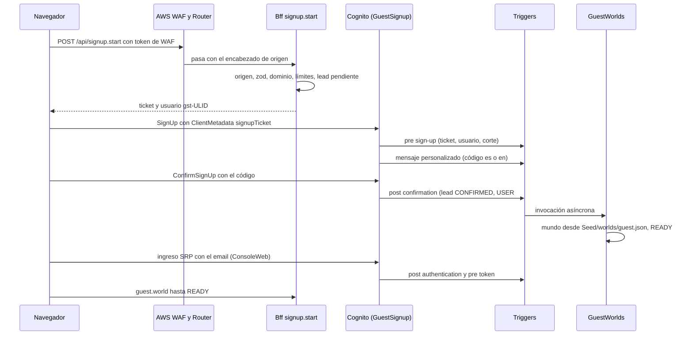

# Integraciones · canales y sistemas simulados

Complemento de `docs/architecture.md`: cómo entra y sale cada mensaje y cómo están hechos los sistemas externos que simulamos. Todo servicio de AWS nombrado acá es real en `poc`; lo simulado es la contraparte (teléfonos del personal, despacho de órdenes, orquestador de red, buzones de destino).

## 1. SES saliente

Módulo `packages/bff/src/channels/email/outbound.ts`: **cliente único de SES v2**. Todo email de producto pasa por él (actas, alertas al jefe de zona), así que el cerco vive adentro del cliente y ningún camino puede olvidarlo. Hay dos excepciones declaradas, que no son emails de la demo y tienen su propio cerco (§9): los de autenticación, que manda Cognito desde `no-reply@` a la dirección que verificó cada persona, y el aviso de lead, que manda `LeadStream` desde `leads@` solo a `@craftech.io`.

| Remitente | Uso | Quién lo usa |
|---|---|---|
| `"Cuadrilla · Actas" <actas@cuadrilla.demo.craftech.io>` | `CERTIFICATE_EMAIL` al cliente y al buzón de operaciones. El remitente visible es genérico en los dos modos; el nombre de la operadora (`Isps/META.displayName`, resuelto por `resolveBrand`: la operadora ficticia rotulada "ficticia" en modo `neutral`, el socio de diseño en `cobrand`, que es el modo de `poc`) va en el asunto y en el cuerpo, con el aviso de demo sintética en co-branding (ADR-0018) | `CertificateWriter` vía pipeline (`ToolCases`, `InstallerWorker`) |
| `"Cuadrilla · Alertas" <avisos@cuadrilla.demo.craftech.io>` | `ZONE_CHIEF_ALERT` | Pipeline (`InstallerWorker`, `ToolCases`) |

Destinatarios permitidos (`CP-RECIPIENT-FENCE`, `outbound/recipient-fence.ts`), **por mundo**:

| Destinatario | Permitido | Por qué |
|---|---|---|
| `*@simulator.amazonses.com` (con etiqueta `success+<tag>@`, `bounce+<tag>@`, `complaint+<tag>@`) | Sí, en todo mundo | SES lo entrega y produce el evento esperado sin un buzón que tengamos que leer y sin afectar la reputación de la cuenta |
| Direcciones de `SeedOverrides.demoRecipients.emails` | Solo en el mundo vivo o de demo del operador (`GLOBAL#isp-demo`); nunca en mundos `GUEST`, `QA` ni `EVAL` | Buzones del equipo registrados para la demo en vivo; un invitado que edita el email de una persona no puede dirigir alertas a buzones reales (`people.upsert` aplica el mismo cerco al escribir) |
| `*@cuadrilla.demo.craftech.io` y subdominios | **No** | El dominio no tiene buzones (sin MX de recepción): sería un rebote seguro |
| Dominios reservados (`.test`, `.example`, `.invalid`, `.localhost`, `example.com|net|org`) | No | RFC 2606/6761 |
| Cualquier otro | No | `RECIPIENT_NOT_ALLOWED` antes de llamar a SES, auditado |

Parser estricto RFC 5322 (dominio en minúsculas, sin punto final, sin IDN ni no-ASCII, sin comillas, un solo `@`, sin CR/LF); comparación exacta de dominio. `outbound/recipient-fence.test.ts` cubre sufijos engañosos (`simulator.amazonses.com.attacker.example`), mayúsculas, punto final, comillas e IDN.

| Aspecto | Diseño |
|---|---|
| API | `SendEmail` (SES v2) con `Content.Simple` (`Subject` y `Body.Text`/`Body.Html` con `Charset UTF-8`, `Body.Html` mínimo generado del texto, `Attachments` con el PDF del acta: `FileName acta-<número>.pdf`, `ContentType application/pdf`, `ContentDisposition ATTACHMENT`, `RawContent` desde S3), `ConfigurationSetName aws-cds-hackathon-poc-cuadrilla-email-poc`, `EmailTags {ispId, workOrderId, mailId, kind, stage}` con valores normalizados por una sola función (`channels/email/tags.ts`: todo carácter fuera de `[A-Za-z0-9_-]` pasa a `-`; `tags.test.ts` con ids de todos los mundos, incluidos `GLOBAL#…` y `GUEST#…`) |
| Asuntos | `Acta de instalación · Orden 24817 · <displayName>` (con "(ficticia)" en modo neutral y "(demo sintética)" en co-branding) · `[Cuadrilla] Alerta de seguridad · Orden 24819 · Zona Norte` · `[Cuadrilla] Caso sin atender · Orden 24818` |
| Tope | `SIMCAP#<clockId>#emails#<realDay>`, por perfil de origen del mundo (`INVITED` 20 y `SIGNUP` 10 por día real; fuente única: `docs/seed-spec.md` §4); las actas del set de QA tienen el presupuesto de su corrida |
| Encabezados | Todo valor armado con datos del registro se valida (sin CR/LF ni caracteres de control; nombre visible codificado RFC 2047); `X-Cuadrilla-Mail-Id: <mailId>` |
| Contenido | Textos de `packages/bff/src/copy/es-MX.ts` con parámetros de la orden; en co-branding, la primera línea del cuerpo es "Cuadrilla for <socio> · Powered by Craftech" y la última, el aviso de demo sintética (ADR-0018); el resumen de un caso es el verificado por G2 y la verificación determinista; ningún texto libre del modelo sin verificar. Link a la consola solo en `ZONE_CHIEF_ALERT` (`https://cuadrilla.demo.craftech.io/app/cases/<caseId>`, requiere login) |
| Pendiente | Antes de `SendEmail`, `Runtime/PENDING#<clockId>` · `MAIL#<mailId>`; lo cierra `ChannelEvents` con el primer evento de SES del destinatario |
| Registro | `Conversations/OUTBOX#<ispId>` · `MAIL#<ts>#<mailId>` con el cuerpo tal como salió, la clave del adjunto, `providerMessageId` y los eventos; es lo que muestra el **buzón de salida** |

## 2. Eventos de SES

Configuration set → EventBridge (bus default): `SEND`, `DELIVERY`, `BOUNCE`, `COMPLAINT`, `REJECT`, `DELIVERY_DELAY`, `RENDERING_FAILURE`; sin `OPEN` ni `CLICK`. Regla filtrada por `ses:configuration-set` → `ChannelEvents` → `EMAIL_EVENT` en la cola del instalador de la orden (por `EmailTags.workOrderId`).

El mismo configuration set tiene un segundo destino, de **CloudWatch**, con la dimensión `kind` tomada del tag del mensaje y valor por defecto `AUTH`. Los emails de Cognito (código de alta, reenvío, recuperación, invitación) salen por este configuration set (`EmailConfiguration.ConfigurationSet` del pool) y no llevan tags, así que se miden como `kind = AUTH` (`AuthEmailSends`, `AuthEmailBounces`, `AuthEmailComplaints`), con las alarmas que encienden el corte del alta (ADR-0025 §4). En EventBridge, un evento sin `EmailTags.workOrderId` no se encola: los de Cognito (sin tags) se descartan y los del aviso de lead (`kind LEAD_NOTIFY`) solo suman `LeadNotifyFailures` si rebotan; `ChannelEvents` nunca loguea la dirección.

| Evento | Efecto |
|---|---|
| `Delivery` | `OutboundEmail.status = DELIVERED`; `Certificate.deliveries[destinatario] = DELIVERED`; para `ZONE_CHIEF_ALERT`, marca la hora de entrega (`SafetyAlertLatency`) |
| `Bounce` `Permanent` | Entrega `BOUNCED`; si es un acta → caso `CERTIFICATE_UNDELIVERED` en la consola; si es una alerta → alarma y aviso en el caso |
| `Bounce` `Transient`, `DeliveryDelay` | `DELAYED`; `TIMER#CERT_RETRY` único a + 5 min |
| `Complaint` | `COMPLAINED`; caso `CERTIFICATE_UNDELIVERED` con motivo queja; la dirección queda marcada y no se vuelve a usar |
| `Reject`, `RenderingFailure` | `FAILED`, alarma |

## 3. Sin recepción de email

La cuenta tiene un solo rule set de recepción activo por región y pertenece a la otra POC. Cuadrilla no publica MX de recepción, no crea rule sets, no los lee y su rol de CI no tiene esas acciones (ADR-0003). Nada del producto necesita email entrante: los supervisores responden por WhatsApp, el jefe de zona entra a la consola por el link y los clientes sintéticos son buzones del simulador de SES.

## 4. WhatsApp (End User Messaging Social)

Adaptador `packages/bff/src/channels/whatsapp/` con dos transportes detrás de la misma interfaz (ADR-0002). El stage declara qué transportes existen (`ChannelModes.whatsapp.transports`: `["simulated"]` hasta P-01, `["simulated", "live"]` después); cada mundo tiene su modo (`Isps/SETTINGS.whatsappMode`), y el transporte de cada envío lo decide el **destinatario** (`channels/registry.ts`): un teléfono real del mundo vivo o ligado por código sale por EUM Social; toda identidad sintética, por el transporte simulado. Lo que dicen la landing y el README: "End User Messaging Social adapter implemented and fixture-tested; the phone simulator works in every demo world, and live WhatsApp is enabled once the WhatsApp Business Account is connected".

### 4.1 Transporte `live`

**Dos ids del mismo número.** EUM Social identifica al número de dos formas y no son intercambiables:

| Secreto | Forma | Dónde se usa |
|---|---|---|
| `WhatsAppPhoneNumberId` | Id de AWS, `phone-number-id-<32 hex>` (zod con ese patrón) | `originationPhoneNumberId` de `SendWhatsAppMessage`, `GetWhatsAppMessageMedia` y `PostWhatsAppMessageMedia`; ARN de IAM `…:phone-number-id/<32 hex>` (`whatsappPhoneArn()`) |
| `WhatsAppMetaPhoneNumberId` | Id de Meta, numérico | Solo el filtro de entrada (§4.4): `context.MetaPhoneNumberIds[].metaPhoneNumberId` y `changes[].value.metadata.phone_number_id` |

Los dos salen de `aws socialmessaging get-linked-whatsapp-business-account --id <WabaId>` (`phoneNumbers[].phoneNumberId`, `.metaPhoneNumberId` y `.arn`); P-01 paso 6 los carga y verifica que el ARN que arma `whatsappPhoneArn()` sea igual a `phoneNumbers[].arn`.

**Alta, número y límites** (verificados el 2026-09-26, detalle en `docs/pending.md` §1.1). La WABA se vincula por registro embebido de Meta en la consola de EUM Social (el CTO; no hay API). El número es un DID de EE. UU. de Amazon Connect verificado por llamada de voz o una SIM prepago; en los dos casos queda fuera de este app: Cuadrilla solo recibe `WabaId`, `WhatsAppPhoneNumberId` y `WhatsAppMetaPhoneNumberId` como secretos, y ningún recurso `aws.connect.*` entra en `infra/` ni en el rol de CI. Con el portfolio de Meta sin verificar rigen 2 números y 250 usuarios únicos por 24 h en conversaciones iniciadas por la empresa, compartidos con las otras POC de Craftech. Display name: "Craftech".

| Operación | Llamada | Detalle |
|---|---|---|
| Enviar | `SendWhatsAppMessage` (`@aws-sdk/client-socialmessaging`) con `originationPhoneNumberId = WhatsAppPhoneNumberId`, `metaApiVersion` fijada en `channels/whatsapp/config.ts`, `message` = bytes del JSON de la Cloud API de Meta | Texto (`preview_url: false`), interactivo (`button` ≤ 3 respuestas de título ≤ 20; `list` ≤ 10 filas de título ≤ 24), imagen (`image.id`), documento (`document.id`, `filename`), reacción (`reaction.message_id` + emoji, FL-103) o plantilla (`template`, `language.code = es_MX`, `body` con parámetros, `header` de documento en `acta_instalacion`, `button` `quick_reply` con `payload` = nonce) |
| Acuse de lectura | `SendWhatsAppMessage` con el payload de estado de la Cloud API (`status: read`, `message_id`, `typing_indicator {type: text}`) | Al encolar un mensaje del instalador (FL-102); no es un mensaje y no pasa por la política de contenido |
| Subir media para enviar | `PostWhatsAppMessageMedia` con `originationPhoneNumberId` y `sourceS3File {bucketName: Evidence, key}` | Devuelve `mediaId` (acta PDF, fotos del `CASE_BRIEF`); se reusa dentro de su validez |
| Media entrante | `GetWhatsAppMessageMedia` con `mediaId`, `originationPhoneNumberId = WhatsAppPhoneNumberId` y `destinationS3File {bucketName: Media, key: waMediaKey(wamid, mediaId)}` = `wa/<sha256(wamid)[0:32]>/<sha256(mediaId)[0:16]>` (`docs/architecture.md` §6, claves de media; el `wamid` crudo es base64 y puede traer `=`, `+` o `/`) (primero con `metadataOnly: true` para leer tipo y tamaño) | Solo `audio/ogg` (voz, ≤ 16 MB y ≤ 120 s) e `image/jpeg`/`image/png` (≤ 3,75 MB) siguen; lo demás se borra y recibe respuesta fija. Un PNG se convierte a JPEG antes de guardarse como evidencia; toda foto pierde sus metadatos (`docs/architecture.md` §6) |
| Plantillas | `CreateWhatsAppMessageTemplateMedia` (muestra del encabezado de documento) → `CreateWhatsAppMessageTemplate` / `ListWhatsAppMessageTemplates` / `GetWhatsAppMessageTemplate` desde `scripts/channels/whatsapp-templates.ts` (operador, P-01), que guarda `metaTemplateId`, `status` y `category` en `Reference/TEMPLATE#WHATSAPP` | Todas `UTILITY`, `es_MX`, con ejemplos de parámetros (§4.5); el adaptador rechaza una plantilla no `APPROVED` en vivo |
| Destino de eventos | EUM Social admite **un solo destino por WABA**, compartido por todos sus números, y exige un topic SNS **estándar (no FIFO)** cuya política permita `sns:Publish` a `social-messaging.amazonaws.com`; se puede cambiar después. `PutWhatsAppBusinessAccountEventDestinations` con el ARN del topic `aws-cds-hackathon-poc-cuadrilla-wa-inbound` (estándar; también se puede elegir en el alta por registro embebido, P-01 paso 5) (`scripts/channels/waba-event-destination.ts`, idempotente, operador con su profile). **Antes de aplicar**, lee `GetLinkedWhatsAppBusinessAccount` y aborta sin `--apply` si `eventDestinations` tiene un ARN distinto de nuestro topic o si la WABA tiene números que no son el nuestro (así nunca secuestra los eventos de la otra POC en una WABA compartida; `waba-event-destination.test.ts` con fixture) | Ningún rol del app ni el de CI tiene esta acción. Política del topic: §4.4 |

### 4.2 Forma del evento que llega por SNS

`Records[].Sns.Message` (JSON; forma verificada contra la documentación de EUM Social el 2026-09-26: `context.MetaPhoneNumberIds[]` y `whatsAppWebhookEntry` como **string** JSON con `changes[].value.metadata.phone_number_id`). Los dos ids del número tienen formas distintas; el filtro compara solo el de Meta:

```json
{
  "context": {
    "MetaWabaIds": [{ "wabaId": "209876543210987", "arn": "arn:aws:social-messaging:us-east-1:776805327629:waba/0f1e2d3c4b5a69788796a5b4c3d2e1f0" }],
    "MetaPhoneNumberIds": [{ "metaPhoneNumberId": "106540352242922", "arn": "arn:aws:social-messaging:us-east-1:776805327629:phone-number-id/0123456789abcdef0123456789abcdef" }]
  },
  "whatsAppWebhookEntry": "{\"id\":\"209876543210987\",\"changes\":[{\"field\":\"messages\",\"value\":{\"messaging_product\":\"whatsapp\",\"metadata\":{\"display_phone_number\":\"…\",\"phone_number_id\":\"106540352242922\"},\"contacts\":[{\"wa_id\":\"525501010001\"}],\"messages\":[{\"from\":\"525501010001\",\"id\":\"wamid.…\",\"timestamp\":\"…\",\"type\":\"audio\",\"audio\":{\"id\":\"<mediaId>\",\"mime_type\":\"audio/ogg; codecs=opus\",\"voice\":true}}]}}]}",
  "aws_account_id": "776805327629",
  "message_timestamp": "2026-10-13T15:20:00.000Z",
  "messageId": "<uuid>"
}
```

En este ejemplo `WhatsAppMetaPhoneNumberId = 106540352242922` y `WhatsAppPhoneNumberId = phone-number-id-0123456789abcdef0123456789abcdef`. Los fixtures de `channels/whatsapp/` usan siempre las dos formas; `phone-filter.test.ts` incluye un caso con ids de forma real que falla si el filtro compara contra el id de AWS.

`whatsAppWebhookEntry` es un string JSON que se parsea con zod (`channels/whatsapp/payloads.ts`) solo después del primer filtro de §4.4. Tipos de `messages[]` tratados: `text`, `button` (respuesta a plantilla: `button.payload` = nonce), `interactive` (`button_reply.id` / `list_reply.id` = nonce), `audio` (`voice: true` = nota de voz), `image` (`caption` opcional). El resto (`document`, `video`, `sticker`, `reaction`, `location`, `contacts`) recibe respuesta fija. `statuses[]` (`sent`, `delivered`, `read`, `failed` con `errors[]`) actualizan `Message.status`; su zod admite los dos modelos de precio de Meta: `pricing {billable?, pricing_model: CBP | PMP, category, type?}` y `conversation` **opcional** (desde el 2025-07-01 Meta cobra por mensaje, `PMP`, y los estados pueden no traer `conversation`; desde el 2026-10-01 cobra también los mensajes dentro de la ventana, así que un estado `service` puede traer `billable: true`: `CostPerConversation` lo valoriza con `RATECARD`, ADR-0019). La alarma de categoría distinta de `utility` mira solo los estados de plantillas. Nunca se usa `contacts[].profile.name`.

### 4.3 Transporte `simulated`

| Dirección | Transporte simulado |
|---|---|
| Saliente | `SimulatedWhatsAppTransport.send(metaMessage)`: valida el mismo JSON de Meta con los mismos schemas zod, lo persiste (`simulated: true`) y emite `statuses[]` sintéticos (`sent` inmediato, `delivered` a 1 s, `read` cuando el simulador marca el hilo). Plantillas renderizadas desde `Reference/TEMPLATE#WHATSAPP`; su estado lo decide `IspSettings.templateStatus` del mundo (así se prueba el plan B). `PostWhatsAppMessageMedia` se reemplaza por la referencia a la clave de S3. Acuse de lectura y reacción se dibujan como en WhatsApp |
| Entrante | El simulador llama al BFF (`simulator.sendText`, `tapButton`, `sendVoiceNote`, `sendPhoto`); el BFF arma **el mismo sobre SNS** de §4.2 con `clockId` = el mundo del principal (nunca uno del cliente), `from` = teléfono registrado de la identidad elegida del mundo o el teléfono "desconocido" del mundo, `id = wamid.SIM.<ulid>` (o, desde el `QaDriver`, `wamid.SIM.<sha256(idempotencyKey)>`), id de Meta del número `sim-<clockId>` (en `context.MetaPhoneNumberIds[].metaPhoneNumberId` y en `metadata.phone_number_id`) e id de AWS ficticio con el patrón válido (`phone-number-id-00000000000000000000000000000000`, constante `SIMULATED_ORIGINATION_ID`), con firma HMAC (`sim-envelope`), y lo entrega por `lambda:Invoke` a `InboundWhatsApp` |
| Media | Nota de voz: elegir una sintética del set (copia servidor de `Seed/audio/<voiceId>.ogg` a `simMediaKey(clockId, worldEpoch, uploadId)` = `Media/sim/<mediaKeySegment(clockId, worldEpoch)>/<uploadId>`; nunca el `clockId` crudo, que lleva `#`) o grabar en el navegador (`MediaRecorder`: Ogg/Opus, WebM/Opus o, en Safari/iOS, `audio/mp4` AAC; ≤ 60 s); si el navegador no admite ninguno (`MediaRecorder.isTypeSupported`), el botón de grabar se oculta con el aviso "usa una nota de voz de ejemplo". Foto: elegir del set sintético (`Seed/photos/…`) o subir JPEG ≤ 3,5 MB. Toda subida empieza con `simulator.presignMedia(kind)`, que registra `Runtime/UPLOAD#<uploadId>` = `{userId, clockId, key, kind, maxBytes}` (10 min) y devuelve un POST prefirmado con la clave exacta (`content-length-range`, `Content-Type` `audio/ogg`, `audio/webm`, `audio/mp4` o `image/jpeg`); `sendVoiceNote`/`sendPhoto` reciben solo el `uploadId`, que se verifica contra el principal y el mundo, con `HeadObject` y bytes mágicos. El mensaje lleva `audio.id`/`image.id` = `sim-media:<uploadId>` y el transporte resuelve la clave desde `UPLOAD#`, nunca desde el cliente |
| Ventana de 24 h | Para identidades sintéticas, medida con el reloj del mundo y el último entrante simulado. Un destinatario con transporte `live` (teléfono ligado por `PHONELEASE#`, §4.4.1), aunque esté en un mundo simulado, usa el reloj real y `lastInboundAtReal`: `CP-WA-24H` usa el reloj real y el último entrante real (`lastInboundAtReal`, del `timestamp` de Meta) para todo destinatario con transporte `live` (mundo vivo o `PHONELEASE#`); el reloj del mundo solo para identidades sintéticas. |
| Vista | Hilo por identidad del mundo; plantillas con encabezado, cuerpo y botones; listas; imágenes y documentos; reacciones; reproductor de audio con la transcripción debajo (rotulada "transcripción"); "El agente está escribiendo…" desde el acuse hasta el primer saliente; glosa "EN" |

Pasar el stage a vivo no cambia normalizador, identidad, política, tools ni textos: agrega un transporte y el origen de los eventos del mundo vivo (P-01). Los mundos simulados siguen igual.

### 4.4 Enrutamiento por número y WABA compartida

`InboundWhatsApp`, **antes de cualquier otro trabajo** (ni idempotencia, ni parseo de `messages[]`). Ningún evento ajeno o inválido hace fallar la Lambda: devuelve éxito sin efectos (así SNS no reintenta ni el cuerpo termina en un destino de falla; la suscripción no tiene uno).

1. **Origen.**
   - Evento vivo: firma SNS válida con `SignatureVersion 2` (el topic se crea con `signatureVersion: 2`; SNS firma con la versión 1, SHA1, si no se lo pide) y `SigningCertURL` con esquema `https` y host exacto `sns.us-east-1.amazonaws.com`; el `TopicArn` firmado tiene que ser el de nuestro topic (`Resource.WaInboundOrigin.arn`): SNS firma los topics de todas las cuentas con el mismo certificado, así que una notificación de otro topic entregada directo a la Lambda por un principal con `lambda:InvokeFunction` se rechaza (`FOREIGN_TOPIC`); un mensaje con el atributo `qa-foreign=1` se descarta siempre (lo pone el `QaDriver`, FL-095); el stage tiene que tener el transporte `live`.
   - Sobre simulado: firma `sim-envelope` válida y `clockId` de un mundo con `whatsappMode = simulated`; si el mundo es vivo o no existe, se descarta.
2. **Número, en el sobre, sin parsear `whatsAppWebhookEntry`.** Evento vivo: `context.MetaPhoneNumberIds[]` tiene que contener una entrada con `metaPhoneNumberId = WhatsAppMetaPhoneNumberId` **y** `arn = whatsappPhoneArn(WhatsAppPhoneNumberId)` (cuenta `776805327629` y nuestro número). Sobre simulado: `metaPhoneNumberId = sim-<clockId>`. Si no, el evento es **ajeno**: suma `ForeignPhoneNumberEvents` (dimensión: id de Meta enmascarado a sus últimos 4 dígitos), escribe la sonda idempotente `Runtime/PROBE#foreign#<messageId>` (solo id y hora, 48 h; la usa el ejecutor como chequeo sin la demora de CloudWatch), no escribe contenido en logs ni en tablas y no responde.
3. **Número, en cada cambio.** Se parsea `whatsAppWebhookEntry` y se exige que **cada** `changes[].value.metadata.phone_number_id` sea igual a `WhatsAppMetaPhoneNumberId` (o `sim-<clockId>`); un cambio distinto se descarta igual que en el paso 2; un cambio sin `metadata` también.
4. **Mundo e identidad.** Sobre simulado: el mundo es el del sobre. Evento vivo: `Runtime/PHONELEASE#<phoneHash>` vigente → su mundo y persona (§4.4.1); si no, `People GSI1` con la clave compuesta (`liveWorldClockId`, `phoneHash`); si no, número desconocido del mundo vivo.
5. Solo después siguen la idempotencia por `wamid`, el corte (`KILL#`), el acuse de lectura, las palabras clave y el resto.

| Opción (P-01) | Topic | Qué hace Cuadrilla |
|---|---|---|
| **A · WABA propia (decidida el 2026-09-26)** | `aws-cds-hackathon-poc-cuadrilla-wa-inbound` (propio, estándar), único destino de la WABA | Filtro por número igual, como defensa; no hay eventos ajenos esperados |
| B · WABA compartida con otra POC (descartada) | Habría exigido un topic neutral fuera de los dos apps y un ADR nuevo, porque la WABA tiene un solo destino | — (Cuadrilla nunca se suscribe al topic de otra POC ni lo modifica, y `waba-event-destination.ts` no aplica nada sobre una WABA con otro destino u otros números) |

**Política del topic propio** (topic estándar, nunca FIFO: EUM Social no publica en uno FIFO). `Allow sns:Publish` a `social-messaging.amazonaws.com` con `aws:SourceAccount = 776805327629` y al rol del `QaDriver`; `Deny sns:Publish` a todo principal que no sea ese servicio (`aws:PrincipalServiceName`) ni ese rol (`aws:PrincipalArn`), para que ningún otro rol de la cuenta pueda inyectar eventos vivos con nuestro número aunque su política de identidad lo permita.

Prueba en `poc` sin WABA: el `QaDriver` publica en el topic propio un evento con la forma real y otro número (`wa.publishForeign`, que por código se niega a usar nuestro id de Meta y agrega `qa-foreign=1`) y asierta el descarte por `PROBE#foreign#…` y la ausencia de efectos; la métrica se verifica como chequeo secundario (FL-095).

### 4.4.1 Teléfono real en un mundo de invitado (alta por código)

Solo con el transporte `live` en el stage (P-01 cerrado). En su consola, un invitado toca "Probar con mi WhatsApp" y elige una persona de su mundo (Rogelio o un supervisor): el BFF crea `Runtime/JOINCODE#<code>` (`ALTA G07-4F2K`: prefijo del mundo + 4 caracteres de un alfabeto sin ambigüedades, 30 min, un uso, ligado a `{clockId, personId, userId}`) y lo muestra con el número de WhatsApp y un QR. Cuando llega "ALTA <código>" desde un teléfono real, `InboundWhatsApp` consume el código con escritura condicional y crea `Runtime/PHONELEASE#<phoneHash>` = `{clockId, personId, expiresAt: +48 h}` **con `attribute_not_exists`** (un teléfono ligado a otro mundo recibe "este número ya está en uso en otra demo"); rechaza el alta si el teléfono está registrado en el mundo vivo. Desde ahí, los mensajes de ese teléfono entran al mundo del invitado como esa persona, con los topes del mundo, y sus salientes salen por el transporte vivo. El envío del código desde el propio teléfono prueba que el número es de quien lo manda: nadie puede ligar un teléfono ajeno. **Reloj de la política para el teléfono ligado.** El mundo del invitado es `simulated` y su reloj pasa días en pausa entre sesiones, pero Meta mide la ventana de ese teléfono en tiempo real. Por eso `CP-WA-24H` usa el reloj real y el último entrante real (`lastInboundAtReal`, del `timestamp` de Meta) para todo destinatario con transporte `live` (mundo vivo o `PHONELEASE#`); el reloj del mundo solo para identidades sintéticas. Cada evento vivo de ese teléfono actualiza `PHONELEASE#.lastInboundAtReal` con el `timestamp` del mensaje de Meta (en el mundo vivo, `People/PERSON#…/META.lastInboundAtReal`); `CP-WA-24H` decide texto libre o plantilla con `realNow − lastInboundAtReal < 24 h`. `CP-QUIET-HOURS` no se aplica a un teléfono ligado (el invitado conversa en ese momento; la decisión registra `NOT_APPLICABLE_LEASE`); a los teléfonos reales del mundo vivo se aplica con la hora real de America/Mexico_City. Un estado vivo `failed` con el error de reenganche (`131047`) sobre un texto libre cae una vez a la plantilla `UTILITY` equivalente (`RELAY` del supervisor → `respuesta_supervisor` con los pendientes del puente; `ORDERS_DETAIL` → `ordenes_del_dia`); los demás tipos quedan como pendientes del puente hasta el próximo entrante; todo se audita (`WINDOW_FALLBACK` con el `messageId` original) y `PolicyAudit` reevalúa con el mismo reloj real (`channels/whatsapp/events.test.ts`, `policy/window.test.ts`). Todo queda auditado (`PHONE_LEASE_CREATED`, `…_EXPIRED`); "Reiniciar demo" y `WorldJanitor` borran los leases del mundo. El **kit del invitado** (página de la consola con QR) abre en el teléfono las 4 fotos de la historia y la nota de voz `vn-01` para reenviarlas por WhatsApp, y muestra el guion de voz con una ayuda fonética para quien no habla español.

### 4.5 Plantillas `UTILITY` (`es_MX`)

Textos en `packages/bff/src/copy/templates.ts` y `Reference/TEMPLATE#WHATSAPP`; **ninguna nombra a la operadora** (el texto queda registrado en Meta y es el mismo en los dos modos de marca; el remitente es el display name "Craftech"); ninguna empieza ni termina con un parámetro; al menos 3 palabras fijas por variable; botones ≤ 25 caracteres; parámetros sin saltos de línea y pasados por G3; cada plantilla con un ejemplo sintético por parámetro (`example.body_text`), que Meta exige. `copy.test.ts` verifica la proporción de texto fijo por variable, los ejemplos y los límites.

| Nombre | Para | Cuerpo | Ejemplos | Botones |
|---|---|---|---|---|
| `ordenes_del_dia` | Instalador | "Hola {{1}}, hoy tienes {{2}} instalaciones asignadas en tu ruta. La primera cita es de {{3}}. Toca Ver órdenes para recibir el detalle de cada una." | Rogelio · 3 · 09:00 a 11:00 | "Ver órdenes" |
| `caso_escalado` | Supervisor de turno | "Tienes un caso nuevo de tu equipo: {{1}}. El instalador {{2}} necesita apoyo en la orden {{3}} por este motivo: {{4}}. ¿Puedes tomarlo ahora?" | C-0412 · Rogelio · 24818 · potencia fuera de rango después de 3 pasos | "Tomar caso" · "No puedo" |
| `caso_reasignado` | Supervisor de respaldo | "El supervisor de turno no respondió el caso {{1}}. El instalador {{2}} sigue esperando apoyo en la orden {{3}} por este motivo: {{4}}. ¿Puedes tomarlo ahora?" | igual | "Tomar caso" · "No puedo" |
| `alerta_seguridad` | Supervisor | "Alerta de seguridad en la orden {{1}}. El instalador {{2}} reportó este riesgo: {{3}}. Ya recibió la instrucción de seguridad del manual. ¿Puedes tomarlo ahora?" | 24819 · Rogelio · cable de energía dañado | "Tomar caso" · "No puedo" |
| `respuesta_supervisor` | Instalador | "Tu supervisor {{1}} te respondió sobre la orden {{2}}. Toca Ver respuesta para leer su mensaje completo." | Héctor · 24818 | "Ver respuesta" |
| `acta_instalacion` | Instalador | Encabezado: documento (muestra: `Seed/templates/acta-muestra.pdf`, sintético, subido con `CreateWhatsAppMessageTemplateMedia`; su `handle` va en `example.header_handle`). "El acta de la orden {{1}} está lista. Ya se envió al cliente y al buzón de operaciones." | 24817 | — |

`{{4}}` es la categoría del caso en palabras, armada por código, nunca texto libre del modelo. Se crean con `CreateWhatsAppMessageTemplate` desde `scripts/channels/whatsapp-templates.ts` (la consola de EUM Social también puede, pero no registra id, estado y categoría en `Reference`); la revisión de Meta lleva de minutos a 24 h, así que P-01 prueba primero una sola plantilla. Plan B (sin plantilla aprobada): el mismo cuerpo como mensaje interactivo con los mismos botones, solo dentro de la ventana de turno del supervisor (abierta por "TURNO") o de la ventana del instalador (abierta por "ÓRDENES").

### 4.6 Palabras clave y botones

| Entrada | Quién | Efecto (determinista, sin Harness) |
|---|---|---|
| `ALTA` | Persona de la lista de permitidos | `record_consent` + `SYSTEM_NOTICE` de bienvenida |
| `ALTA <código>` | Teléfono real (transporte vivo) | Alta por código en un mundo de invitado (§4.4.1) |
| `BAJA` | Persona con opt-in | `revoke_consent` + confirmación; un supervisor sale del roster efectivo; una alta por código se libera |
| `TURNO` | Supervisor | `register_shift` (ventana de turno 24 h) + "Turno registrado hasta las …" |
| `ÓRDENES` (con o sin acento) | Instalador | `AGENT_TURN(ORDERS_REQUESTED)` (plan B del día) |
| Botón "Consultar a mi supervisor" | Instalador | `BUTTON_ACTION` en la cola del instalador; el `InstallerWorker` hace `open_case(OUT_OF_MANUAL)` con un resumen armado por código (orden, última pregunta enmascarada, secciones consultadas) y `CASE_NOTICE`; sin turno (FL-031) |
| Botón "Cerrar instalación" | Instalador | `BUTTON_ACTION` en la cola del instalador; el `InstallerWorker` hace `close_installation(INSTALLED)` con `caller CHANNEL` (FL-047); si devuelve `NOT_COMPLETE`, el worker manda el `SYSTEM_NOTICE` fijo `closeNotComplete` con `refs.items` = `missing`, sin turno (FL-050); como todo entrante, el toque actualiza `lastInboundAtSim` antes de encolarse (el acta sale como documento, FL-049); "ya terminé" en texto libre sigue siendo un turno del agente |
| Botón "Cliente conforme" | Instalador | `BUTTON_ACTION` en la cola del instalador; el `InstallerWorker` hace `record_customer_ok` |
| Botón con nonce | Cualquiera | Nonce resuelto contra `Runtime/NONCE#` (ligado a `phoneHash`, objeto y acción, 7 días); ajeno o vencido → respuesta fija |

Las comparaciones ignoran mayúsculas, acentos y espacios; solo el mensaje completo cuenta como palabra clave ("dar de baja el módem" no es `BAJA`).

Los botones sobre una orden cambian el trabajo del instalador, así que no corren en `InboundWhatsApp`: van a `InstallerEvents.fifo` con `MessageGroupId = installerId` (ADR-0017), nunca en paralelo con un turno del mismo instalador que actualiza el checklist, y los ejecuta el `InstallerWorker` con sus roles (`PIPELINE` para el aviso y las entregas del acta, `TIMERS` para la escalera del caso, `MOCK_NETWORK` para la lectura de la ONU, `lambda:InvokeFunction` de `CertificateWriter`); ninguno de esos permisos está en `InboundWhatsApp` (`channels/whatsapp/button-actions.ts`). En la cola solo viajan ids (orden, mensaje, oferta): el aviso `closeNotComplete` lo resuelve el pipeline desde la persona.

## 5. Transcribe (notas de voz)

`transcribe_voice_note` (worker, dentro del mensaje FIFO del instalador):

1. Límites: duración ≤ 120 s (de la metadata del contenedor Ogg/WebM/MP4 leída con un parser acotado; si no se puede leer, ≤ 2 MB), si no → aviso fijo "Manda notas de voz de menos de 2 minutos". Antes de arrancar, el corte (`KILL#AGENT`) y la reserva condicional del techo global (`TRANSCRIBE#GLOBAL`) y del tope del mundo.
2. `StartTranscriptionJob`: `TranscriptionJobName = cuadrilla-poc-<sha256(clockId ‖ worldEpoch ‖ messageId)>[0:32]` (idempotente por mensaje: un reintento del mismo evento encuentra su propio trabajo; dos mundos que mandan el mismo archivo sintético a la vez tienen trabajos distintos), `LanguageCode es-MX`, `MediaFormat ogg|webm|mp4`, `Media.MediaFileUri = mediaFileUri(Media, key)` (la clave sale de `simMediaKey` o `waMediaKey`), `OutputBucketName Media`, `OutputKey = transcriptOutputKey(clockId, worldEpoch, messageId, jobName)` = `transcripts/<mediaKeySegment(clockId, worldEpoch)>/<sha256(messageId)[0:32]>/<jobName>.json` (una clave por mensaje; la API solo admite `[a-zA-Z0-9-_.!*'()/]{1,1024}` y los `clockId` de demo y invitado llevan `#`: `docs/architecture.md` §6, claves de media), `Settings.VocabularyName cuadrilla-poc-ftth-es-mx`, `Tags [{Key: Project, Value: aws-cds-hackathon-poc-cuadrilla}]`. `ConflictException` (el trabajo ya existe) → se sondea el existente, que es el del mismo mensaje.
3. Sondeo cada 1,5 s con `GetTranscriptionJob` hasta 90 s; lectura del JSON de salida por S3 (≤ 1 MB), enmascarado del texto y **borrado inmediato** del JSON (la regla de ciclo de vida de 1 día es el respaldo); `DeleteTranscriptionJob`. `NotFoundException` durante el sondeo (trabajo borrado por un intento anterior del mismo evento) → se relee la salida si todavía existe o se reinicia el trabajo una vez; si no, aviso fijo "no pude procesar el audio". `media/transcribe.test.ts` cubre dos mensajes concurrentes con bytes idénticos en mundos distintos, `ConflictException` y `NotFoundException`.
4. Confianza = promedio de `confidence` de los ítems `pronunciation`; texto vacío o confianza < 0,55 → aviso fijo "No te entendí bien el audio; ¿me lo repites más despacio o me lo escribes?" (sin Harness, `TranscribeLowConfidence`).
5. El texto pasa por el normalizador y el clasificador de seguridad como cualquier texto, y entra al sobre como `VOICE_TRANSCRIPT` con su confianza.

Vocabulario `cuadrilla-poc-ftth-es-mx` en **formato tabla** (el formato lista está deprecado y una frase inválida deja `CreateVocabulary` en `FAILED` y rompe el deploy): `packages/bff/src/copy/transcribe-vocabulary.ts` genera un archivo de **texto plano `*.txt`** (la guía de Transcribe exige `*.txt` para un vocabulario creado por la API), UTF-8, separado por TAB, con la cabecera `Phrase\tSoundsLike\tIPA\tDisplayAs` y las columnas `SoundsLike` e `IPA` siempre vacías (AWS ya no las admite y las ignora); `infra/media.ts` lo sube con `aws.s3.BucketObjectv2` (`contentType text/plain; charset=utf-8`) a `Seed/transcribe/vocabulary-v002.txt` y crea `aws.transcribe.Vocabulary` con `vocabularyFileUri` y `dependsOn` del objeto (el rol de CI tiene `s3:GetObject` sobre esa clave). Reglas: frases de varias palabras con guiones (`medidor-de-potencia`, `caja-terminal`, `patch-cord` con `DisplayAs` "patch cord", `luz-roja`); siglas que se deletrean con los nombres de sus letras unidos por guiones (`o-ene-u` → `DisplayAs` "ONU", `o-ele-te`, `pe-o-ene`, `ele-o-ese`, `ese-ce-a-pe-ce` → "SC/APC", `de-be-eme` → "dBm"): el charset de `es-MX` no admite el punto de las siglas de otros locales de español (ADR-0022); solo letras, acentos, `ñ`, `ü`, apóstrofo y guion. Filas: las siglas anteriores y roseta, drop, acometida, conector, fusión, empalme, parpadea, cordón, pigtail, splitter. `copy/transcribe-vocabulary.test.ts` valida la extensión `.txt` de la clave publicada, que cada fila (cabecera incluida) tenga exactamente 3 TAB, que el archivo pese ≤ 50 KB y cada frase ≤ 256 caracteres, que `SoundsLike` e `IPA` estén vacías, y cada fila contra el charset `es-MX` y las reglas de guiones.

Tiempos esperados: 10-30 s de encolado y trabajo para una nota de 10 s, más el sondeo; `TranscribeLatency` se reporta aparte de `TurnLatency` y entra en la meta de < 45 s de voz. `SMK/5` la mide desde la ola de voz; si la p95 de voz pasa de 45 s, se evalúa Transcribe streaming (`StartStreamTranscription` con `MediaEncoding ogg-opus`, `es-MX` en `us-east-1`) con un ADR, o se publica la meta con su N y rótulo.

## 6. Orquestador de red (mock de un sistema externo)

Contrato `packages/network-contract/openapi.yaml` (OpenAPI 3.1); cliente `packages/bff/src/network/client.ts` y mock `packages/network-mock/` validan con schemas zod que `npm run network:contract` compara con el YAML. No replica a ningún fabricante ni producto: es la API mínima que un orquestador genérico expondría.

```yaml
openapi: 3.1.0
info: { title: Network Orchestrator API, version: 1.0.0 }
security: [{ sigv4: [] }]
paths:
  /v1/onus/{serial}:
    get:
      operationId: getOnu
      parameters:
        - { name: serial, in: path, required: true, schema: { type: string, pattern: "^[A-Z0-9]{8,16}$" } }
        - { name: X-World, in: header, required: true, schema: { type: string } }
      responses:
        "200": { content: { application/json: { schema: { $ref: "#/components/schemas/OnuStatus" } } } }
        "404": { description: unknown serial }
        "503": { description: temporarily unavailable, Retry-After header }
  /v1/health:
    get: { operationId: health, responses: { "200": { description: ok } } }
components:
  securitySchemes:
    sigv4: { type: apiKey, in: header, name: Authorization, description: AWS Signature V4 (Lambda Function URL, AWS_IAM) }
  schemas:
    OnuStatus:
      type: object
      required: [serial, operState, observedAt]
      properties:
        serial: { type: string }
        adminState: { type: string, enum: [ENABLED, DISABLED] }
        operState: { type: string, enum: [ONLINE, OFFLINE, LOS, DYING_GASP, NOT_PROVISIONED] }
        rxPowerDbm: { type: number, description: optical power received at the ONU, 1490 nm }
        txPowerDbm: { type: number }
        oltPort: { type: string, description: "e.g. OLT-N3/1/4" }
        profile: { type: string }
        lastSeenAt: { type: string, format: date-time }
        observedAt: { type: string, format: date-time }
```

Mock (`NetworkMock`, Function URL `AWS_IAM`): cada fila `Network/ONU#<clockId>#<serial>` tiene un **comportamiento** (`OnuBehaviour`) sembrado por la plantilla del mundo y un estado físico (`fixed: boolean`, `fixedBy`, `fixedAtSim`). Las transiciones las producen **eventos del mundo**, nunca la cantidad de lecturas: una lectura del agente, de la consola (`orders.onuStatus`), del worker o del chequeo cruzado del validador (`VAL-CROSSCHECK`) no cambia nada. `queryCount` se sigue contando por lector (`caller`), solo para métricas y pruebas.

Eventos del mundo (rutas de control del mock, invocables por `InstallerWorker`, `Bff` y `QaDriver`, dentro del mundo de `X-World`):

| Evento | Ruta | Quién lo produce |
|---|---|---|
| El instalador actuó sobre la instalación | `POST /v1/onus/{serial}/physical-action {kind: INSTALLER_STEP}` | El worker, al recibir un mensaje del instalador sobre una orden con un paso de diagnóstico `PENDING` (el agente le indicó algo y el instalador responde); el mensaje rápido del recorrido "Ya limpié el conector, ya prende"; `network.fix` del `QaDriver` |
| El supervisor indicó el arreglo | `POST /v1/onus/{serial}/physical-action {kind: SUPERVISOR_FIX}` | `relay_message` supervisor → instalador entregado sobre una orden con caso tomado; `network.fix` |
| Control de demo | `POST /v1/onus/{serial}/behaviour` | Consola de demo (`clock.setOnuBehaviour`), `network.setBehaviour` del `QaDriver` |

| Comportamiento | Respuesta |
|---|---|
| `ONLINE_OK` | `ONLINE`, `rxPowerDbm` sembrado (p. ej. −19,8) |
| `LOS_THEN_ONLINE` | `LOS` hasta la primera acción `INSTALLER_STEP`; después `ONLINE` −21,4 (la historia de la 24817: consulta inicial `LOS`, paso §DIAG-02, "ya limpié el conector" → `ONLINE`) |
| `LOW_POWER` | `ONLINE` −29,8 (fuera de B+) siempre |
| `LOW_POWER_THEN_OK` | −29,8 hasta la primera acción `SUPERVISOR_FIX` (o el control de demo); −22,1 después (historia del puente: los tres intentos del instalador no la arreglan, la indicación de Héctor sí) |
| `NOT_PROVISIONED` | `NOT_PROVISIONED` siempre |
| `DYING_GASP` | `DYING_GASP` (ONU sin energía, §DIAG-01) hasta la primera acción `INSTALLER_STEP`; después `ONLINE` en el valor sembrado |
| `UNKNOWN` | `404` |

`network-mock/network.test.ts` prueba que las lecturas de la consola, del worker y del validador no cambian el comportamiento, y cada transición por su evento.

Fallas configurables por mundo (`Runtime/FAULTS#<clockId>`: `ERROR_503`, `TIMEOUT`, `LATENCY`), escritas solo por el `QaDriver` para relojes `qa-*`; nunca para `GLOBAL#*` ni `GUEST#*`. El cliente: SigV4, timeout 3 s, 2 reintentos con `Retry-After`; agotados → `UNAVAILABLE` (el agente dice que no puede ver la red ahora y sigue con el manual). Las rutas de control (`/behaviour`, `/physical-action`) son del mock, no del contrato de un orquestador real: no figuran en `openapi.yaml`, las validan schemas zod propios del mock y solo las invocan `InstallerWorker`, `Bff` y `QaDriver`, dentro del mundo.

## 7. Despacho de órdenes (mock externo)

`DispatchMock` (Function URL `AWS_IAM`, invocable por `Bff` y `QaDriver`, tabla `Dispatch` con filas `DWO#<ispId>#<workOrderNumber>`) simula el sistema que asigna las órdenes. La fábrica de mundos escribe y borra sus filas directamente (capacidad `WORLDS`).

| Ruta | Uso |
|---|---|
| `GET /v1/work-orders/{number}?isp=<ispId>` | Datos maestros de una orden (lo usa la consola al mostrar el origen) |
| `POST /v1/work-orders/{number}/reschedule` | Control del mock (consola de demo, `QaDriver`): nueva ventana o nuevo día; publica `WorkOrderRescheduled` |
| `POST /v1/work-orders/{number}/reassign` | Otro instalador; publica `WorkOrderReassigned` |
| `POST /v1/work-orders/{number}/cancel` | Publica `WorkOrderCancelled` |
| `GET /v1/health` | Salud |

```json
{ "Source": "mock.dispatch", "DetailType": "WorkOrderRescheduled",
  "Detail": { "eventId": "evt_01…", "ispId": "isp-demo", "workOrderNumber": "24818",
              "previousWindow": { "start": "2026-10-13T11:30:00-06:00", "end": "2026-10-13T13:30:00-06:00" },
              "newWindow": { "start": "2026-10-14T09:00:00-06:00", "end": "2026-10-14T11:00:00-06:00" },
              "reason": "CUSTOMER_REQUEST", "occurredAtSim": "2026-10-13T10:40:00-06:00" } }
```

Regla del bus → `FeedEvents`: valida con zod, resuelve la orden por operadora y número (los números se repiten entre mundos de invitado), deduplica por `eventId` y encola `DISPATCH_EVENT` en el grupo del instalador. Una orden `CLOSED` no se reprograma (`DISPATCH_AFTER_CLOSE`, auditado, sin efecto).

## 8. Manual en la Knowledge Base

El manual vive en `scripts/seed/data/manual/v001/<sectionId>.md` (escrito de cero y sin nombre de operadora: dice "la operadora"; el visor antepone la marca resuelta en runtime, ADR-0018; `docs/seed-spec.md` §8) y su índice en `Reference/MANUALINDEX#v001`. `seed:load`:

1. Calcula la huella del manual (sha256 de secciones y sidecars); si no cambió, no hace nada.
2. Sube cada sección a `Manual/manual/v001/<sectionId>.md` y su sidecar `<sectionId>.md.metadata.json` (`{"metadataAttributes": {"sectionId": "COM-04", "title": "Reubicación de la roseta", "manualVersion": "v001", "category": "COM", "ispScope": "all"}}`).
3. `StartIngestionJob` y espera `COMPLETE` (tope 10 min); falla el paso si alguna sección queda en `failedDocuments`.
4. Escribe `Reference/MANUALINDEX#v001` con id, título, `sha256` y la versión vigente.

El texto de §SEG-01 lo genera el script a partir de `copy/es-MX.ts` (`safetyInstruction`), así que la instrucción que se manda y la sección que se cita son la misma (`npm run manual:check`).

## 9. Alta propia, acceso y leads

Decisiones en ADR-0025 (alta, mundo de invitado, anti abuso) y ADR-0026 (leads); UX y textos en `docs/landing-spec.md` §7.

### 9.1 Secuencia del alta

¿Qué pasa entre que el visitante envía el formulario y su mundo está listo?



| Paso | Detalle |
|---|---|
| Borde | La ACL de borde (§9.2) evalúa el pedido; el Router lo manda a la Function URL con el encabezado de origen `x-cuadrilla-origin` y `CloudFront-Viewer-Address`. `routers/handler.ts` compara el encabezado con `OriginVerifyKey` en tiempo constante antes de parsear (`403` sin cuerpo si falta o no coincide) y recién después lee la IP (ADR-0025 §3) |
| `signup.start` | Público (`publicProcedure`), `POST /api/signup.start`. Entrada zod `.strict()`: `email` (RFC 5322 estricto, ≤ 254), `name?`, `company?`, `jobTitle?` (≤ 80, sin controles), `locale` (`es-MX` \| `en`), `consents` (`TERMS_PRIVACY` aceptado y `CONTACT` con su `textVersion` vigente), `attribution` (`utm_*`, `referrerOrigin`); cualquier campo `origin` del pedido se rechaza por `.strict()` (el origen lo decide el servidor). Corte del alta (`KILL#SIGNUP`, `KILL#ALL`) → `CAP_REACHED`. Dominio del email: MX con plazo de 1 s (sin MX, A o AAAA; MX nulo o ninguno → `INVALID`; plazo vencido o error del resolvedor → sigue y suma `SignupMxUnknown`). IP por `edge.viewerIp` → `ipHash`; el encabezado `x-amzn-waf-cuadrilla-anon` de la regla 3 de §9.2 activa el límite de IP anónima. Límites de ADR-0025 §3 (por IP, por persona con `abuseHash`, cuentas por persona, global). Usuario `gst-<ULID>`; lead pendiente nuevo o existente (`attribute_not_exists(PK) OR attribute_not_exists(status)`, agrega el usuario a `pendingUsernames`), evento `STARTED`. Respuesta `{ticket, username, expiresAt}`; errores `RATE_LIMITED`, `CAP_REACHED`, `INVALID`, `EMAIL_TAKEN` y `UNAVAILABLE`, con un formateador que nunca devuelve el input (ADR-0026, PII) |
| `SignUp` | Cliente `GuestSignup`, `Username` = el del ticket, atributos `email`, `locale` y `name` si se dio, `ClientMetadata {signupTicket}`. La web validó la contraseña contra la política del pool antes de `signup.start` |
| Pre sign-up | Solo `PreSignUp_SignUp` (con ticket) y `PreSignUp_AdminCreateUser` (sin ticket); cualquier otro origen se rechaza. Ticket válido, del mismo email, para `event.userName` y con a lo sumo dos usos; lead no `CONFIRMED`; sin `custom:*`; `locale` ∈ {`es-MX`, `en`}; lee el corte y el tope diario sin incrementar nada (`SIGNUP#GLOBAL#` lo reserva solo `signup.start`). Rechazos con mensaje de error por código (`TICKET_INVALID`, `EMAIL_TAKEN`, `CAP_REACHED`) que la web traduce. Un `SignUp` que falla después de consumir el ticket se reintenta con el mismo ticket (mismo usuario) o con un `signup.start` nuevo |
| Código | Cognito lo manda por el trigger de mensaje personalizado (`CustomMessage_SignUp`, `_ResendCode`), vence a las 24 h; reenvío con `ResendConfirmationCode` (límites de Cognito y del WAF del pool; con el corte del alta encendido, el trigger no manda nada) |
| Post confirmation | Solo si el usuario es `gst-*`, hay un lead pendiente para el email que lo lista en `pendingUsernames` o en `retiredUsernames` y el `sub` no tiene registro (`GSI1 SUB#` y `Runtime/SIGNUPSUB#<sub>` condicional); si no, no-op con `SIGNUP_CONFIRM_IGNORED` en la bitácora de leads (ADR-0025 §1). Lead `CONFIRMED` (`cognitoSub`, `cognitoUsername`, `userId = usr-g<ULID>`, `confirmedAt`, `expiresAt` = +24 meses), evento `CONFIRMED`; suma `SIGNUPKEY#<abuseHash>`; reserva `SIGNUPOK#GLOBAL#` y un lugar en `GUESTWORLDS#<yymmdd>`; `Runtime/GUESTACCOUNT#<userId>` = generación 1 `PROVISIONING` (o `CAP_FULL`); `Isps/USER#<userId>` en la operadora de la generación, con `cognitoUsername` (sin `META` todavía: el pre-token solo necesita la fila de usuario); invocación asíncrona de `GuestWorlds`. El stream de `Leads` dispara el aviso (§9.3) y el borrado de los demás usuarios pendientes |
| `GuestWorlds` | Crea el mundo (ADR-0025 §2): primera transacción con `ISP#<id>/META` y `CLOCK#GUEST#<id>` condicionales (otro sufijo si choca), después escrituras por lotes idempotentes; `GUESTACCOUNT#.status = READY` o `FAILED` (reintentable con `guest.retryWorld`); métrica `GuestWorldProvisionLatency` |
| Ingreso | Después de `ConfirmSignUp`, la web ingresa sola por SRP (`ConsoleWeb`) con el email y la contraseña que tuvo solo en memoria durante el alta y abre `/app/home`; si falla, `/login` con el email completado. Post authentication (solo registro `GUEST` de origen `SIGNUP`): `lastLoginAt` y `expiresAt` del lead, evento `LOGIN`; generación nueva si la vigente venció o falta. Pre token: `ispId`, `userId`, `role GUEST`, `isGuest true` |
| Portada | `guest.world` (`guestProcedure`) → `{status, generation, expiresAtReal, simNow, summary, canDeleteAccount}` (`canDeleteAccount` solo para origen `SIGNUP`; las partes habilitadas de la consola salen del registro de vistas de la web, `lib/view-registry.ts`); la web sondea cada 2 s mientras está `PROVISIONING` (tope 60 s, después el mensaje de espera larga) |
| Recuperación | `ForgotPassword` → código (`CustomMessage_ForgotPassword`) → `ConfirmForgotPassword`; `preventUserExistenceErrors` |
| Logout | `RevokeToken` del refresh token y borrado de los tokens del navegador |
| Borrado | `account.deleteGuest` (login ≤ 15 min, origen `SIGNUP`, solo `{userId}` del principal) o `npm run leads:delete` → `GuestAccountDeletion`, que verifica su objetivo (ADR-0025 §6, ADR-0026) |

### 9.2 AWS WAF

Dos web ACL declaradas en `infra/waf.ts` con sus valores en `infra/waf-spec.ts` y su test sin cuenta (`infra/waf-spec.test.ts`): reglas, prioridades, acciones, límites de tasa, alcance por URI o por `x-amz-target`, sobrescrituras de las reglas administradas, encabezado insertado, asociaciones y nombres; métricas de CloudWatch por regla con muestreo, sin logs completos (no guardan IP). La ACL de borde se asocia al Router (`webAclId` de la distribución); la del pool, con `aws.wafv2.WebAclAssociation` sobre el ARN del user pool. Las reglas del alta de la ACL de borde (tasa, IP anónima y Challenge) comparten un único **alcance del alta** en `infra/waf-spec.ts`: URI que empieza con `/api/` y ruta o query que **contiene** `signup.`, con las transformaciones `URL_DECODE` y `LOWERCASE`; nunca "empieza con `/api/signup.`", que un lote de tRPC (`/api/x,signup.start?batch=1`) o una ruta codificada (`/api/%73ignup.start`) esquivan. El borde de la app (`routers/edge.ts`) rechaza además con `400` toda forma del alta distinta de `POST /api/signup.start` sin `batch` (ADR-0025 §3). **Ninguna regla usa CAPTCHA**: `AWSManagedRulesAnonymousIpList` corre en Count (sus dos reglas sobrescritas): `AnonymousIPList` agrega el encabezado `cuadrilla-anon: 1`, que llega al origen como `x-amzn-waf-cuadrilla-anon` y que `signup.start` limita más (1 alta por hora por IP, 30 por día en el stage), y `HostingProviderIPList` solo etiqueta, así un prospecto detrás de una VPN corporativa, un escritorio en la nube o un proxy puede registrarse. La web adquiere el token con el SDK de integración de aplicaciones de AWS WAF (`packages/web/src/lib/waf-token.ts`), cuyo `challenge.js` se carga desde la URL de integración de la ACL de borde (variable de build `VITE_WAF_INTEGRATION_URL`). AWS WAF emite esa URL solo para una ACL con ACFP, ATP o Bot Control dirigido: por eso la ACL de borde lleva `AWSManagedRulesBotControlRuleSet` en nivel `TARGETED`, en Count y con el alcance del alta (solo etiqueta); `infra/waf.ts` detiene el deploy si la URL llega vacía, un build de producción sin ella deja el alta "sin configurar" y una respuesta que sigue siendo el desafío es `BROWSER_CHECK` en el formulario. La ACL del pool no tiene reglas sobre el cuerpo: Cognito no entrega a AWS WAF el usuario ni otros datos personales (ADR-0025 §4); la CSP del bootstrap admite los hosts de AWS WAF con comodín (`*.sdk.awswaf.com`, `*.token.awswaf.com`). Sin token válido, un `POST /api/signup.start` recibe el desafío de WAF (`202` con `x-amzn-waf-action: challenge`). `SMK/9` lo verifica en cada deploy **desde el runner de GitHub de `deploy.yml`** (IP de un proveedor de nube: la etiqueta `HostingProviderIPList` no cambia la respuesta): un `POST` sin la cookie `aws-waf-token` y con cuerpo `{}` debe recibir `202` con `x-amzn-waf-action: challenge`; un `403` (la IP del runner en la lista de reputación) es `warn`; cualquier otra respuesta falla. Repite con un lote que nombra el alta (`POST /api/health.live,signup.start?batch=1`): desafío o `400` del borde de la app, nunca `200` ni `RATE_LIMITED`.

### 9.3 Aviso de lead

| Aspecto | Diseño |
|---|---|
| Disparo | Stream de `Leads` → `LeadStream` con filtro de eventos: `MODIFY` de un `META` sin `status` en la imagen vieja y con `status CONFIRMED` en la nueva, y `REMOVE` por TTL (`userIdentity.type = Service`, `principalId = dynamodb.amazonaws.com`). Reintentos del mapeo 3, bisección, destino de falla `LeadStreamDlq`. Además, un schedule diario (`UNCONFIRMED_SWEEP`) |
| Efectos | `MODIFY` a `CONFIRMED`: el aviso y el borrado en Cognito de los demás usuarios de `pendingUsernames` y `retiredUsernames`. `REMOVE` de un lead pendiente: `AdminDeleteUser` de cada usuario de `pendingUsernames` y `retiredUsernames` y `LEAD_EXPIRED`. `REMOVE` de un lead `CONFIRMED`: invoca `GuestAccountDeletion` con el `userId` de la imagen vieja (usuario, registro, `GUESTACCOUNT#` y mundo vigente). Barrido diario: `ListUsers` con el filtro `cognito:user_status = "UNCONFIRMED"` y `AdminDeleteUser` de los `gst-*` creados hace más de 7 días (`UnconfirmedUsersSwept`) |
| Remitente | `"Cuadrilla · Leads" <leads@cuadrilla.demo.craftech.io>`, configuration set del app (eventos de SES al mismo bus; un rebote del aviso suma `LeadNotifyFailures`) |
| Destinatarios | `LeadConfig.notifyRecipients` (1 a 5), cerco propio: dominio exacto `craftech.io` por el parser estricto de `channels/email/address.ts`; `SEND_LEAD_NOTIFY` fija remitente y `ses:Recipients` |
| Contenido | Asunto `Nuevo lead de la demo Cuadrilla · <empresa o "sin empresa">`, precedido de `NO CONTACTAR · ` si `CONTACT` no está aceptado (y esa misma advertencia como primera línea del cuerpo); cuerpo en texto plano (y HTML mínimo generado del texto escapando todo valor, sin convertir nada en link) con la referencia `leadId`, nombre, empresa, cargo, email, idioma, consentimiento de contacto (sí/no y versión), origen, UTM y fecha de alta; los campos del visitante van bajo el rótulo "declarados por el visitante, sin verificar" y toda URL o dominio dentro de ellos se neutraliza (`ejemplo[.]com`, sin esquema); sin links ni datos del mundo. Texto en `packages/bff/src/copy/lead-notify.ts`; `leads/notify.test.ts` lo cubre |
| Leads de QA | `origin: QA` → sin envío, `notifyOutcome SUPPRESSED_QA` |
| Idempotencia | `notifiedAt` condicional (`attribute_not_exists`) |
| Prueba de envío real | `npm run leads:notify-test` del operador |

### 9.4 Emails de autenticación

Trigger de mensaje personalizado (`packages/bff/src/auth-triggers/custom-message.ts`) con los textos de `packages/bff/src/copy/auth-emails.ts` (es-MX, tuteo) y `auth-emails.en.ts` (en), elegidos por el atributo `locale`: alta (`CustomMessage_SignUp`), reenvío (`_ResendCode`), recuperación (`_ForgotPassword`) e invitación de roles internos y cuentas invitadas (`_AdminCreateUser`). Layout de tablas con estilos en línea y el logo PNG de Craftech por URL absoluta (el mismo de `infra/auth-email.ts`, que queda como plantilla por defecto del pool si el trigger falla); asunto ≤ 140 y cuerpo ≤ 20.000 caracteres con `{####}` presente; **marca neutral** ("Cuadrilla · Powered by Craftech") en todo modo de `BrandConfig` y el aviso de demo sintética (ADR-0018); **ningún atributo que escribió el usuario** (`name` ni otro) se interpola: solo el código, el producto y textos fijos (`copy/auth-emails.test.ts` lo verifica con un `name` con texto y un link); ninguna palabra del concurso (ADR-0023, verificado sobre la salida renderizada). Con el corte del alta encendido (`KILL#SIGNUP` o `KILL#ALL`), `_SignUp` y `_ResendCode` lanzan error y no se manda nada. Salen por el configuration set del app, medidos como `kind = AUTH` (§2). `CustomMessage_UpdateUserAttribute` y `_VerifyUserAttribute` lanzan error: el email de una cuenta no cambia.

