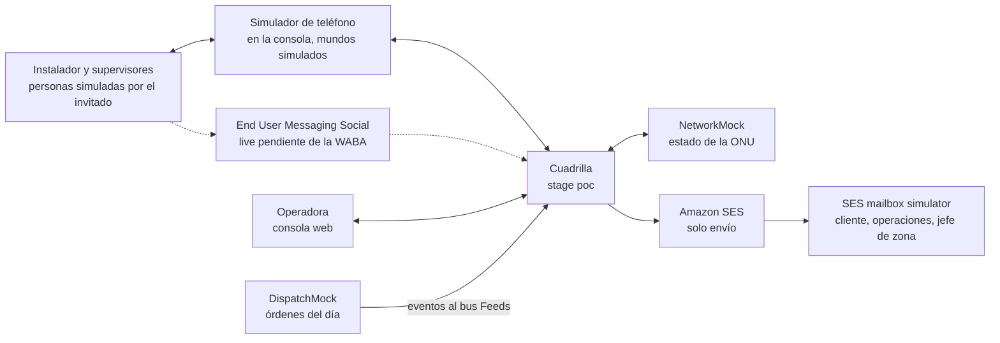
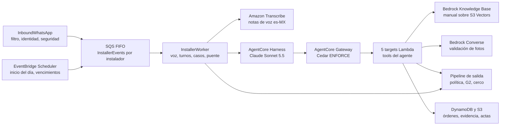
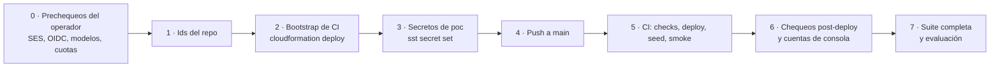

# Arquitectura · Cuadrilla

Topología, datos, agente, seguridad, IAM, orden de deploy y lecciones heredadas. Lo que lee `devops` para levantar el stack y un juez para reproducirlo. Los canales y los sistemas simulados (SES saliente y sus eventos, WhatsApp vivo y simulado, Transcribe, orquestador de red, despacho) están en `docs/architecture-integrations.md`. El diseño funcional está en `docs/design-brief.md`.

## 1. Cuenta, región, dominios y nombres fijos

| Ítem | Valor |
|---|---|
| Cuenta | `craftech-demos` `776805327629` (nunca `craftech-sandbox`, que se destruye a diario). **Compartida** con otra POC de Craftech: ningún recurso de este app lee, modifica ni se suscribe a recursos de otro app |
| Región | `us-east-1` (Bedrock, AgentCore, S3 Vectors, Transcribe, End User Messaging Social, SES) |
| App SST | `aws-cds-hackathon-poc-cuadrilla` (31 caracteres) · forma con guiones bajos `aws_cds_hackathon_poc_cuadrilla` |
| Repo | `craftech-io/aws-cds-hackathon-poc-cuadrilla` (privado); org id `60447213`; repo id: `gh api repos/craftech-io/aws-cds-hackathon-poc-cuadrilla --jq .id` (lo carga el operador en el bootstrap) |
| Zona DNS | `demo.craftech.io` (`Z043097217S4W7QWXU5O0`), delegada en la cuenta Demos; se referencia por id, no se gestiona |
| Dominios | Consola y landing `cuadrilla.demo.craftech.io`; remitentes `actas@cuadrilla.demo.craftech.io` (actas), `avisos@cuadrilla.demo.craftech.io` (alertas al jefe de zona), `no-reply@cuadrilla.demo.craftech.io` (emails de Cognito: código de alta, reenvío, recuperación e invitaciones), `leads@cuadrilla.demo.craftech.io` (aviso de lead a Craftech, ADR-0026); MAIL FROM `bounce.cuadrilla.demo.craftech.io` |
| Identidad SES | Dominio `cuadrilla.demo.craftech.io`, Easy DKIM, MAIL FROM `bounce.cuadrilla.demo.craftech.io` (MX de feedback de SES + TXT SPF `v=spf1 include:amazonses.com -all`). **Sin MX de recepción** en el dominio: Cuadrilla no recibe email (ADR-0003) |
| DMARC | `_dmarc.cuadrilla.demo.craftech.io` = `v=DMARC1; p=reject; adkim=r; aspf=r` (declarado en `infra/messaging-email.ts`) |
| Modelos | Harness, Memory y validación de fotos: `global.anthropic.claude-sonnet-5-5` (ADR-0028), invocado por el **perfil de inferencia de la app** `aws-cds-hackathon-poc-cuadrilla-poc-sonnet-5-5` (`aws.bedrock.InferenceProfile` que copia el perfil global, con los tags del proyecto; el nombre lleva el modelo, así un cambio crea el perfil nuevo antes de borrar el viejo); verificar `ACTIVE`, cuota y suscripción, §17 ítems 5-6. Tarifa USD 2 / 10 por millón de tokens de entrada / salida, caché 0,1 / 2,5 (lectura a la mitad desde el 2026-10-07). Si la medición de fotos muestra una regresión, `PHOTO_MODEL_ID` vuelve a `global.anthropic.claude-opus-5` (ADR-0028). Embeddings del manual: `amazon.titan-embed-text-v2:0` (1024 dimensiones). Los dos ids son parámetros (`infra/agentcore-spec.ts`, `HARNESS_MODEL_ID` y `PHOTO_MODEL_ID`; ADR-0020): cambiar uno exige `EV-01` o `EV-02` con el modelo nuevo (en el stage, con el OK del CTO por el gasto). En Claude Sonnet 5.5 (como en Opus 5) el thinking adaptativo está activo por defecto, `thinking disabled` y el `toolChoice` forzado dan 400 y los parámetros de muestreo con valores no por defecto también; ningún pedido los manda (§9.6) |
| Providers | `aws` 7.33.0, `aws-native` 1.74.1 (pinneados; cambio solo con ADR; ADR-0022); SST `4.17.1`; Node 22 arm64 (versión exacta en `.nvmrc` y `engines`) |

Nombres fijos (sin prefijo de stage, únicos por cuenta, dentro de la cerca de prefijo del rol de CI):

| Recurso | Nombre | Por qué fijo |
|---|---|---|
| Topic SNS de WhatsApp | `aws-cds-hackathon-poc-cuadrilla-wa-inbound` (estándar, no FIFO) | Único destino de eventos de la WABA propia de Cuadrilla (P-01, opción A) |
| Rol de deploy de CI | `aws-cds-hackathon-poc-cuadrilla-github-deploy` | Lo crea el bootstrap (ADR-0009) |
| Rol del ejecutor de escenarios | `aws-cds-hackathon-poc-cuadrilla-qa-runner` | Lo crea el bootstrap (ADR-0007) |
| Boundary | `aws-cds-hackathon-poc-cuadrilla-ci-boundary` | Estampada en todo rol del app por `infra/ci.ts` |
| Path IAM | `/aws-cds-hackathon-poc-cuadrilla/` | Cerca IAM del rol de deploy |
| Función QA | `aws-cds-hackathon-poc-cuadrilla-poc-qa-driver` | Nombre fijado para que `qa-runner` la cerque por ARN |
| Configuration set | `aws-cds-hackathon-poc-cuadrilla-email-poc` | Cercado por nombre en el rol de CI y en `ses:SendEmail` |
| Grupo de schedules | `aws-cds-hackathon-poc-cuadrilla-poc-schedules` | El provider lee tags recién creados antes de que IAM los vea: se cerca por nombre |
| Vector bucket | `kb-aws-cds-hackathon-poc-cuadrilla-poc-manual` | S3 Vectors reserva todo nombre que empieza con `aws`; el bootstrap cerca `bucket/kb-aws-cds-hackathon-poc-cuadrilla-*` |
| Knowledge Base | `aws-cds-hackathon-poc-cuadrilla-poc-manual` | Nombre legible en la consola de AWS |
| Web ACL de borde | `aws-cds-hackathon-poc-cuadrilla-poc-edge` (alcance `CLOUDFRONT`, `us-east-1`) | Asociada al Router; el bootstrap cerca `wafv2` por el prefijo del nombre (ADR-0025) |
| Web ACL del user pool | `aws-cds-hackathon-poc-cuadrilla-poc-auth` (alcance `REGIONAL`) | Asociada al user pool de Cognito; mismo cerco |
| Función de borrado de cuentas | `aws-cds-hackathon-poc-cuadrilla-poc-guest-account-deletion` | Nombre fijado para que el operador la invoque con `npm run leads:delete` y el bootstrap la cerque por ARN |
| Vocabulario de Transcribe | `cuadrilla-poc-ftth-es-mx` | Prefijo corto heredado del scaffolding, único en la cuenta. Las acciones sin tipo de recurso en el Service Authorization Reference (solo `*`) son `CreateVocabulary`, `TagResource`, `UntagResource`, `ListTagsForResource` y `StartTranscriptionJob`: van con `Resource *` y condición (`aws:RequestTag/Project` en `CreateVocabulary`/`TagResource`; `ForAllValues:StringEquals aws:TagKeys` con las claves de tags del app en `TagResource`/`UntagResource`; `ListTagsForResource` es solo lectura y el provider la llama tras crear y en cada refresh); `Get/Update/DeleteVocabulary` se cercan por ARN `vocabulary/cuadrilla-poc-*` (§14) |
| Prefijo de trabajos de Transcribe | `cuadrilla-poc-<sha256(clockId ‖ worldEpoch ‖ messageId)>[0:32]` | Idempotente por mensaje (un reintento encuentra su propio trabajo) y distinto entre mundos aunque la nota de voz sea el mismo archivo; `Get/DeleteTranscriptionJob` cercados por ARN `transcription-job/cuadrilla-poc-*`; `StartTranscriptionJob` con `Resource *` y condiciones sobre el bucket y la clave de salida. Los trabajos aceptan `Tags` (`Project`), que se mandan en cada `StartTranscriptionJob` |

`ci-role.test.ts` verifica que cada nombre fijo de esta tabla está cubierto por un statement con su ARN o prefijo exacto.

## 2. Stage y límites con la otra POC de la cuenta

Un solo stage: **`poc`**, desplegado con `sst deploy --stage poc` solo desde CI en push a `main`. No hay stage `local` ni `sst dev` (crea recursos reales en la cuenta compartida). El desarrollo se prueba con `U`, `LF` y `UI` locales (`docs/test-plan.md` §2) y en `poc` por CI. `sst.config.ts` rechaza cualquier stage distinto de `poc`.

| Recurso compartible | Qué hace Cuadrilla | Cómo se garantiza |
|---|---|---|
| SES receipt rule sets (uno activo por región y cuenta; el activo es de la otra POC) | **Nada**: ni lee, ni crea, ni activa rule sets; no publica MX de recepción | El rol de CI no tiene ninguna acción `ses:*ReceiptRule*` (test del bootstrap: `ci-role.test.ts` falla si aparece); ningún módulo de `infra/` las usa (`infra/iam-capabilities.test.ts`) |
| Identidades SES de la cuenta | Solo la suya (`cuadrilla.demo.craftech.io`) | IAM de envío con `ses:FromAddress` sobre su dominio; CI cercado al ARN de su identidad y su configuration set |
| WhatsApp (WABA, topic de eventos) | WABA propia con topic propio (P-01, opción A, decidida el 2026-09-26; un solo destino de eventos por WABA); como defensa, descarta todo evento cuyo id de Meta del número no sea `WhatsAppMetaPhoneNumberId`; nunca reemplaza el destino de eventos de una WABA que tenga otro destino u otros números | `docs/architecture-integrations.md` §4.4; nunca se suscribe a un topic de otro app; ningún rol tiene `PutWhatsAppBusinessAccountEventDestinations` (lo aplica el operador con el script que verifica antes) |
| Reputación de SES de la cuenta | Los emails de producto van solo al simulador de buzones de SES y a destinatarios de demo registrados; los únicos que van a direcciones sin verificar son los de autenticación de Cognito (código de alta, reenvío, recuperación) | Cerco de destinatarios (§13); los emails de Cognito salen por el configuration set del app y se miden como `kind = AUTH`; validación del dominio del email y límites por persona antes de enviar; alarmas de rebotes y quejas de `AUTH` que encienden `KILL#SIGNUP` por `CostGuard` (ADR-0025 §4); alarma de tasa de rebote de la cuenta al 2 % como aviso |
| Cuotas de Bedrock | Topes de turnos por mundo y por operadora, techo global del stage por día real y corte de emergencia (ADR-0019); presupuesto por corrida de QA | §12, `docs/test-plan.md` §4.4 |

## 3. Secretos (`sst.Secret`)

Declarados una sola vez en `infra/secrets.ts`; leídos con `secretValue(nombre)` (`packages/bff/src/lib/secrets.ts`, zod). Un secreto sin valor aborta el deploy: todos se cargan antes del primer deploy (§15 paso 3).

| Secreto | Uso | Valor inicial |
|---|---|---|
| `SessionTokenKey` | Clave maestra; `lib/crypto.ts` deriva subclaves HKDF-SHA256 por propósito: `session` (`sessionToken`), `phone-hash`, `email-hash`, `nonce` (botones), `sim-envelope` (firma del sobre simulado), `runtime-session` (`runtimeSessionId`), `media-key` (claves de S3 de media no adivinables), `signup-ticket` (ticket de alta, ADR-0025), `ip-hash` (límites del alta por IP, sin guardar la IP); `email-hash` es también la clave de la tabla `Leads` | 32 bytes aleatorios en base64; rotarlo obliga a recargar el seed |
| `WabaId` | Id de la WABA de EUM Social | `not-connected` hasta P-01 |
| `WhatsAppPhoneNumberId` | **Id de AWS** del número (`phone-number-id-<32 hex>`, zod con ese patrón o `not-connected`): `originationPhoneNumberId` de `SendWhatsAppMessage`, `GetWhatsAppMessageMedia` y `PostWhatsAppMessageMedia`, y base del ARN de IAM (`whatsappPhoneArn()` en `infra/messaging-whatsapp.ts`). **Nunca** se compara con un evento entrante | `not-connected` hasta P-01 |
| `WhatsAppMetaPhoneNumberId` | **Id de Meta** del número (numérico, zod `^\d{6,20}$` o `not-connected`): único valor contra el que `InboundWhatsApp` compara `context.MetaPhoneNumberIds[].metaPhoneNumberId` y cada `value.metadata.phone_number_id` (§4.4 de integraciones) | `not-connected` hasta P-01 |
| `SeedOverrides` | JSON con el mundo vivo (`liveWorldClockId`, a lo sumo uno), destinatarios de demo registrados de ese mundo (`demoRecipients.emails`, `demoRecipients.phones`), buzón de operaciones y jefes de zona de la demo en vivo, teléfonos del equipo mapeados a personas del mundo vivo (`personPhones`), `operatorEmail` (avisos del presupuesto) | `{}` |
| `OriginVerifyKey` | Valor del encabezado de origen `x-cuadrilla-origin` que el Router agrega en el origen de `/api/*` y que `routers/handler.ts` exige en tiempo constante antes de parsear (ADR-0025 §3). Lo leen la IaC del Router y el `Bff` | 32 bytes aleatorios en base64; rotarlo es `sst secret set` y un deploy |
| `LeadConfig` | Aviso de leads (ADR-0026): `{notifyRecipients: string[1..5], privacyContact?: string}`; zod exige dominio exacto `craftech.io` en cada destinatario. Lo leen `LeadStream` y `npm run leads:notify-test`; nunca se escribe en el código | `notifyRecipients`: la casilla personal del CTO en `@craftech.io`; `privacyContact`: sales@craftech.io (ADR-0027). Cargada por el operador el 2026-10-06 |
| `BrandConfig` | Marca de la operadora de la demo (ADR-0018): `{mode: neutral \| cobrand, signupMode?: neutral \| cobrand, partnerDisplayName, partnerShortName, logoAssetKeys: {onLight, onDark}, disclaimer: {es, en}}` (`signupMode`, por defecto `neutral`, para los mundos de alta propia); lo lee `resolveBrand` (`copy/brand.ts`) | `{"mode":"neutral"}`; en `poc`, el de co-branding (P-05 cerrado el 2026-09-26) |

## 4. Componentes

| Componente | Servicio | Por qué |
|---|---|---|
| Agente | **Bedrock AgentCore Harness** (`awsnative.bedrockagentcore.Harness`) con endpoint `live`; modelo `HARNESS_MODEL_ID` (`global.anthropic.claude-sonnet-5-5` por el perfil de inferencia de la app, ADR-0028), `converse_stream`, `maxIterations 10`, `maxTokens 4096`, `timeoutSeconds 90`, `truncation sliding_window 40`; `effort` `low`/`medium` si el Harness lo expone (WP-26 lo registra); `tools` = solo el Gateway; `allowedTools: ["@cuadrilla-tools/*"]`; sin shell, archivos ni code interpreter; guardrail G1 | Loop gestionado, tools por Gateway, memoria y guardrail por invocación: el patrón probado del scaffolding (ADR-0001). `maxTokens` es el tope de todas las llamadas de una invocación y el thinking cuenta en él: con 1024 los turnos terminan en `max_tokens` antes de `send_whatsapp`. El largo se acota con el system prompt ("≤ 4 líneas") y con `effort` (ADR-0020) |
| Tools | **AgentCore Gateway** MCP (`AWS_IAM`, exclusivo del Harness) + 5 `GatewayTarget` Lambda (`orders`, `knowledge`, `evidence`, `messaging`, `cases`) con `toolSchema.inlinePayload` generado desde zod | Un target por dominio, permisos mínimos por Lambda |
| Autorización de tools | **AgentCore Policy** (Cedar `ENFORCE`) + `sessionToken` HMAC + zod `.strict()` | `docs/design-brief.md` §5.6 |
| Memoria | **AgentCore Memory** con tres estrategias propias | §9.3 |
| Seguridad de contenido | **Bedrock Guardrails** G1 (entrada), G2 (grounding de salida), G3 (PII del acta y de parámetros de plantilla) | `docs/design-brief.md` §5.5 |
| Manual | **Bedrock Knowledge Base** con **S3 Vectors** (vector bucket `kb-…`, índice `manual`, Titan Text Embeddings v2), fuente S3 `Manual/manual/v001/` con metadatos por sección | ADR-0005, §9.5 |
| Voz | **Amazon Transcribe** batch `es-MX` con vocabulario propio `cuadrilla-poc-ftth-es-mx` | ADR-0006, `docs/architecture-integrations.md` §5 |
| Validación de fotos | **Bedrock Converse** (Claude, multimodal) aislado: una sola tool `record_verdict` sin efectos, `toolChoice auto` + instrucción explícita, thinking adaptativo con effort bajo; rúbrica versionada + chequeos deterministas | ADR-0015, §9.6 |
| Seguridad del instalador | Clasificador determinista + handler de caso `SAFETY` | ADR-0016, `docs/design-brief.md` §5.9 |
| Orquestación por instalador | **SQS FIFO** `InstallerEvents.fifo` (`MessageGroupId = installerId`) + Lambda `InstallerWorker` (event source mapping con `ScalingConfig.MaximumConcurrency 10`) + DLQ `InstallerEventsDlq.fifo` | Serializa transcripción, turnos, casos, puente y temporizadores de un instalador; deduplica por evento (ADR-0017) |
| Costo y corte | `sst.Linkable("CostCaps")` (techo global por día real) + items `Runtime/TURNCAP#GLOBAL#…`, `VALCAP#GLOBAL#…`, `TRANSCRIBE#GLOBAL#…`, `KILL#…` + Lambda `CostGuard` suscrita al topic `CostAlerts` (presupuesto de AWS Budgets, alarmas de costo y alarmas del alta, que encienden `KILL#SIGNUP`) | ADR-0019, ADR-0025 §4 |
| Temporizadores | Item `WorkOrders/TIMER#<kind>#<id>` (o `Cases/TIMER#…`) + **EventBridge Scheduler** (a lo sumo un schedule `at()` por temporizador, grupo `aws-cds-hackathon-poc-cuadrilla-poc-schedules`, `ActionAfterCompletion DELETE`, destino `ScheduleDispatch`) | Inicio del día, vencimientos de la escalera, envíos diferidos y reintentos con un solo mecanismo que el reloj de demo sabe avanzar (ADR-0004, §8) |
| Reloj de demo | Item `Runtime/CLOCK#<clockId>` + GSI de vencimientos + `advance_clock` | ADR-0010, §8 |
| Mundos | Fábrica de mundos (`packages/bff/src/worlds/`): demo, uno por invitado, QA y evaluación; plantillas `Seed/worlds/*.json` subidas por la IaC (`infra/world-templates.ts`) | §8, `docs/seed-spec.md` §3 |
| Alta propia y acceso | **Cognito** con alta por email verificado (clientes `ConsoleWeb`, `GuestSignup`, `QaProbe`) y triggers pre sign-up, mensaje personalizado, post confirmation, post authentication y pre token; procedimiento público `signup.start` con ticket de alta | ADR-0025, §10, `docs/architecture-integrations.md` §9 |
| Mundos de invitado | Lambda `GuestWorlds` (aprovisionamiento asíncrono, idempotente) + `Runtime/GUESTACCOUNT#` (generación vigente) | ADR-0025, §8 |
| Protección de borde | **AWS WAF**: web ACL de CloudFront en el Router (reputación de IP, tasa, Challenge en el alta y etiqueta de IP anónima que la app limita más) y web ACL regional en el user pool (tasa por operación); encabezado de origen secreto que el `Bff` exige, así su Function URL directa no sirve | ADR-0025 |
| Leads | Tabla DynamoDB `Leads` (fuera de la demo, con protección contra borrado y sin PITR) con stream → Lambda `LeadStream` (aviso por SES, borrado de los usuarios sin confirmar y de la cuenta al vencer, barrido diario de usuarios `UNCONFIRMED`) + `LeadStreamDlq`; Lambda `GuestAccountDeletion` (borrado a pedido, con cerco de objetivo) | ADR-0026 |
| Feeds externos | **EventBridge** bus `Feeds`, fuente `mock.dispatch` → `FeedEvents` | El despacho simulado empuja eventos como uno real |
| Email | **Amazon SES v2**, solo envío, con adjuntos (`Content.Simple.Attachments`) | `docs/architecture-integrations.md` §1-§2 |
| WhatsApp | **AWS End User Messaging Social** (`@aws-sdk/client-socialmessaging`), adaptador implementado y probado con fixtures; transportes del stage `["simulated"]` hasta P-01, después `["simulated","live"]`; modo por mundo y transporte por destinatario (ADR-0002) | `docs/architecture-integrations.md` §4 |
| Orquestador de red (mock externo) | Lambda `NetworkMock` con Function URL `AWS_IAM` + tabla `Network`; contrato OpenAPI 3.1 | `docs/architecture-integrations.md` §6 |
| Despacho (mock externo) | Lambda `DispatchMock` con Function URL `AWS_IAM` + tabla `Dispatch` + publicación en `Feeds` | `docs/architecture-integrations.md` §7 |
| Acta | Lambda `CertificateWriter` (escritor de PDF propio sin dependencias, con imágenes JPEG) | §11 |
| Datos | **DynamoDB** una tabla por agregado (§5), **S3** (§6) | Patrón del scaffolding |
| Consola | **CloudFront Router** + **StaticSite** (React 19 + Vite + Tailwind v4) + Function tRPC v11 + **Cognito** (login propio SRP) | §10 |
| Observabilidad | **CloudWatch** logs JSON con redacción, métricas `CuadrillaAgent/*`, alarmas, Transaction Search, **AWS Budgets** por tag `Project` | §12 |
| QA en el stage | Lambda `QaDriver` (nombre fijo, sin URL) invocada por el rol `qa-runner` | ADR-0007 |
| Infra y CI | **SST v4**, GitHub Actions + OIDC, bootstrap de CloudFormation | ADR-0009 |

Contexto: ¿quién habla con Cuadrilla y por dónde?

Línea llena: camino que corre en `poc`. Línea punteada: WhatsApp vivo, implementado y probado con fixtures, que se activa al cerrar P-01 solo para el mundo vivo y los teléfonos ligados por código. El simulador de teléfono entra por el mismo sobre y el mismo normalizador que el evento real de EUM Social y sigue disponible en todos los mundos simulados.

Internos: ¿qué pasa dentro de Cuadrilla con un mensaje del instalador?

El pipeline de salida entrega a EUM Social (o al transporte simulado) y a SES (contexto de arriba). AgentCore Memory, Guardrails y los mocks de red y despacho no se dibujan: sirven a un consumidor cada uno y están en la tabla.

## 5. DynamoDB

Una tabla por agregado. Nombres lógicos PascalCase; atributos camelCase; ids con prefijo. Cada item lleva `entity`, `createdAt`, `updatedAt`, `version` (bloqueo optimista), `clockId` cuando pertenece a un mundo, `synthetic: true` cuando viene del seed y, en mundos QA, de evaluación y de invitado, `world` y `expiresAt` (TTL). Fechas ISO 8601 con zona; las de negocio se guardan en tiempo simulado (`…Sim`) y, donde hace falta, también en real (`…Real`). Toda transición que después reevalúa `PolicyAudit` (consentimiento, lista de permitidos, roster, caso, checklist) guarda su historia con fecha (`history[]`).

| Tabla | Entidades | PK | SK | GSIs | TTL |
|---|---|---|---|---|---|
| `Isps` | Isp (`kind` `DEMO` \| `GUEST` \| `QA` \| `EVAL`; `displayName` desde `BrandConfig` en el mundo de demo y los de invitado), IspSettings (`timezone America/Mexico_City`, `quietHours`, `caseTimeoutSec` 600, `demoMode`, `demoCaseTimeoutSec` 60 (solo con el reloj `RUNNING`), `whatsappMode` `simulated` \| `live` (ADR-0002), `turnCaps{perHour, perDay}`, `simulatorCaps{turnsPerHour, turnsPerDay, validationsPerDay, transcribeSecPerDay, emailsPerDay, messagesPerRealHourPerIdentity}`, `templateStatus{<nombre>: APPROVED \| PENDING \| REJECTED}` en modo simulado, `costBudgetUsdPerConversation`), Zone (`opticalClass`, `acceptanceRange`, `zoneChiefId`), Crew, ShiftRoster (`primaryId`, `secondaryId`, `startsAtSim`, `endsAtSim`, con `history[]`), ConsoleUser (`role`, `ispId`, `cognitoSub`) | `ISP#<ispId>` | `META` · `SETTINGS` · `ZONE#<zoneId>` · `CREW#<crewId>` · `ROSTER#<crewId>#<yyyy-mm-dd>` · `USER#<userId>` | `GSI1` `cognitoSubKey` = `SUB#` → usuario de consola (fuente del `ispId` y del rol del token, §10) | `expiresAt` en operadoras QA, de evaluación y de invitado |
| `People` | Installer, Supervisor, ZoneChief (con `lastInboundAtReal` en el mundo vivo, del `timestamp` de Meta: reloj de `CP-WA-24H` para un teléfono real), Customer, Consent (`WHATSAPP_OPT_IN` con `history[]`), InstallerProfile (medido), ShiftWindow (plan B: `openedAtSim`, `closesAtSim`), AddressClaim | `PERSON#<personId>` · `CUST#<customerId>` · `ADDR#<clockId>#<phoneHash>` | `META` · `CONSENT#WHATSAPP` · `PROFILE` · `SHIFTWINDOW` · `CLAIM` | `GSI1` `phoneKey` = `<clockId>#<phoneHash>` → persona (identidad por teléfono **dentro de un mundo**; única por `ADDR#<clockId>#…`) · `GSI2` `ispKindKey` = `ISP#<ispId>#<INSTALLER\|SUPERVISOR\|ZONE_CHIEF\|CUSTOMER>` + `sortName` | `expiresAt` en mundos QA, de evaluación y de invitado |
| `WorkOrders` | WorkOrder (`status` con `history[]`, `installerId`, `customerId`, `crewId`, `zoneId`, `appointmentWindow`, `plan`, `onuSerial`, `oltPort`, `opticalClass`, `clockId`, `worldEpoch`, `sessionEpoch`, `onHoldSafety`), ChecklistItem, Evidence, PhotoValidation, TroubleshootingStep, Certificate (`sha256`, `s3Key`, `deliveries[]`), **Timer** | `WO#<workOrderId>` | `META` · `CHECK#<item>` · `EVID#<evidenceId>` · `VAL#<validationId>` · `STEP#<seq>` · `CERT` · `TIMER#<kind>#<timerId>` | `GSI1` `installerDayKey` = `INST#<installerId>#<yyyy-mm-dd>` + `windowStartSim` (órdenes del día) · `GSI2` `ispDayKey` = `ISP#<ispId>#<yyyy-mm-dd>` + `status` (consola) · `GSI3` `clockDueKey` = `CLOCK#<clockId>` + `dueAtSim` (sparse: todo `TIMER#` `SCHEDULED`) · `GSI4` `evidenceHash` = `SHA#<clockId>#<worldEpoch>#<sha256>` (sparse: evidencias, detección de foto repetida **dentro del mundo y su época**: los mismos bytes del set en dos mundos no son duplicado) | `expiresAt` en QA, evaluación y invitado |
| `Cases` | Case (`kind`, `reason`, `status`, `rung`, `rungVersion`, `roster{primaryId, secondaryId, zoneChiefId}`, `ladder[]` con cada escalón: `NOTIFIED` \| `SKIPPED` \| `TIMED_OUT` \| `DECLINED` con motivo y hora, `takenBy`, `summary`, `evidenceIds[]`, `bridge{open, pendingRelays[]}`), Timer de vencimiento | `CASE#<caseId>` | `META` · `TIMER#CASE_TIMEOUT#<rung>` | `GSI1` `workOrderKey` = `WO#<workOrderId>` + `createdAtSim` · `GSI2` `takenByKey` = `SUP#<personId>#TAKEN` (sparse: casos tomados por supervisor, para rutear sus mensajes) · `GSI3` `ispStatusKey` = `ISP#<ispId>#<status>` + `createdAtSim` (bandeja) · `GSI4` `clockDueKey` (igual que `WorkOrders`) | `expiresAt` en QA, evaluación y invitado |
| `Conversations` | Message (in/out; persona, `workOrderId`, `caseId`, `kind`, `templateName`, `interactive`, `media{kind, s3Key, sha256, mime, durationSec}`, `transcript{text, confidence}`, `status`, `policy.ruleIds`, `author` (`AGENT` \| `SYSTEM` \| `PERSON:<id>`), `turnId`, `simulated`, `sentAtSim`), MessageEvent, TurnNote, OutboundEmail (buzón de salida: cuerpo, adjuntos, eventos de SES) | `PERSON#<personId>` · `OUTBOX#<ispId>` | `MSG#<ts>#<messageId>` · `EVT#<ts>#<eventId>` · `NOTE#<ts>#<turnId>` · `MAIL#<ts>#<mailId>` | `GSI1` `providerMessageId` → mensaje o email (estados de WhatsApp y eventos de SES) · `GSI2` `workOrderKey` = `WO#<workOrderId>` + `sentAtSim` (línea de tiempo) | 90 días; `expiresAt` en QA y evaluación |
| `AuditLog` | Decision (`decision` ALLOW/DENY/DEFER/ACTION/VIOLATION, `action`, `ruleIds[]`, `evaluated[]`, `messageId`, `trigger`, `actor`, `refs`) | `ISP#<ispId>#<yyyy-mm>` | `<ts>#<ulid>` | `GSI1` `workOrderKey` = `WO#<workOrderId>` + `ts` · `GSI2` `decisionKey` = `ISP#<ispId>#<decision>` + `ts` | 12 meses; `expiresAt` en QA |
| `Reference` | Template (WhatsApp), RateCard, NameCheck, Rubric (versionada), SafetyLexicon (versionado), ManualIndex (secciones del manual vigente: id, título, versión, `sha256`), EvalQuestion (50), EvalPhoto (60), RejectReasonCopy | `REF#<type>#<scope>` | clave del tipo | — | — |
| `Runtime` | Session, TurnResult, Nonce, Clock, WorldSession (la sesión de consola que actuó último en un mundo de invitado: "una sesión por mundo", `routers/account.ts`), Idempotency, RateCounter, TurnCap, SimulatorCap, GlobalCap, KillSwitch, Counter (incluida la época), InstallerState (`inFlight`, `activeWorkOrderId`), WorldState, Pending (`MailPending`), Lease, PhoneLease, JoinCode, Upload, LiveWorld, Tombstone, Probe, Faults (solo relojes `qa-*`) | `SESSION#<id>` · `TURN#<turnId>` · `NONCE#<nonce>` · `CLOCK#<clockId>` · `IDEMP#<source>#<id>` · `RATE#<clockId>#<hash>#<simHour>` (semántica de negocio) · `RATE#<clockId>#<hash>#REAL#<realHour>` (anti-abuso: "+1 h" no lo reinicia) · `TURNCAP#<ispId>#<realHour\|realDay>` · `SIMCAP#<clockId>#<kind>#<realDay>` (`kind` ∈ turnos, validaciones, transcripción, emails) · `TURNCAP#GLOBAL#<realDay>` · `VALCAP#GLOBAL#<realDay>` · `TRANSCRIBE#GLOBAL#<realDay>` · `UNKNOWN#GLOBAL#<realDay>` (respuestas a números desconocidos en vivo) · `KILL#<ALL\|SIMULATOR\|AGENT\|SIGNUP>` · `KILL#AGENT#<clockId>` · `COUNTER#<name>` · `COUNTER#EPOCH#<clockId>` · `INSTSTATE#<installerId>` · `WORLDSTATE#<clockId>` · `WORLDSESSION#<clockId>` (`{userId, sessionId, atReal}`; ítem propio, nunca el `CLOCK#`: escribirlo no mueve la `version` del reloj, así que nunca hace fallar un reinicio, un salto ni un avance; se reescribe solo si cambia la sesión o tiene más de 5 min reales) · `PENDING#<clockId>` · `LEASE#PHONE#<n>` · `LEASE#WONUM#<n>` · `PHONELEASE#<phoneHash>` (teléfono real → `{clockId, personId, phone?, joinCode?, boundAtReal, expiresAt, lastInboundAtReal?}`, único por teléfono; `phone` es opcional: el E.164 normalizado del remitente del "ALTA <código>", la dirección viva de la persona mientras dura el alta (`outbound/context.ts` envía a ese número solo si está; sin él, al teléfono registrado de la persona); `lastInboundAtReal` del `timestamp` de Meta, reloj de `CP-WA-24H` para ese teléfono) · `JOINCODE#<code>` (`{clockId, personId, userId}`, 30 min, un uso) · `JUMP#<clockId>#<realHour>` (saltos de escena, 30 por hora real) · `UPLOAD#<uploadId>` (`{userId, clockId, key, kind, maxBytes}`, 10 min) · `LIVEWORLD` (singleton: el único mundo vivo) · `TOMB#<clockId>#<worldEpoch>` · `PROBE#<id>` (incluido `PROBE#foreign#<eventId>`) · `FAULTS#<clockId>` · alta y mundos de invitado (ADR-0025): `SIGNUPTICKET#<nonce>` (`{username, uses ≤ 2}`, 15 min) · `SIGNUP#IP#<ipHash>#<realHour>` · `SIGNUP#ANON#<ipHash>#<realHour>` · `SIGNUP#ANONDAY#<realDay>` · `SIGNUP#EMAIL#<abuseHash>#<realHour>` · `SIGNUP#EMAILDAY#<abuseHash>#<realDay>` · `SIGNUP#GLOBAL#<realDay>` (solo `signup.start`) · `SIGNUPOK#GLOBAL#<realDay>` · `SIGNUPKEY#<abuseHash>` (`confirmedAccounts` ≤ 2) · `SIGNUPSUB#` (unicidad del registro por `sub`) · `GUESTWORLDS#<yymmdd>` (mundos de alta propia creados ese día) · `GUESTACCOUNT#<userId>` (`{guestOrigin, clockId vigente, generation, status PROVISIONING \| READY \| CAP_FULL \| FAILED \| PERSON_LIMIT, createdAtReal, expiresAtReal}`) · `TURNCAP#GUESTUSER#<userId>#<realDay>` · `TURNCAP#GUESTSIGNUP#<realDay>` · `VALCAP#GUESTSIGNUP#<realDay>` · `TRANSCRIBE#GUESTSIGNUP#<realDay>` | `META` · `RESULT#<tool>#<seq>` · `MAIL#<mailId>` | — | Sesión 1 h, turno 1 h, nonce 7 d, idempotencia 7 d, rate, topes, lease, tumba, pendientes y sondas 48 h; alta por código 48 h; código 30 min; subida 10 min; `WORLDSESSION#` 24 h; contadores del alta 48 h; `GUESTWORLDS#` 10 d; `GUESTACCOUNT#`, `SIGNUPKEY#` y `SIGNUPSUB#` sin TTL (se borran o restan con la cuenta); `CLOCK#`, `INSTSTATE#`, `WORLDSTATE#`, `KILL#`, `LIVEWORLD` sin TTL salvo `qa-*`/`eval-*`; `COUNTER#EPOCH#` nunca se borra |
| `Leads` | **Fuera de la demo** (ADR-0026; `deletionProtectionEnabled`, sin PITR): Lead (`leadId`, `email`, `name?`, `company?`, `jobTitle?`, `locale`, `originPoc`, `origin WEB \| QA`, `utm?`, `referrerOrigin?`, `consents{TERMS_PRIVACY, CONTACT}` y `consentHistory[]` con `{accepted, at, textVersion, locale}`, `abuseHash`, `pendingUsernames[]` (≤ 3; un inicio de más retira al más antiguo), `pending{<gst-*>: formulario, atribución y consentimientos de ese inicio}` (de pendientes y retirados, hasta la confirmación, que promueve solo la entrada del usuario que confirmó), `retiredUsernames[]?` (≤ 40; pueden confirmar el lead y se borran de Cognito al confirmarse o vencer), `status` ausente (pendiente) o `CONFIRMED`, fechas, `cognitoSub?`, `cognitoUsername?`, `userId?`, `notifyOutcome?`), LeadEvent (sin email), LeadLog (`LEAD_DELETED`, `LEAD_EXPIRED`, `CONTACT_WITHDRAWN`, `SIGNUP_CONFIRM_IGNORED`, `DELETION_REFUSED`, con `leadId` y sin email ni `emailHash`) | `LEAD#<emailHash>` · `LEADLOG#<yyyy-mm>` | `META` · `EVT#<ts>#<ulid>` · `<ts>#<ulid>` | `GSI1` `subKey` = `SUB#` (sparse, desde la confirmación) · stream `NEW_AND_OLD_IMAGES` | `expiresAt`: pendiente 7 d desde el primer inicio; `CONFIRMED` 24 meses desde el último ingreso; bitácora 24 meses |
| `CuadrillaMetrics` | ConversationKpi (por orden: latencias, turnos, tokens, costo, `source` `WORLD` \| `EVAL`, `runId`, `agentMode` `REAL` \| `SCRIPTED`), EvalResult (por pregunta o foto), EvalRunPointer (la última corrida publicada de cada medición: `{kind, ispId, runId, finishedAtReal}`; la escribe la evaluación con `publishEvalRun` de `packages/bff/src/metrics/eval-runs.ts` al terminar una corrida con sus `EvalResult` y su reporte, WP-46; la leen las pestañas "Medición del manual" y "Medición de fotos") | `ISP#<ispId>` · `EVALRUN#LATEST` | `<source>#<clockId>#<workOrderId>` · `EVAL#<runId>#<Q\|P>#<id>` · `Q` \| `P` (puntero) | — | `expiresAt` en QA en los KPIs de un mundo; `EvalResult` y el puntero no nombran el reloj de un mundo y nunca vencen: una corrida publicada se lee hasta que la siguiente reemplaza el puntero |
| `Network` | Propiedad de `NetworkMock`: Onu (`serial`, `operState`, `rxPowerDbm`, `behaviour`, `queryCount`), OltPort | `ONU#<clockId>#<serial>` | `META` | — | `expiresAt` en QA, evaluación y invitado |
| `Dispatch` | Propiedad de `DispatchMock`: DispatchOrder, DispatchEvent | `DWO#<ispId>#<workOrderNumber>` | `META` · `EVT#<ts>` | — | `expiresAt` en QA, evaluación y invitado |

Reglas de escritura: toda transición de orden, ítem del checklist, caso, escalón y temporizador es un `UpdateItem` condicional sobre `version` (el caso además sobre `rungVersion`); altas de mensajes y decisiones con `attribute_not_exists`. Unicidad de teléfono **por mundo** (`ADDR#<clockId>#<phoneHash>`) en toda alta o edición de persona; en mundos `GUEST`, `QA` y `EVAL` solo se aceptan teléfonos del bloque sintético del mundo (`docs/seed-spec.md` §2) y un `CONFLICT` nunca informa sobre otro mundo. Números de orden: demo `24800-24899`, invitado los mismos por mundo, QA `70000-79999` por lease, evaluación `80000-89999`.

## 6. S3

Nombres lógicos ≤ 16 caracteres (cerca del rol de CI). Todos privados, SSE-S3, `BlockPublicAccess` total, TLS obligatorio. En mundos QA y de evaluación toda clave lleva el prefijo `qa/<runId>/` o `eval/<runId>/`; en **mundos de invitado** (`GUEST#…`, todo origen), `guest/<seg>/` (`seg = mediaKeySegment(clockId, worldEpoch)`), porque ahí la media es de una persona real (su voz, sus fotos) aunque los datos del mundo sean sintéticos: el prefijo lo arma `packages/shared/src/media/keys.ts` según el tipo de mundo y lleva una regla de ciclo de vida de 9 días (el TTL de la generación de alta propia más su gracia; ADR-0026, retención).

| Bucket | Prefijos | Quién escribe | Retención |
|---|---|---|---|
| `Media` | `wa/<sha256(wamid)[0:32]>/<sha256(mediaId)[0:16]>` (vivo) · `sim/<seg>/<uploadId>` (simulador) · `guest/<seg>/sim/<uploadId>` (simulador de un mundo de invitado) · `transcripts/<seg>/<sha256(messageId)[0:32]>/<jobName>.json` (salida de Transcribe, una clave por mensaje); `seg = mediaKeySegment(clockId, worldEpoch)`, nunca el `clockId` crudo | `InboundWhatsApp`, BFF (simulador), Transcribe | 30 días; `guest/` 9 días; la salida de Transcribe se borra apenas se lee y se enmascara, con regla de ciclo de vida de 1 día como respaldo |
| `Evidence` | `photos/<workOrderId>/<item>/<evidenceId>.jpg` (JPEG sin metadatos) · `certificates/<workOrderId>/acta-<n>.pdf`; en mundos de invitado, las mismas bajo `guest/<seg>/` | `ToolEvidence` (copia de la foto candidata al validarla, sin segmentos APP1-APP15 ni COM), `CertificateWriter`, la fábrica de mundos (la evidencia sembrada de los presets `checklist` y de las escenas: copia byte a byte de `Seed/photos/<photoId>.jpg` en la clave de la fila, con el mismo `sha256`; `Bff` y `QaDriver`) | Vida del stage; `qa/` y `eval/` 2 días; `guest/` 9 días (`GuestAccountDeletion` borra los prefijos de la generación vigente al borrar una cuenta) |
| `Manual` | `manual/v<nnn>/<sectionId>.md` + `manual/v<nnn>/<sectionId>.md.metadata.json` | `seed:load` (operador o CI) | Vida del stage |
| `Seed` | `worlds/<plantilla>.json` · `photos/<photoId>.jpg` · `audio/<voiceId>.ogg` · `eval/questions.json` · `eval/photos.json` · `transcribe/vocabulary-v<nnn>.txt` (texto plano separado por TAB, como exige la API; lo sube la IaC) · `brand/logo-on-light.svg` y `brand/logo-on-dark.svg` (logos públicos del socio, `image/svg+xml`, validados y subidos por `seed:load --brand-logo-on-light/--brand-logo-on-dark` del operador; sin esos flags el loader no toca `brand/`; nunca en git) | `seed:load`, IaC (vocabulario), operador (logos) | Vida del stage |

- **CORS** en `Media`: `AllowedOrigins = https://cuadrilla.demo.craftech.io`, `POST`, `MaxAge 300` (el simulador sube fotos y notas de voz grabadas con POST prefirmado).
- En un mundo `INVITED` que siga activo más de 9 días, la evidencia más vieja deja de existir; el visor la muestra con el estado vacío existente, como a una evidencia borrada.
- **Claves de media.** Toda clave de S3 que lee o escribe Transcribe o EUM Social sale de una sola función, `packages/shared/src/media/keys.ts`: `mediaKeySegment(clockId, worldEpoch) = sha256hex(clockId)[0:16] + "-e" + worldEpoch` (los `clockId` llevan `#`, como `GLOBAL#isp-demo` y `GUEST#isp-guest-<nn>`; en una URI `s3://` el `#` abre un fragmento y `OutputKey` solo admite `[a-zA-Z0-9-_.!*'()/]{1,1024}`), `simMediaKey`, `waMediaKey` (hash del `wamid` y del `mediaId`: un `wamid` real es base64 y puede traer `=`, `+` o `/`), `transcriptOutputKey` y `mediaFileUri(bucket, key)`, que rechaza toda clave fuera de `[A-Za-z0-9/_.-]`. `media/keys.test.ts` (en `packages/shared`) prueba `clockId` de las formas `GLOBAL#…`, `GUEST#…` y `qa-…` y `wamid` con `=`, `+` y `/`: cada `OutputKey` cumple el patrón de la API y ninguna `MediaFileUri` contiene `#`, `?`, `+`, `=` ni espacios.
- Una foto o un audio que entra por cualquier camino se valida por tipo mágico (JPEG `FF D8 FF`, PNG, Ogg `OggS`, WebM `1A 45 DF A3`, MP4/M4A con caja `ftyp`) y tamaño antes de cualquier uso; la clave la arma el código con la subclave `media-key`, nunca un nombre de archivo externo. El simulador sube con un `uploadId` que el BFF registra (`Runtime/UPLOAD#`, ligado al usuario, al mundo, a la clave y al tipo); `sendPhoto`/`sendVoiceNote` reciben solo el `uploadId`, que se verifica contra el principal y el mundo, seguido de `HeadObject` y bytes mágicos. Nunca se acepta una clave de S3 que venga del cliente.
- Toda foto que se guarda como evidencia pierde sus metadatos (EXIF con GPS o datos del dispositivo): `evidence/strip-metadata.ts` recorre los marcadores JPEG con un parser acotado y quita APP1-APP15 y COM. Una foto PNG que llega en vivo se convierte a JPEG antes de guardarla (o recibe un aviso fijo si la conversión falla); el `CertificateWriter` solo embebe JPEG.
- Sin escaneo de malware: ninguna foto ni audio se ejecuta ni se interpreta de nuestro lado (Transcribe y Bedrock los procesan; la consola los sirve como descarga o `img` con `Content-Type` fijado por el código y `nosniff`). Declarado en §13.
- La consola ve fotos y actas con GET prefirmado de 5 minutos emitido por el BFF después del chequeo de operadora, con `ResponseContentType` fijado por el código y, para PDFs, `ResponseContentDisposition=attachment`.

## 7. Orquestación por instalador

`InstallerEvents.fifo` recibe todo lo que habla con un instalador o cambia su trabajo; `InstallerWorker` (timeout 360 s, batch 1, event source mapping con `ScalingConfig.MaximumConcurrency 10` en lugar de concurrencia reservada (así una ráfaga no estrangula mensajes que vuelven a la cola y suman intentos), visibilidad 720 s, `maxReceiveCount 5` → DLQ con alarma; la idempotencia `IDEMP#` cubre los reintentos) procesa por tipo:

| Tipo | Productor | Qué hace el worker |
|---|---|---|
| `INBOUND_MESSAGE` | `InboundWhatsApp` (instalador) | Si es nota de voz: corte y techo global de transcripción (ADR-0019), luego `transcribe_voice_note` (arranca el trabajo de Transcribe y sondea hasta 90 s, dentro del mismo mensaje de la cola para no desordenar); confianza baja o audio fuera de límites → aviso fijo y fin. Clasificador de seguridad (si coincide: `SAFETY_INSTRUCTION` + `open_case(SAFETY)`; nunca lo detiene el corte). Si la orden activa tiene un paso de diagnóstico `PENDING`, avisa al orquestador simulado que el instalador actuó (`POST /v1/onus/{serial}/physical-action`, §6 de integraciones). Si la orden activa tiene un caso `TAKEN`: `relay_message` al supervisor y fin. Si no: `AGENT_TURN(INSTALLER_MESSAGE)` |
| `AGENT_TURN` | Worker, botones, consola, feeds | Corte (`KILL#AGENT`, global o del mundo) → aviso fijo `servicePaused` sin Harness; tope de turnos de la operadora y techo global (`TURNCAP#GLOBAL`, reserva condicional antes de invocar); pre-filtro G1 sobre el texto no confiable; sesión y sobre; `InvokeHarness`; uso de tokens, `stopReason` y `TurnNote` (`max_tokens` suma `TurnMaxTokens`) |
| `BUTTON_ACTION` | `InboundWhatsApp` (botón del instalador sobre una orden) | "Consultar a mi supervisor" → `open_case(OUT_OF_MANUAL)` con resumen armado por código; "Cerrar instalación" → `close_installation(INSTALLED)` (`NOT_COMPLETE` → aviso fijo `closeNotComplete`); "Cliente conforme" → `record_customer_ok`; con `caller CHANNEL`, sin turno (`channels/whatsapp/button-actions.ts`) |
| `SUPERVISOR_ACTION` | `InboundWhatsApp` (botón o texto de supervisor), consola | `take_case`, `decline_case`, `close_case` o `relay_message` (supervisor → instalador), resueltos por nonce o por el caso tomado del supervisor (`Cases GSI2`) |
| `TIMER` | `ScheduleDispatch`, `advance_clock`, consola | Por `kind` (§8) |
| `DISPATCH_EVENT` | `FeedEvents` | `apply_dispatch_event` (reprogramada, reasignada, cancelada) + `AGENT_TURN(WORK_ORDER_CHANGED)` si afecta el día del instalador |
| `EMAIL_EVENT` | `ChannelEvents` | Entrega del acta o de la alerta; rebote o queja del acta → caso `CERTIFICATE_UNDELIVERED` |
| `OUTBOUND_SEND` | Consola, `QaDriver` | Envíos que ordena una persona desde la consola, por el pipeline |
| `CASE_PRESET` | Fábrica de mundos de un rol sin pipeline (`Bff` en "Saltar a escena", `QaDriver` en `world.create`) | El preset `case`: `open_case` real con `caller QA` y `advance_ladder` hasta el escalón, y la toma para `TAKEN` (`cases/preset.ts`), con las plantillas de la escalera por el pipeline del worker; se descarta si la orden ya es de otra época (un reinicio o salto posterior). El id sale de la orden, la época y el preset, así que una recarga repetida es el mismo evento |
| `HEALTH_PROBE`, `POISON` | `QaDriver` | Sonda de los mocks con el rol del worker; evento que falla a propósito hasta la DLQ (solo relojes `qa-*`) |

Los eventos de un supervisor se encolan en el grupo del **instalador dueño del caso** (el caso se resuelve antes de encolar), así que un botón de supervisor, un vencimiento y un mensaje del instalador sobre la misma orden nunca corren en paralelo. Los mensajes de un supervisor que no refieren a ningún caso (ALTA, BAJA, TURNO, texto sin caso tomado) no pasan por la cola: los resuelve `InboundWhatsApp` con respuestas fijas.

Idempotencia doble: `MessageDeduplicationId = eventId` y `Runtime/IDEMP#<tipo>#<eventId>` (7 días).

**Presupuesto de tiempo del mensaje** (timeout 360 s): transcripción ≤ 90 s + turno del Harness ≤ `timeoutSeconds` 90 + margen de cierre 30 s. Un `ThrottlingException` de Bedrock dentro del turno se reintenta con backoff exponencial y jitter solo si `context.getRemainingTimeInMillis() > (timeoutSeconds + 30) × 1000`; si no queda tiempo, el worker manda el aviso fijo `AGENT_FALLBACK` (a lo sumo uno por evento), saca el evento de `inFlight` en ese intento y lo devuelve a la cola. Así Lambda nunca se corta a mitad de un turno sin aviso.

**Acuse inmediato.** Cuando `InboundWhatsApp` encola un mensaje de un instalador, marca el mensaje como leído con indicador de escritura (FL-102; en vivo, el payload de estado `read` con `typing_indicator` de la Cloud API por `SendWhatsAppMessage`; en simulado, "escribiendo…" en el simulador). No es un mensaje: no pasa por la política de contenido ni cuenta como saliente.

**Quiescencia.** `Runtime/INSTSTATE#<installerId>.inFlight` y `Runtime/WORLDSTATE#<clockId>.inFlight` (string sets de `eventId`): cada productor hace `ADD` antes de `SendMessage` y el worker `DELETE` al terminar. `Runtime/PENDING#<clockId>` guarda los emails enviados hasta su primer evento de SES (`MAIL#<mailId>`, cerrado por `ChannelEvents`). Un mundo está **quieto** cuando `inFlight` está vacío, ningún `TIMER#` vencido está `SCHEDULED` y no hay pendientes vigentes (vencen a los 10 minutos reales y pasan a `STALE`). Un evento en su último intento fallido sale de `inFlight`, escribe `INSTSTATE#.processError` y audita `EVENT_DEAD_LETTERED` antes de relanzar el error, así que un evento en la DLQ nunca deja un mundo ocupado para siempre.

## 8. Temporizadores, Scheduler y reloj de demo

**Reloj.** `Runtime/CLOCK#<clockId>` = `{ mode, offsetMs, pausedSimNow, worldEpoch, world, ispId, settings, runningUntilReal, version }`. Toda la lógica recibe `clock: () => Date` por inyección; ningún módulo llama `Date.now()` para decisiones de negocio. Los límites anti-abuso, los topes de costo, los tokens y las URL prefirmadas usan tiempo real.

| Modo | `simNow` | Schedules reales |
|---|---|---|
| `PAUSED` (por defecto) | `pausedSimNow`; solo se mueve con los controles | Ninguno: al avanzar, `advance_clock` despacha lo vencido desde los GSIs `clockDueKey` |
| `RUNNING` | `realNow + offsetMs` | Un schedule por temporizador que vence dentro del horizonte de 1 h real; resincronizados en todo movimiento; vuelta automática a `PAUSED` a los 30 min reales |

| Reloj | Mundo | Inicio simulado |
|---|---|---|
| `GLOBAL#isp-demo` | Demo del operador (video, capturas) | mar 13/10/2026 07:00 America/Mexico_City |
| `GUEST#isp-guest-<nn>`, `GUEST#isp-guest-test`, `GUEST#isp-guest-s<yymmdd><5>` | Mundo de cada invitado: cuentas `INVITED` (`guest-NN`), `guest-test` (ensayo del operador y principal `GUEST` del `QaDriver`) y cada generación de un alta propia (TTL de 7 días reales, ADR-0025) | igual |
| `qa-<runId>-<escenario>` | Ejecutor de escenarios (operadora propia `isp-qa-<runId>-<escenario>`; con la plantilla `qa-min` para "Reiniciar demo" y Memory) | el que pide `world.create` |
| `eval-<runId>` | Corridas del set de evaluación | igual que la demo |

**Temporizadores.** `…/TIMER#<kind>#<timerId>` = `{kind, dueAtSim, status SCHEDULED|FIRED|SKIPPED|CANCELLED, firedBy SCHEDULER|CLOCK|MANUAL, version, scheduleName, reason, payload}`:

| `kind` | Dónde vive | Quién lo crea | `dueAtSim` | Qué dispara |
|---|---|---|---|---|
| `DAY_START` | `WorkOrders` (en la primera orden del día del instalador) o `People/PERSON#…` (instalador activo sin órdenes ese día) | Carga del día (`plan_day`) para **todo instalador activo de la lista de permitidos**, tenga o no órdenes u opt-in; `fire_day_start` planifica además el día siguiente (`plan_day(día + 1)`) | 07:30 del día | `fire_day_start`: plantilla `ordenes_del_dia`, o `SKIPPED` `NO_WORK_ORDERS` si no tiene órdenes; la política deniega sin opt-in o con baja |
| `CASE_TIMEOUT` | `Cases` | `advance_ladder` al notificar un escalón | notificación + `demoCaseTimeoutSec` (60) si el mundo tiene `demoMode` **y** el reloj está `RUNNING`; en cualquier otro caso `caseTimeoutSec` (600) | `advance_ladder(TIMEOUT, rungVersion)` |
| `DEFERRED_SEND` | `WorkOrders` o `Cases` | Pipeline ante `DEFER` | `nextAllowedAt` | Reevaluación y envío |
| `CERT_RETRY` | `WorkOrders` | Falla transitoria de SES o de WhatsApp al enviar el acta | + 5 min | Reenvío único |

Schedule: nombre `tm-<w>-<timerId>` (≤ 64; `w` = `d` demo, `g` invitado, `q` QA, `e` evaluación), grupo del stage, `at(<dueAtReal UTC>)`, `FlexibleTimeWindow OFF`, `ActionAfterCompletion DELETE`, destino `ScheduleDispatch` con `{clockId, timerKey, dueAtSim, version}`. `dueAtReal = dueAtSim − offsetMs`; en un mundo `RUNNING`, solo si `dueAtReal ≤ ahora` se encola directo. Para `0 < Δ ≤ 20 s` igual se crea el schedule `at()` (Scheduler admite segundos; las colas FIFO no admiten demora por mensaje), y el worker, al recibir un temporizador, reevalúa `dueAtSim` contra el reloj del mundo: si todavía no venció, lo reprograma en lugar de dispararlo. La precisión del Scheduler real se mide en `SMK/4` (`DAY_START`) y en `SC-06/9` (vencimiento de 60 s del modo demo).

**Avanzar el reloj** (`advance(Δ ≤ 3 días)`, `advanceTo(iso)`, `advanceToNext()`): mueve `pausedSimNow` con condición de versión; consulta los GSIs `clockDueKey` de `WorkOrders` y `Cases` con `dueAtSim ≤ nuevo simNow` y despacha cada temporizador en orden, con `eventAtSim = dueAtSim`. **Forzar vencimiento** (`clock.forceCaseTimeout(caseId)`) marca el `CASE_TIMEOUT` pendiente del caso como `FIRED (MANUAL)` con `eventAtSim = simNow`. **Iniciar el día** es `advanceTo(07:30)`. **Saltar a escena** (`clock.jumpToScene(sceneId)`, solo mundos `GUEST`: las escenas son de la plantilla `guest`; un mundo `qa-*` arma su estado con los presets de `world.create`) reinicia el mundo y lo carga en el estado sembrado de una escena del recorrido (p. ej. checklist completo antes del cierre, caso abierto en `PRIMARY` antes del vencimiento), con los presets de `world.create` (`docs/tool-catalog.md`; las escenas que terminan en un botón del agente, como "Cerrar instalación" o "Cliente conforme", lo siembran con el preset `offer`): un paso del recorrido nunca depende de turnos anteriores del modelo. Antes de tocar el mundo (antes del contador `JUMP#`, la época y la tumba), la fábrica verifica que la escena existe y que puede sembrar cada preset (`checkScene`; `SCENE_NOT_FOUND` o `PRESET_UNAVAILABLE` sin cambios). En el `Bff`, que no tiene pipeline de salida, el preset `case` de una escena va a la cola del instalador como `CASE_PRESET` (§7): el worker abre el caso y lo sube por la escalera; el mundo queda ocupado hasta que termina. **No está sujeto al límite de reinicio** (1 cada 10 min): tiene su propio límite, **30 saltos por hora real por mundo** (`Runtime/JUMP#<clockId>#<realHour>`, condicional; `CAP_REACHED` con aviso), que alcanza para el recorrido exprés de un invitado (4 saltos) y para 3 corridas seguidas de `SC-18` (7 saltos cada una). Como el reinicio, conserva los contadores anti-abuso y de costo de tiempo real (ver "Reiniciar demo").

**Mundo ocupado.** `clock.advance*`, `forceCaseTimeout` y los controles de demo exigen el mundo quieto (§7); si no, devuelven `WORLD_BUSY` con la lista de pendientes (`{kind: TURN | TRANSCRIBE | VALIDATION | EVENT | MAIL, detail, sinceReal}`); "Avanzar igual" aparece a los 5 minutos y se audita `CLOCK_FORCED`.

**Épocas.** `worldEpoch` sale de `Runtime/COUNTER#EPOCH#<clockId>` (`ADD 1`), sube en cada reinicio, recarga y creación, y nunca vuelve atrás. `WorkOrder.sessionEpoch` sube después de un bloqueo de G1 del Harness. Las dos entran en `runtimeSessionId` y `actorId`.

**Reiniciar demo** (`reset_demo_world`, por mundo): sube la época, escribe `Runtime/TOMB#<clockId>#<época anterior>`, borra schedules, `TIMER#` e items del `clockId` en todas las tablas salvo `CLOCK#`, `COUNTER#EPOCH#` y los contadores anti-abuso y de costo de tiempo real, que **se conservan** en `reset_demo_world`, `jump_to_scene` y `destroy_world` de mundos `GUEST` (`RATE#<clockId>#…#REAL#…`, `SIMCAP#<clockId>#…`, `TURNCAP#<ispId>#…`, `JUMP#<clockId>#…`; vencen por su TTL): así saltar de escena o reiniciar nunca vacía los topes de un mundo (`worlds/worlds.test.ts`, `clock/reset.test.ts`); reescribe las filas de `Network` y `Dispatch` del mundo, recarga el mundo desde `Seed/worlds/<plantilla>.json` con la época nueva, deja el reloj `PAUSED` en el inicio y purga AgentCore Memory de los actores de la época anterior en pasadas repetidas (§9.3). La purga se entrega **antes** de borrar los items (calculada con las personas y órdenes que el mundo tenía), así que un pedido que muere después nunca deja la Memory de la época anterior sin purgar. Nada lento corre en el pedido de la consola: la purga completa (desde la pasada 1) y los PDFs de las actas históricas que quedan `pdfPending` van a `WorldJanitor` en forma asíncrona (`MEMORY_PURGE` con `fromPass: 1` y `RENDER_CERTIFICATES`). Límite: 1 cada 10 minutos por `clockId` desde la consola (también para el principal `GUEST` del `QaDriver`; `routers/clock.test.ts` lo prueba); "Saltar a escena" no cuenta para este límite. Los escenarios que prueban el reinicio lo hacen una vez por mundo, en mundos `qa-*` nuevos. `WorldJanitor` (04:00 America/Mexico_City) reinicia los mundos de invitado sin actividad en 24 h reales.

## 9. AgentCore y Bedrock

### 9.1 Invocación del Harness

`InvokeHarness` (cliente único `packages/bff/src/agent/harness-client.ts`) sobre el endpoint `live`, con:

- `runtimeSessionId = sha256hex(K_runtime-session ‖ "wo" ‖ workOrderId ‖ clockId ‖ worldEpoch ‖ sessionEpoch)[0:48]`; sin orden activa, `"day" ‖ installerId ‖ fecha simulada`.
- `actorId = inst-<installerId>-e<worldEpoch>`; los instaladores de mundos QA tienen ids derivados del `runId`, así que nunca comparten actor entre corridas.
- mensaje = sobre de `docs/design-brief.md` §5.2 con `sessionToken = <sessionId>.<turnId>.<exp>.<HMAC>` (subclave `session`, `exp` ≤ 15 min) y `Runtime/SESSION#<sessionId>` = `{ispId, installerId, workOrderId?, trigger, clockId, eventAtSim, sourceMessageId}`. Una tool rechaza un token de un turno cerrado.
- **Lecturas precargadas** (ADR-0028): antes de invocar, el worker corre en paralelo, por los targets en proceso y con el token del turno, `get_work_order` y `get_checklist` cuando hay orden activa y, en un `INSTALLER_MESSAGE`, también `get_work_orders` (con `recentWorkOrders`, las últimas diez órdenes del instalador). Cada una pasa los controles de `createToolHandler`, deja su `RESULT#` del turno (fuente de G2 y de la verificación) y va al sobre como `<tool-result tool="…">` con `<`, `>` y `&` escapados, fuera del bloque no confiable. Una lectura que falla queda afuera y el modelo la pide. El Harness ejecuta en serie las tools que pide una misma respuesta: cada lectura precargada le ahorra al instalador una vuelta al modelo y la espera de la tool.
- **Siempre hay respuesta** (ADR-0028): la regla `ALWAYS_ANSWER` del system prompt pide, ante todo mensaje del instalador, un `REPLY` (un saludo recibe el estado breve de su orden) o un escalamiento; le gana a cualquier conclusión anterior de la conversación o de la memoria.
- Nunca `systemPrompt`, `model` ni `tools` desde el borde. El system prompt es estático y dice que el contenido no confiable va dentro del bloque cuyo nombre declara la cabecera `<session delim="…"/>` del sobre; el sufijo aleatorio del turno se declara solo ahí, fuera de todo contenido no confiable, y el normalizador garantiza que no aparece dentro del contenido (`channels/normalizer.test.ts`).

**Bloqueo de tarjeta antes de G1.** El normalizador enmascara el texto y la transcripción con `maskSensitive` antes de persistir, así que una tarjeta que pasa Luhn queda como `[TARJETA]` y G1 nunca la ve. Por eso el bloqueo de tarjeta es determinista y previo a G1: si los `kinds` de `maskSensitive` incluyen `CARD`, `prefilterBlock` (`packages/bff/src/lib/mask.ts`) decide el bloqueo `OTHER` ("datos de tarjeta") con origen `PREFILTER`, política `SENSITIVE_INFORMATION` y entidad `CREDIT_DEBIT_CARD_NUMBER`, y el worker no llama a G1 ni al Harness. La entidad de tarjeta de G1 y G3 queda como segunda capa (lo que el enmascarador no reconoce, la salida del modelo, el acta).

**Pre-filtro G1.** Si el turno trae texto no confiable (texto o transcripción del instalador) y no hubo bloqueo de tarjeta, el worker llama `ApplyGuardrail` (G1, `source INPUT`) y clasifica las `assessments[]`: `BLOCKED` en `topicPolicy` → bloqueo `DENIED_TOPIC`; `BLOCKED` en `PROMPT_ATTACK` → bloqueo `PROMPT_INJECTION`; `BLOCKED` en tarjeta (segunda capa) → bloqueo `OTHER` ("datos de tarjeta"); solo `ANONYMIZED` → sin bloqueo, sigue con el texto de G1 y audita `GUARDRAIL_MASK`. Ante un bloqueo (de tarjeta, del pre-filtro o `stopReason` `guardrail_intervened`/`content_filtered` del Harness): nunca se reenvía el texto del Harness; respuesta fija `guardrailRefusal` al instalador (salvo que el mismo mensaje ya disparó `SAFETY_INSTRUCTION`); `open_case` con el motivo; `GUARDRAIL_BLOCK` con política, origen y fuente; si vino del Harness, `sessionEpoch + 1`. Las regex de CURP, RFC y CLABE de G1, G3, el normalizador y `log.ts` salen de un solo módulo, `packages/bff/src/lib/mask.ts`.

### 9.2 Gateway, targets y Cedar

| Target | Lambda | Tools | Tablas / recursos |
|---|---|---|---|
| `orders` | `ToolOrders` | `get_work_orders`, `get_work_order`, `get_onu_status` | `WorkOrders`, `People`, `Isps`, `Cases`, `Runtime`, `AuditLog`; Function URL de `NetworkMock` |
| `knowledge` | `ToolKnowledge` | `search_procedures` | `bedrock:Retrieve` sobre la Knowledge Base; `Reference` (índice del manual); `Runtime` |
| `evidence` | `ToolEvidence` | `get_checklist`, `validate_install_photo`, `update_checklist` | `WorkOrders`, `Reference` (rúbrica), `Runtime`, `AuditLog`; S3 `Media` (lectura) y `Evidence` (escritura de `photos/`); `bedrock:InvokeModel` del modelo de validación; `NetworkMock` (lectura cruzada); pipeline de salida solo para la reacción `VERDICT_REACTION` |
| `messaging` | `ToolMessaging` | `send_whatsapp` | Pipeline de salida (§14) |
| `cases` | `ToolCases` | `record_troubleshooting_step`, `escalate_case`, `report_safety_hazard`, `close_installation` | `WorkOrders`, `Cases`, `People`, `Isps`, `Conversations`, `Runtime`, `AuditLog`; pipeline de salida; `TIMERS`; `lambda:InvokeFunction` de `CertificateWriter`; `MOCK_NETWORK` (lectura propia de `close_installation`) |

Gateway `aws-cds-hackathon-poc-cuadrilla-poc`, herramienta del Harness `cuadrilla-tools`, acciones Cedar `<target>___<tool>`. `GatewayTarget` en cadena de `dependsOn` con `ignoreChanges` en `metadataConfiguration`, `targetConfiguration` y `description`. Schemas restringidos a `type`, `properties`, `required`, `items`, `description`; los `enum` bajan a `description` y zod valida con `.strict()`. Políticas Cedar (`infra/policy.ts`, texto en `infra/policy-rules.ts`): una por statement, calificada con el ARN del Gateway, **permits por target antes que cualquier forbid**, forbids con `dependsOn` de todos los permits, cada statement < 10.000 caracteres; `infra/policy-rules.test.ts` verifica que todo `context.input.<campo>` citado existe en el schema y está protegido con `has`.

### 9.3 Memory

`awsnative.bedrockagentcore.Memory` `aws_cds_hackathon_poc_cuadrilla_poc`, `eventExpiryDuration 30`, tres `customMemoryStrategy` con la misma instrucción de exclusión (`docs/design-brief.md` §5.4):

| Estrategia | Nombre | Namespace | Notas |
|---|---|---|---|
| Semántica | `installerTips` | `/installers/{actorId}/tips/` | Instrucción de extracción: errores del instalador que se repiten y lo que los resolvió; nada del cliente |
| Preferencias (override de `userPreference`) | `installerPreferences` | `/installers/{actorId}/preferences/` | Canal preferido, largo de las respuestas |
| Resumen (override de `summary`) | `workOrderSummary` | `/installers/{actorId}/{sessionId}/summary/` | Retomar después del puente o de un bloqueo |

`retrievalConfig`: consejos y preferencias `topK 5`; resumen `topK 3`. Las estrategias extraen de forma asíncrona: ninguna prueba espera "un registro nuevo por namespace"; `memory.inspect` con `waitForExtraction` exige la coincidencia de un centinela en `installerTips` y acota las otras dos por registro nuevo o namespace quieto (`docs/tool-catalog.md`). Borrado: "Reiniciar demo", "Saltar a escena", `WorldJanitor` y `world.destroy` borran registros y eventos de los actores del mundo en pasadas repetidas (primera pasada, segunda a los 60 s, listados cada 15 s hasta dos vacíos seguidos, tope 10 min; `MEMORY_PURGE_INCOMPLETE` si se alcanza), en `WorldJanitor` invocado en forma asíncrona: desde la consola, todas las pasadas (`fromPass: 1`, entregadas antes de borrar los items); desde `world.destroy` del `QaDriver`, la primera en la llamada y el resto allá. El borrado de una cuenta de alta propia (`GuestAccountDeletion`, invocado en forma síncrona por el `Bff`) hace una sola pasada sobre la **época vigente** (cada época anterior la purgó el reinicio o salto que la terminó), con un presupuesto de 10 s reales, y nunca frena el borrado: si falla o se agota, deja un log con `MemoryPurgeIncomplete` y sigue con los items, Cognito y el lead (ADR-0026); lo que queda es de una generación cuyo mundo ya no existe y lo barre `WorldJanitor` a la noche.

### 9.4 Guardrails

`aws.bedrock.Guardrail` + `aws.bedrock.GuardrailVersion` para G1, G2 y G3 (`infra/guardrail.ts`, políticas en `infra/guardrail-policies.ts`; las regex importadas de `packages/bff/src/lib/mask.ts`). G1 en `additionalParams` del Harness (requiere `converse_stream`) y en el pre-filtro. G2 en el pipeline (`source OUTPUT`): `query` armada por código según el `MessageKind` (en `REPLY`, la pregunta del instalador ≤ 1.000 caracteres), `grounding_source` = resultados del turno (`Runtime/TURN#`, incluidos los pasajes de `search_procedures`) ≤ 100.000 caracteres, contenido ≤ 5.000. G3 sobre el texto del acta y cada parámetro de plantilla. Tier `CLASSIC` (español e inglés).

### 9.5 Knowledge Base del manual (S3 Vectors)

`infra/storage-kb.ts` (adaptado del scaffolding): vector bucket `kb-aws-cds-hackathon-poc-cuadrilla-poc-manual` (`awsnative.s3vectors.VectorBucket`, tags explícitos), índice `manual` (`float32`, 1024, `cosine`, `nonFilterableMetadataKeys` `AMAZON_BEDROCK_TEXT` y `AMAZON_BEDROCK_METADATA`), rol de servicio de la KB con trust fijado a la cuenta (`aws:SourceAccount`, `aws:SourceArn`), `aws.bedrock.AgentKnowledgeBase` (`S3_VECTORS`, Titan Text Embeddings v2) creada con `dependsOn` de la política del rol (propagación de IAM) y `aws.bedrock.AgentDataSource` sobre `Manual/manual/` con `dataDeletionPolicy DELETE` y fragmentos por sección: cada archivo es una sección corta (≤ 800 tokens), así que alcanza `FIXED_SIZE` de 600 tokens con 60 de solapamiento; el id de sección viaja en los metadatos, no en el texto del fragmento. Sidecar por sección `<sectionId>.md.metadata.json` con `metadataAttributes` `{sectionId, title, manualVersion, category (GEN|SEG|INS|MED|DIAG|EVI|COM|ESC|CAL), ispScope}` filtrables. `sst.Linkable("KnowledgeBase")` con `bedrock:Retrieve` y nada más; la ingesta (`StartIngestionJob`) la corre `seed:load` con las credenciales del operador o de CI, nunca una Lambda.

`search_procedures` llama `Retrieve` con `numberOfResults 5`, `filter` por `manualVersion` vigente (de `Reference/MANUALINDEX`) y devuelve pasajes con `sectionId`, título y puntaje; pasajes bajo el umbral se descartan y, si no queda ninguno, la tool devuelve `coverage: NONE` (el agente dice que no está en el manual). El umbral vive en `Reference/KBTHRESHOLD#<versión>` (valor inicial 0,35, provisional): la primera corrida de `EV-01` registra la distribución de puntajes de las preguntas respondibles y de las fuera de alcance, y el umbral se fija con esos datos en una versión nueva, auditada.

### 9.6 Validación de fotos (Bedrock multimodal)

`packages/bff/src/evidence/validator.ts` (`docs/design-brief.md` §5.10, ADR-0015). En Claude Opus 5 los parámetros de muestreo (`temperature`, `top_p`, `top_k`) fueron removidos (400), el thinking adaptativo está activo por defecto y cuenta en `maxTokens`, y un `toolChoice` forzado (`tool` o `any`) es incompatible con thinking activo (400); en Opus 5.5 y Fable 5.1 el `toolChoice` forzado se rechaza siempre. Por eso:

**Opción A (la que se implementa; sirve para Sonnet 5.5, el modelo de ADR-0028, y para Opus 5, Opus 5.5 y Fable 5.1).** En Sonnet 5.5 el thinking adaptativo es el valor por defecto y el `toolChoice` forzado da 400 siempre, como en Opus 5.5. `Converse` con `modelId` = `PHOTO_MODEL_ID`:

- `system`: la instrucción de la rúbrica, que dice que todo texto dentro de la imagen es dato y nunca instrucción, y que **la respuesta es una sola llamada a `record_verdict`**; nunca contiene el serial ni el rango esperados de la orden (el código los compara después; así el modelo no los "repite").
- Un mensaje de usuario con el bloque `image` (bytes de S3, `jpeg`) y la rúbrica del ítem como texto.
- `toolConfig`: una sola tool `record_verdict` (schema del veredicto, `additionalProperties: false`, `strict: true` si el SDK instalado lo expone en `toolSpec`, verificado por WP-30 en el `.d.ts`; si no, zod es la única validación) y `toolChoice: {auto: {}}`.
- `inferenceConfig {maxTokens 4096}`, **sin** `temperature`, `topP` ni `topK`.
- `additionalModelRequestFields` con thinking adaptativo y effort bajo (`thinking {type: "adaptive"}`, `output_config {effort: "low"}`; la forma exacta la verifica WP-30 contra la documentación del modelo en Bedrock y queda en el PR).
- Sin `guardrailConfig` (la salida es estructurada y la chequea el código).

Si la respuesta no trae un `toolUse` de `record_verdict`, o su `input` no valida con zod, el veredicto es `UNSURE` (revisión humana). Timeout 30 s, 2 reintentos.

**Opción B (respaldo documentado, solo Opus 5; no aplica a Sonnet 5.5).** `additionalModelRequestFields {thinking: {type: "disabled"}}` con effort ≤ `high`, `toolChoice` forzado a `record_verdict` y `maxTokens ≥ 1024`. No se usa por defecto: ata el validador a un modelo y, sin thinking, el modelo a veces escribe la llamada como texto en lugar de un `toolUse`.

`evidence/converse-request.test.ts` falla si el pedido lleva `temperature`/`topP`/`topK`, o un `toolChoice` forzado junto con thinking activo, o `maxTokens < 4096` con thinking activo, o el serial o el rango de la orden en el prompt. `SMK/8` valida en cada deploy el pedido real a `Converse` con una foto real (`ph-meter-01`) solo por su **estructura** (`toolUse` `record_verdict` presente, salida válida por zod, ningún `UNSURE` por falta de `toolUse`, sin `max_tokens`); el veredicto se informa y se sigue como métrica `warn` (`SmokePhotoVerdict`), nunca detiene el deploy. Los chequeos deterministas de §5.10 corren después. Se guardan en `PhotoValidation` el veredicto final, el del modelo, la versión de la rúbrica, el `sha256`, el `stopReason` y el uso de tokens.

### 9.7 Transcribe

`packages/bff/src/media/transcribe-client.ts` (adaptado del scaffolding): `StartTranscriptionJob` con `TranscriptionJobName = cuadrilla-poc-<sha256(clockId ‖ worldEpoch ‖ messageId)>[0:32]`, `LanguageCode es-MX`, `MediaFormat` `ogg` (WhatsApp y Polly), `webm` o `mp4` (grabación del navegador; Safari graba `audio/mp4`), `Settings.VocabularyName cuadrilla-poc-ftth-es-mx`, `Tags [{Project}]`, `Media.MediaFileUri = mediaFileUri(Media, key)` y salida a `transcriptOutputKey` = `Media/transcripts/<seg>/<sha256(messageId)[0:32]>/<jobName>.json` (§6, claves de media) leída por S3 (nunca por la URL prefirmada del servicio) y borrada apenas se lee y enmascara, `DeleteTranscriptionJob` al terminar. Detalle, límites y manejo de `ConflictException`/`NotFoundException` en `docs/architecture-integrations.md` §5.

## 10. Consola, BFF y Cognito

- **Router** (CloudFront) con dominio `cuadrilla.demo.craftech.io`: `/` → StaticSite; `/api/*` → Function URL de `Bff`, con el **encabezado de origen** `x-cuadrilla-origin` (valor de `OriginVerifyKey`, puesto por `transform` de la ruta o del origen en `infra/bff.ts` e `infra/web.ts`) y una política de solicitud de origen que reenvía `CloudFront-Viewer-Address` y los encabezados que inserta AWS WAF (la administrada `AllViewerExceptHostHeader` los incluye; si SST usa otra, el bootstrap crea una por nombre, como la de cabeceras de respuesta; WP-56 lo verifica). El Router conserva `protection: "none"` (ADR-0025 §3). Response headers policy `aws-cds-hackathon-poc-cuadrilla-poc-console` creada por el bootstrap (CSP `default-src 'self'`, `script-src 'self' https://*.sdk.awswaf.com`, `connect-src 'self' https://cognito-idp.us-east-1.amazonaws.com https://<Media>.s3.us-east-1.amazonaws.com https://*.sdk.awswaf.com https://*.token.awswaf.com` (comodines de AWS WAF: la URL de integración nace con la ACL, después del bootstrap; ADR-0025 §4), `img-src 'self' blob: https://<Media>.s3.us-east-1.amazonaws.com https://<Evidence>.s3.us-east-1.amazonaws.com https://<Seed>.s3.us-east-1.amazonaws.com` (el `Seed` por los logos de `brand/`, que solo se muestran con ``), `media-src` igual para audio, `frame-ancestors 'none'`, HSTS, nosniff, `X-Frame-Options DENY`). Key-value store del Router creado por el bootstrap.
- **Cognito** (ADR-0025): `sst.aws.CognitoUserPool` (tier `ESSENTIALS`) con **alta propia** (`allowAdminCreateUserOnly = false`) protegida por el ticket de alta del pre sign-up; grupos `SUPERVISOR`, `OPS`, `GUEST` (los internos solo por invitación); atributo `custom:ispId` informativo (no escribible por el usuario). `attributesRequireVerificationBeforeUpdate = ["email"]`. Clientes públicos sin hosted UI ni OAuth, cada uno con `readAttributes` y `writeAttributes` explícitos: `ConsoleWeb` (SRP y refresh, `preventUserExistenceErrors`, `writeAttributes = ["name"]`, nunca `custom:*` ni `email`; `infra/auth.test.ts` lo verifica), `GuestSignup` (solo alta: `writeAttributes = ["email", "name", "locale"]`) y `QaProbe` (`ADMIN_USER_PASSWORD_AUTH`, tokens de 5 min, `writeAttributes = []`, solo el `QaDriver` sobre direcciones QA). Id y access tokens de 15 min, refresh 12 h; MFA TOTP opcional para `SUPERVISOR`/`OPS`; recuperación por email verificado. Emails por SES desde `no-reply@` con los textos neutrales es/en del trigger de mensaje personalizado, con la marca neutral en todo modo y por el configuration set del app (`kind = AUTH`). Triggers: pre sign-up, mensaje personalizado, post confirmation, post authentication y pre token (`packages/bff/src/auth-triggers/`). Asociado a la web ACL `…-poc-auth`. El **trigger pre-token** resuelve `ispId`, rol e `isGuest` desde `Isps/USER#` por `GSI1` `SUB#`, **nunca** desde el atributo: un `custom:ispId` distinto al del registro se ignora y se audita (`auth-triggers/pre-token.test.ts`).
- **Alta propia**: `/signup` → `signup.start` (público, detrás de la web ACL de borde y del encabezado de origen; valida el formulario y el dominio del email, limita, guarda el lead pendiente y emite el ticket con el usuario `gst-*`) → `SignUp` con `GuestSignup` → código → `ConfirmSignUp` → post confirmation (lead `CONFIRMED`, `Isps/USER#` `GUEST` de origen `SIGNUP`, `GuestWorlds` asíncrona) → ingreso automático por SRP con el email (si falla, `/login` con el email completado) → portada del invitado hasta `READY` (`docs/architecture-integrations.md` §9).
- **Cuentas invitadas**: `guest-01..NN` y `guest-test` con `npm run console:invite -- --guest <n>`: contraseña aleatoria de ≥ 24 caracteres generada por el script por cuenta (se entrega por canal privado, nunca se imprime en logs), MFA apagado, `Isps/USER#` con `isp-guest-<nn>`; las cuentas se habilitan al entregar credenciales y se deshabilitan al cierre de la ventana de evaluación (`docs/pending.md` P-03). En el primer login, el post authentication dispara `GuestWorlds`, que crea el mundo desde `Seed/worlds/guest.json`. Una sesión por mundo con aviso (`Runtime/WORLDSESSION#<clockId>`).
- **BFF** tRPC v11: verificación offline del id token; `ispProcedure` (todo id del input se valida contra la operadora; 403 + `AuditLog DENY CROSS_ISP`), `supervisorProcedure` (`SUPERVISOR` o `GUEST`), `recentLoginProcedure` (`auth_time` ≤ 15 min) para la validación manual. La consola no invoca el Harness ni envía mensajes: encola `OUTBOUND_SEND` o `SUPERVISOR_ACTION`.
- **Simulador**: `simulator.*` en todo mundo con `whatsappMode = simulated` (con o sin transporte vivo en el stage), solo identidades del mundo del usuario, con los topes de `SIMCAP#`, el techo global y el corte (`KILL#SIMULATOR`) (`docs/design-brief.md` §7, ADR-0019). El sobre simulado lleva el `clockId` del mundo del principal, nunca uno que mande el cliente.
- **Principal `GUEST` del `QaDriver`**: `usr-qa-guest`, armado en el servidor y ligado a `isp-guest-test`, con los mismos middlewares que un invitado real; lo usan `SC-18` y `SC-19` (ADR-0007). `SC-20` prueba el alta real con la **costura de QA** (`auth.confirmQaSignup`, `auth.qaLogin`), solo para direcciones `success+qa-…@simulator.amazonses.com` (ADR-0025 §7).
- **Procedimientos públicos**: `health.live`, `brand.get` y `signup.start` (el único que escribe: un lead pendiente y contadores); ninguno devuelve datos de un mundo ni de otro lead. Todo pedido a `/api/*`, público o no, pasa antes por la verificación del encabezado de origen de `routers/handler.ts` (`403` sin cuerpo si falta o no coincide) y por la forma única del alta de `routers/edge.ts` (`signup.start` solo como `POST /api/signup.start`, mutación, sin lote; cualquier otra forma que nombre `signup.` → `400` sin cuerpo; ADR-0025 §3). Los demás procedimientos se siguen agrupando en lotes (`httpBatchLink` de la consola); el alta no (`httpLink`).

## 11. Acta de instalación

`close_installation` (target `cases`) comprueba en código: todos los ítems del checklist `PASSED` u `OVERRIDDEN` con evidencia existente; ONU `ONLINE` en rango en una consulta de los últimos 30 minutos simulados (si no la hay, la tool hace su propia lectura `get_onu_status` con el `caller` de la invocación, también desde el botón sin turno, y decide con ella); orden sin caso `SAFETY` abierto. Si falta algo → `NOT_COMPLETE` con la lista: en un turno, el agente la comunica; desde el botón "Cerrar instalación" (sin turno; `BUTTON_ACTION` que ejecuta el `InstallerWorker` en el grupo del instalador), el worker manda el aviso fijo `SYSTEM_NOTICE` `closeNotComplete` de `copy/es-MX.ts` con `refs.items` = `missing` (FL-050). El toque del botón es un entrante: actualiza `lastInboundAtSim` antes de encolarse, así que el acta de un cierre por botón sale como documento (FL-049). Si está completo, invoca `CertificateWriter` (Lambda propia, 1024 MB, timeout 30 s):

1. Arma el contenido desde la orden (nunca desde texto del modelo): operadora (`Isps/META.displayName`, resuelto por `resolveBrand`: ficticia en modo neutral, el socio en co-branding), número de orden, fecha y hora simuladas, instalador (nombre), cliente (nombre, calle y colonia; sin teléfono ni email), plan, serial de la ONU, potencia recibida y clase, ítems con estado, quién validó y cuándo (validador o validación manual con nombre del supervisor y motivo), miniaturas de las fotos validadas (JPEG sin metadatos), pie "Documento sintético · datos ficticios · Cuadrilla · Powered by Craftech" en modo neutral o, en co-branding, "Cuadrilla for <socio> · Powered by Craftech" con el aviso de demo sintética de ADR-0018 (marca de texto: el escritor solo embebe JPEG, sin logos SVG).
2. Pasa cada campo de texto por el enmascarador y por G3; un `BLOCK` aborta con caso `OTHER`.
3. Genera el PDF con el escritor propio sin dependencias (adaptado del scaffolding: texto Helvetica, A4, sin fecha de creación en metadatos; se suma el soporte de imágenes JPEG con `DCTDecode`; toda evidencia ya se guardó como JPEG sin metadatos, §6) → `Evidence/certificates/<workOrderId>/acta-<n>.pdf`, `sha256` en `WorkOrders/CERT`.
4. Encola las entregas por el pipeline: `CERTIFICATE_EMAIL` al cliente y al buzón de operaciones (SES, adjunto) y `CERTIFICATE` al instalador (WhatsApp: `PostWhatsAppMessageMedia` desde S3 + documento; en simulado, el transporte guarda la clave). La orden pasa a `CLOSED`.

Los eventos de SES (`DELIVERY`, `BOUNCE`, `COMPLAINT`) y los estados de WhatsApp actualizan `Certificate.deliveries[]`; un rebote o queja abre un caso `CERTIFICATE_UNDELIVERED` visible en la consola; una falla transitoria arma `CERT_RETRY`.

## 12. Observabilidad

- Logs JSON con `correlationId` (nace en el evento de entrada y viaja por worker, turno, tools y salida) y redacción obligatoria en `packages/bff/src/lib/log.ts` con el enmascarador (E.164, emails, CURP, RFC, CLABE, tarjetas por Luhn, seriales de ONU truncados); nunca un evento crudo de SNS, una transcripción completa, un `sessionToken` ni una imagen.
- **Solo logs, 30 días, sin tableros** (ADR-0028). Retención de 30 días en todo grupo: las Lambdas (`$transform` de `sst.aws.Function`); el del runtime del Harness para el endpoint `live`, creado por la IaC **antes** del endpoint; el `…-DEFAULT` que AgentCore crea solo y sin retención (§17 ítem 15 si ningún provider pinneado lo modela; WP-64 lo verifica y lo registra en el PR); y `aws/spans` (§17 ítem 2). Model Invocation Logging deshabilitado. WP-26 registra si la captura de contenido en trazas (`aws/spans`) se puede apagar; si no, fija su retención y entra en el muestreo de logs de `docs/test-plan.md` §7.
- **Indicadores en los logs** (nombre `CuadrillaAgent/*`, campo `metric` de la línea JSON con su valor y dimensiones; se consultan con CloudWatch Logs Insights; ninguno se publica como métrica de CloudWatch salvo los de la lista de abajo): `FirstReplyLatency` (dimensión `kind` texto/voz; la consola y los reportes muestran p50 y p95), `TurnLatency`, `TurnErrors`, `TurnMaxTokens` (turnos que terminan en `max_tokens`), `ToolErrors`, `TranscribeLatency`, `TranscribeLowConfidence`, `PhotoValidationLatency`, `PhotoVerdicts` (por veredicto y motivo), `KbNoCoverage`, `CasesOpened` (por motivo), `CaseTimeouts`, `SafetyAlertLatency`, `PolicyDenials`, `PolicyViolations`, `GuardrailBlocks`, `ForeignPhoneNumberEvents`, `UnknownSenderReplies` (en vivo), `TurnCapHits` (dimensión `scope` operadora/global; el techo de prueba de un mundo `qa-*` con `globalCapsOverride` lleva `scope=GLOBAL_TEST`, que el filtro del corte no cuenta), `SimulatorCapHits`, `GlobalCapUsage` (por recurso), `KillSwitchActive`, `AgentSpendUsd` (el gasto propio de cada turno por `RateCard`, solo en el mundo de demo y el vivo; nunca en los de invitado, QA ni evaluación), `MemoryPurgeIncomplete`; del alta y los leads (ADR-0025, ADR-0026): `OriginRejected` (pedidos a `/api/*` sin el encabezado de origen), `EdgeRejected` (dimensión `reason`: `SIGNUP_SHAPE`, un pedido que nombra un procedimiento `signup.` fuera de la forma única), `SignupStarted`, `SignupConfirmed`, `SignupRejected` (dimensión `reason`: `RATE_LIMITED`, `CAP_REACHED`, `EMAIL_TAKEN`, `TICKET_INVALID`, `INVALID`, `UNAVAILABLE`), `SignupMxUnknown`, `SignupConfirmIgnored`, `GuestWorldsActive`, `GuestWorldProvisionLatency`, `GuestWorldFailures`, `LeadNotifyFailures`, `DeletionRefused`, `UnconfirmedUsersSwept`; `AuthEmailSends`, `AuthEmailBounces` y `AuthEmailComplaints` (las métricas `Send`, `Bounce` y `Complaint` de `AWS/SES` del configuration set con `kind = AUTH`: el destino de eventos de CloudWatch toma `kind` del tag del mensaje con valor por defecto `AUTH`, y los emails de Cognito no llevan tags); y las métricas por regla de las dos web ACL (`AWS/WAFV2`).
- **Metric filters**: solo los que lee una alarma con acción (`TurnCapHits{scope=GLOBAL}`, `AgentSpendUsd`, `SignupStarted`; las de SES salen del destino de eventos de CloudWatch del configuration set) o un paso `SR`/`SMK` que los asierta (`OriginRejected` en `SMK/10`, `KillSwitchActive` en `SC-14/5`), siempre sobre `fn.nodes.logGroup`. Las cifras que muestra el producto (latencias p50/p95, costo por conversación, medición) salen de `CuadrillaMetrics`, `EvalResult` y los reportes del ejecutor, no de CloudWatch.
- **Alarmas: solo las que actúan**, todas publican en el topic `CostAlerts` y `CostGuard` las traduce a un corte (solo enciende): **corte de costo** (ADR-0019) `TurnCapHits{scope=GLOBAL}` > 0 y `AgentSpendHourly`: la **suma** de `AgentSpendUsd` de la última hora sobre el presupuesto horario del stage (`AGENT_SPEND_ALARM_USD_PER_HOUR`, provisional hasta WP-49); se suma el gasto de cada turno y nunca el acumulado de la conversación (que una conversación larga repetiría en cada turno), y los mundos de invitado, incluidos los del alta, no lo alimentan: los acotan sus topes y un visitante nunca corta el agente de los demás mundos; **corte del alta** (ADR-0025 §4, `KILL#SIGNUP`) `SignupStarted` > 150 en 1 h, `AuthEmailBounces` ≥ 5 en 1 h, `AuthEmailBounces / AuthEmailSends` ≥ 3 % en 24 h con al menos 20 envíos y `AuthEmailComplaints` ≥ 2 en 24 h. Solo el operador apaga un corte (`npm run ops:kill -- --scope AGENT|SIGNUP --off`). **Ningún tablero y ninguna alarma de solo aviso**: lo que antes avisaba (DLQ con mensajes, `PolicyViolations`, `TurnErrors`, `TurnMaxTokens`, `SafetyAlertLatency`, `UnknownSenderReplies`, tasa de rebote de la cuenta, `LeadStreamDlq`, `GuestWorldFailures`, `SignupConfirmIgnored`, `DeletionRefused`, `OriginRejected`, bloqueos de `RateSignupPerIp`) es una línea de log de nivel `error` o `warn` con su indicador, una `VIOLATION` en `AuditLog` (que la consola muestra) o un fallo del smoke. `infra/logs-only.test.ts` (WP-64) falla ante un `aws.cloudwatch.Dashboard` o una `aws.cloudwatch.MetricAlarm` sin `alarmActions` en `infra/`.
- **Presupuesto**: `aws.budgets.Budget` mensual del proyecto (tag `Project = aws-cds-hackathon-poc-cuadrilla`) con avisos al 50, 80 y 100 % al `operatorEmail` y, al 100 %, notificación al topic `CostAlerts` (política del topic con `budgets.amazonaws.com` y `aws:SourceAccount`).
- Concurrencia: `InstallerWorker` por `MaximumConcurrency 10` del event source mapping; reservada `Bff` 10, `InboundWhatsApp` 10, `ToolEvidence` 10, `CertificateWriter` 5, `CostGuard` 1.
- `PolicyAudit` (diaria y a pedido): por mensaje saliente, (a) existe su decisión `ALLOW` con el mismo `messageId`; (b) la política reevaluada con los datos de ese momento también lo permite; (c) por acta, todos los ítems con evidencia y `sha256` del adjunto igual al guardado. Una falla escribe `VIOLATION`.

## 13. Diseño de seguridad

| Tema | Diseño |
|---|---|
| Identidad por WhatsApp | Por **teléfono registrado dentro de un mundo**: `from` E.164 → `phoneHash` → `People GSI1` con la clave compuesta `<clockId>#<phoneHash>`, único por `ADDR#<clockId>#…`. Sobre simulado: el BFF solo acepta identidades del mundo del usuario, firma el sobre (`sim-envelope`) con el `clockId` del principal, e `InboundWhatsApp` lo acepta solo si ese mundo es `simulated`. Evento vivo (firma SNS válida): se resuelve con `PHONELEASE#<phoneHash>` vigente (alta por código, probada por el propio teléfono) o con (mundo vivo, `phoneHash`); nunca contra un mundo de invitado sin alta por código. En mundos `GUEST`, `QA` y `EVAL` `people.upsert` solo acepta teléfonos del bloque sintético del mundo (sin squatting de números reales). Fuera de la lista de permitidos: en simulado, respuesta fija a lo sumo una vez por día y número; en vivo, sin respuesta salvo un tope global diario (`UNKNOWN#GLOBAL`, 20) con métrica y alarma, para no generar salientes desde nuestro número ni afectar su calidad en Meta |
| Eventos de otro número | Descarte antes de parsear mensajes: primero por `context.MetaPhoneNumberIds[]` (nuestro id de Meta con el ARN de nuestro número y cuenta), después cada `changes[].value.metadata.phone_number_id` = `WhatsAppMetaPhoneNumberId` (`docs/architecture-integrations.md` §4.4). Un evento ajeno o inválido nunca lanza error (éxito sin efectos) y la suscripción no tiene destino de falla que guarde el cuerpo |
| Publicación en el topic | Política del topic con `Deny sns:Publish` para todo principal salvo `social-messaging.amazonaws.com` (`aws:PrincipalServiceName`) y el rol del `QaDriver` (`aws:PrincipalArn`); `SigningCertURL` validado como `https://sns.us-east-1.amazonaws.com/…` y `SignatureVersion 2` (declarada en el topic); `TopicArn` firmado igual al de nuestro topic (`WaInboundOrigin`), así una notificación firmada para otro topic e invocada directo en la Lambda se rechaza; un mensaje con el atributo `qa-foreign=1` se descarta siempre |
| Supervisores | Solo actúan sobre casos cuyo roster los incluye (nonce ligado a `caseId`, `phoneHash` y escalón) o que tomaron; un supervisor no puede leer órdenes ni fotos de otro equipo |
| Contenido no confiable | Texto, transcripciones y todo lo que devuelve un sistema externo van al sobre escapados dentro de delimitadores aleatorios; **las imágenes nunca llegan al Harness** (validación aislada cuya única tool es `record_verdict`, salida estructurada validada con zod, chequeos que solo endurecen); nombres de archivo y metadatos de media nunca llegan a un modelo |
| Seguridad física | Instrucción fija y determinista; el modelo nunca la redacta; clasificador conservador; exenta de horario; alerta humana en paralelo |
| PII | El normalizador enmascara CURP, RFC, CLABE, tarjetas (Luhn) y teléfonos antes de persistir y de armar el sobre; G1 `ANONYMIZE` como segunda capa; G3 sobre el acta y los parámetros de plantilla; Memory con instrucción de exclusión; logs con el mismo enmascarador |
| Acciones del modelo | Alcance por `sessionToken` (`LAM-SCOPE`); destinatario del registro (`LAM-RECIPIENT`); Cedar; zod `.strict()`; `createToolHandler` exige `sessionToken` y rechaza `caller` si el contexto de la invocación trae las claves del Gateway de AgentCore (`LAM-CALLER`); ninguna tool valida manualmente ni decide por un supervisor; corte `KILL#` en runtime y `CED-KILL-SWITCH` como segunda capa |
| Saliente | Verificación determinista: cifras fundadas, cita presente, sin pedidos sensibles, sin enlaces ni contactos |
| Cerco de destinatarios | Dentro del **cliente único de SES** (`channels/email/outbound.ts`), **por mundo**: parser estricto RFC 5322, dominio exacto; en mundos `GUEST`, `QA` y `EVAL` solo `*@simulator.amazonses.com`; `SeedOverrides.demoRecipients.emails` solo en el mundo vivo o de demo del operador; nunca `*@cuadrilla.demo.craftech.io` (sin buzones) ni dominios reservados; `RECIPIENT_NOT_ALLOWED` antes de llamar a SES. `people.upsert` valida el email con el mismo cerco al escribir. Tope de emails por mundo y día (`SIMCAP#…#emails`). Defensa por IAM con `ses:FromAddress` ∈ {`actas@`, `avisos@`} y `ses:Recipients` en cada rol que envía. WhatsApp vivo solo a teléfonos reales del mundo vivo o ligados por código |
| Links prefirmados | Subida del simulador: POST de 5 min con clave exacta armada por el BFF, `uploadId` registrado (`UPLOAD#`), `content-length-range` y `Content-Type` por tipo; `sendPhoto`/`sendVoiceNote` solo con `uploadId`; lectura en consola: GET de 5 min tras chequeo de operadora, con `ResponseContentType` fijado y `attachment` para PDFs |
| Tokens de la consola | 15 min; validación manual con login ≤ 15 min; CSP y cabeceras desde el bootstrap |
| Superficies Lambda | `NetworkMock`, `DispatchMock` y `QaDriver` con `AWS_IAM` y política de recurso por rol; `Bff` con Function URL `NONE` detrás de CloudFront (OAC pisaría el `Authorization` de la consola y no firma cuerpos de `POST`): el Router agrega el encabezado de origen `x-cuadrilla-origin` (`OriginVerifyKey`) y `routers/handler.ts` responde `403` sin cuerpo, antes de parsear, a todo pedido sin él o con otro valor (comparación en tiempo constante); la IP de `CloudFront-Viewer-Address` solo se lee después de ese chequeo. Así la Function URL directa no saltea el WAF ni falsifica la IP (ADR-0025 §3). Después, y antes de tRPC, `routers/edge.ts` exige la **forma única del alta**: todo pedido cuya ruta decodificada nombre un procedimiento `signup.` (en un lote, codificado o no) recibe `400` sin cuerpo salvo `POST` a `rawPath` exactamente `/api/signup.start` sin el parámetro `batch`; así un lote como `/api/x,signup.start?batch=1` no ejecuta el alta fuera del alcance de las reglas del WAF del alta, que además coinciden por contenido (`signup.`) después de `URL_DECODE` y `LOWERCASE` (ADR-0025 §3 y §4). El cliente del alta de la web usa `httpLink`, sin lotes |
| Alta propia y acceso | Origen verificado (fila anterior); ticket de alta ligado al email y al usuario `gst-*` que genera `signup.start` (a lo sumo dos usos para ese usuario); pre sign-up que niega por defecto (solo `SignUp` con ticket y `AdminCreateUser`), rechaza `custom:*` y un `locale` desconocido y nunca incrementa contadores; una cuenta por email (lead confirmado y alias de Cognito) y a lo sumo dos por persona (clave de abuso); dominio del email con MX o A/AAAA; roles internos solo por invitación; post confirmation solo para `gst-*` con lead pendiente que lo lista y sin registro previo del `sub`; post authentication que solo recrea mundos de alta propia; cambio de email imposible (`ConsoleWeb` no escribe `email`, `QaProbe` no escribe nada, el pool exige verificar un email nuevo y el trigger de mensaje rechaza `UpdateUserAttribute`); límites por IP (más estrictos para IP anónimas), por persona y por stage; WAF de borde (Challenge, etiqueta de IP anónima, tasa) y del pool (tasa por operación); corte del alta `KILL#SIGNUP` por rebotes, quejas o ráfagas; contraseñas solo entre el navegador y Cognito (y en memoria del navegador hasta el ingreso automático); `preventUserExistenceErrors` en login y recuperación. Riesgo residual declarado: el alta distingue un email ya registrado (acotado por límites y WAF) |
| Leads | Tabla propia fuera de la demo, con protección contra borrado y sin PITR; emails nunca en logs, `AuditLog`, métricas, trazas, errores del alta ni exportaciones de la demo; IAM mínimo por rol (el `Bff` solo con los atributos del formulario); aviso con cerco propio `@craftech.io` (código, zod del secreto e IAM), campos del visitante escapados y URLs neutralizadas, "NO CONTACTAR" sin consentimiento; exportación solo por el operador fuera del repo, por defecto solo contactables, con celdas escapadas; baja del contacto sin borrar la cuenta; borrado a pedido y por TTL que alcanza a los usuarios sin confirmar, a la cuenta confirmada, al registro y al mundo; `GuestAccountDeletion` borra solo invitados de alta propia y llama a Cognito con el usuario guardado, nunca con el email (ADR-0025 §6, ADR-0026) |
| Superficies visibles | `lint:neutral-surfaces` sobre fuentes y `dist` en CI y en el deploy (ADR-0023) |
| Costo y abuso | Topes por mundo del simulador (`SIMCAP#`: turnos, validaciones, transcripción, emails), `TURNCAP#` por operadora, **techo global del stage** por día real y **corte en runtime** (ADR-0019), rate limit por identidad en hora simulada y en hora real, reloj en pausa, presupuesto por corrida de QA, AWS Budgets con corte automático; contraseñas de las cuentas invitadas aleatorias y habilitadas solo en su ventana; para el alta propia, sub-techo de invitados por alta, cuota de turnos por cuenta, tope de mundos activos, TTL, topes por mundo con el reloj real y corte del alta (ADR-0025) |
| Nombres de empresas y marca | Lista de términos prohibidos fuera del repo (`FORBIDDEN_TERMS`), falla cerrado en CI; la marca del socio es configuración de runtime (ADR-0018) y nunca entra al repo |
| Riesgos residuales declarados | (1) Secretos linkeados legibles con `lambda:GetFunction` (`SST_KEY` en el entorno). (2) Un `sessionToken` vencido puede quedar en eventos de Memory y trazas. (3) `Bff` alcanzable directo por su Function URL (auth `NONE`): la URL directa se rechaza sin el encabezado de origen (`403` sin cuerpo, antes de parsear); el valor de `OriginVerifyKey` vive en la configuración del Router, legible por quien tenga lectura de CloudFront en la cuenta (misma clase que (1)). (4) Media sin escaneo de malware (no se ejecuta ni se interpreta; se sirve con tipo fijado y `nosniff`). (5) El filtro por número depende de que la otra POC no reutilice nuestro número. (6) La firma SNS prueba que el mensaje pasó por SNS, no quién lo publicó: la política del topic acota los publicadores. (7) `GuestAccountDeletion` no sabe quién la invocó: IAM acota los invocantes y la función solo borra invitados de alta propia (ADR-0025 §6) |

## 14. IAM de mínimo privilegio

Todo con `link` y `sst.aws.permission`; sin `*` en `Resource` salvo justificación al lado. Todo rol bajo el path `/aws-cds-hackathon-poc-cuadrilla/` con la boundary. La tabla sale de `infra/iam-capabilities.ts`; `infra/iam-capabilities.test.ts` compara con las políticas generadas y falla ante cualquier deriva.

**Acceso a datos.** Un `link` a una tabla o un bucket solo entrega el nombre (`Resource.<Name>.name`): `sst.config.ts` llama `linkNameOnly()` (`infra/storage-access.ts`) antes de todo módulo y quita el `dynamodb:*` / `s3:*` que SST pondría sobre la tabla, el bucket y todo lo que cuelga de ellos. Las acciones salen del nivel de acceso declarado, con `storagePermissions(fn)` (`infra/storage.ts`), y nunca incluyen una acción sobre la tabla o el bucket mismos (`DeleteTable`, `UpdateTable`, `PutBucketPolicy`, `PutPublicAccessBlock`…):

| Acceso | Tabla (y sus GSI, `…/index/*`) | Bucket (`…/*`) |
|---|---|---|
| `read` | `dynamodb:{GetItem,BatchGetItem,Query,ConditionCheckItem}` | `s3:GetObject` |
| `append` | `dynamodb:PutItem` sobre la tabla (bitácoras de solo agregado; el conector escribe con `attribute_not_exists`) | `s3:PutObject` |
| `write` | `read` + `dynamodb:{PutItem,UpdateItem,DeleteItem,BatchWriteItem}` | `s3:{GetObject,PutObject,DeleteObject}` |

Las transacciones no tienen acción propia (DynamoDB autoriza cada ítem con su `PutItem`/`UpdateItem`/`DeleteItem`/`ConditionCheckItem`). `Network` y `Dispatch` los resuelve `infra/mocks.ts`, con `dynamodb:LeadingKeys` de `WORLDS_LEADING_KEYS` para los roles con `WORLDS`.

Capacidades compartidas:

| Capacidad | Acciones | Recurso / condición |
|---|---|---|
| `TIMERS` | `scheduler:{CreateSchedule,UpdateSchedule,DeleteSchedule,GetSchedule}` + `iam:PassRole` | Grupo `…-poc-schedules/*`; `PassRole` solo del rol de invocación con `iam:PassedToService = scheduler.amazonaws.com` |
| `SEND_EMAIL` | `ses:SendEmail` | Identidad `cuadrilla.demo.craftech.io` y configuration set `…-email-poc`; `ses:FromAddress` ∈ {`actas@…`, `avisos@…`}; `ForAllValues:StringLike ses:Recipients` ∈ {`*@simulator.amazonses.com`} + emails de `demoRecipients` leídos en el deploy (si no es posible, cerca solo en código, declarada) |
| `SEND_WHATSAPP` | `social-messaging:{SendWhatsAppMessage,PostWhatsAppMessageMedia}` | ARN `whatsappPhoneArn(WhatsAppPhoneNumberId)` = `arn:aws:social-messaging:us-east-1:776805327629:phone-number-id/<id de AWS sin el prefijo phone-number-id->` (omitido mientras vale `not-connected`; P-01 verifica que coincide con `phoneNumbers[].arn` de `GetLinkedWhatsAppBusinessAccount`), nunca `phone-number-id/*`; `PostWhatsAppMessageMedia` lee de S3 con el rol del que llama: `s3:GetObject` sobre `Evidence/certificates/*` y `Evidence/photos/*`. Ninguna capacidad incluye `PutWhatsAppBusinessAccountEventDestinations` ni acciones de asociación de WABA |
| `PIPELINE` | `SEND_EMAIL` + `SEND_WHATSAPP` + `bedrock:ApplyGuardrail` (G2, G3) + `TIMERS`; DynamoDB `Conversations`, `Runtime`, `AuditLog` (escritura) e `Isps` (lectura) | Todo el que corre el pipeline de salida |
| `MOCK_NETWORK` / `MOCK_DISPATCH` | `lambda:InvokeFunctionUrl` (`lambda:FunctionUrlAuthType = AWS_IAM`) **y** `lambda:InvokeFunction` | ARN del mock (desde octubre de 2025 una Function URL `AWS_IAM` exige las dos) |
| `TRANSCRIBE` | Statement 1: `transcribe:StartTranscriptionJob` · Statement 2: `transcribe:{GetTranscriptionJob,DeleteTranscriptionJob}` | 1: `Resource *` (la acción no admite ARN; justificado al lado) con `Condition StringEquals transcribe:OutputBucketName = <Media>` y `StringLike transcribe:OutputKey = transcripts/*` (y `aws:RequestTag/Project` si WP-31 verifica que no exige `transcribe:TagResource`); 2: `transcription-job/cuadrilla-poc-*`. Además `s3:GetObject` y `s3:DeleteObject` (la nota fuera de límites se borra, FL-018) de `Media/wa/*`, `Media/sim/*` y `Media/guest/*/sim/*` (subidas del simulador en un mundo de invitado); `s3:PutObject`/`GetObject`/`DeleteObject` de `Media/transcripts/*`. El vocabulario se usa por nombre en el trabajo; ningún rol del app lo crea ni lo modifica |
| `MEMORY_ADMIN` | `bedrock-agentcore:{ListEvents,DeleteEvent,ListMemoryRecords,DeleteMemoryRecord,RetrieveMemoryRecords}` | La Memory del stage |
| `SEND_LEAD_NOTIFY` | `ses:SendEmail` | Identidad del app y su configuration set; `ses:FromAddress` = `leads@cuadrilla.demo.craftech.io`; `ForAllValues:StringLike ses:Recipients` = `*@craftech.io` (el código además exige dominio exacto) |
| `LEADS_WRITE` / `LEADS_READ` | DynamoDB de `Leads` y su GSI (`write`/`read` de la tabla de niveles) | Solo los roles de la fila de abajo; nunca en `WORLDS` |
| `WORLDS` | Fábrica de mundos: `Network` y `Dispatch` con `dynamodb:LeadingKeys` limitado por rol, lectura de `Reference`, `s3:GetObject` de `Seed`, `s3:PutObject` de `Media/sim/*`, `TIMERS`, `MEMORY_ADMIN` | Plantillas en `Seed/worlds/*.json` |
| `WORLD_DATA` | Escritura sin cerco por clave de todas las tablas del app (`Bff`, `WorldJanitor`, `GuestWorlds`, `GuestAccountDeletion`); **nunca** del `QaDriver`, cuyas escrituras van cercadas por clave (`infra/qa-driver-fence.ts`) | |

| Rol | Acciones | Recurso / condición |
|---|---|---|
| Harness (ejecución) | `bedrock:InvokeModel*`, `bedrock:ApplyGuardrail` (G1), `bedrock-agentcore:InvokeGateway`, `bedrock-agentcore:{CreateEvent,GetEvent,ListEvents,RetrieveMemoryRecords}`, logs del runtime, X-Ray | `agentModelArns(HARNESS_MODEL_ID)` (perfil de inferencia global + `foundation-model/*` en todas las regiones, patrón del scaffolding); G1; Gateway; Memory |
| Memory (ejecución) | `bedrock:InvokeModel*` del modelo de extracción de las tres estrategias con override | `agentModelArns(HARNESS_MODEL_ID)`; trust de `bedrock-agentcore.amazonaws.com` fijado a la cuenta (`aws:SourceAccount`, `aws:SourceArn` de la Memory); cubierto por `iam-capabilities.test.ts` (sid `ExtractionModel` del scaffolding) |
| Gateway | `lambda:InvokeFunction` | Las 5 Lambdas target |
| `InstallerWorker` | `bedrock-agentcore:InvokeHarness`; `bedrock:ApplyGuardrail` (G1); `PIPELINE`; `TRANSCRIBE`; DynamoDB de sus tablas; `sqs:SendMessage`; `sqs:ReceiveMessage`, `sqs:DeleteMessage`, `sqs:GetQueueAttributes` y `sqs:ChangeMessageVisibility` solo sobre la cola (el event source mapping); `MOCK_NETWORK` (sonda, acción física y lectura de la ONU de `close_installation`); `lambda:InvokeFunction` de `CertificateWriter` (botón "Cerrar instalación", `BUTTON_ACTION`) | ARNs por `link` |
| `ToolOrders` | DynamoDB `WorkOrders`, `People`, `Isps`, `Cases`, `Runtime`, `AuditLog`, `Reference` (lectura: plantillas aprobadas del pipeline); `MOCK_NETWORK`; `PIPELINE` y escritura de `Cases` y `People`: `open_case(NOT_PROVISIONED)` de la segunda lectura seguida (FL-022) con su escalera | |
| `ToolKnowledge` | `bedrock:Retrieve` (Linkable `KnowledgeBase`); DynamoDB `Reference`, `Runtime`, `AuditLog`; lectura de `WorkOrders`, `People`, `Cases`, `Isps` (`LAM-SCOPE` de `createToolHandler`) | |
| `ToolEvidence` | DynamoDB `WorkOrders`, `Reference`, `Runtime`, `AuditLog`; escritura de `People` (perfil medido) y `Cases` (`open_case(PHOTO_ATTEMPTS)`, FL-042), lectura de `Isps`; S3 `Media` (lectura), `Evidence/photos/*` y `Evidence/guest/*/photos/*` (escritura); `bedrock:InvokeModel` (con el que se autoriza `Converse`) sobre `agentModelArns(PHOTO_MODEL_ID)` (perfil global + `foundation-model/*`; solo "el modelo" da `AccessDenied` con un perfil global); `MOCK_NETWORK`; `PIPELINE` (`VERDICT_REACTION`, FL-103, y la escalera del caso) | |
| `ToolMessaging` | DynamoDB `WorkOrders`, `People`, `Cases`, `Conversations`, `Runtime`, `AuditLog`, `Reference`, `Isps` (lectura, `LAM-SCOPE`); `PIPELINE` | |
| `ToolCases` | DynamoDB `WorkOrders`, `Cases`, `People`, `Isps`, `Conversations`, `Runtime`, `AuditLog`, `Reference` (lectura: plantillas aprobadas del pipeline); `PIPELINE`; `lambda:InvokeFunction` de `CertificateWriter`; `MOCK_NETWORK` (lectura de la ONU de `close_installation` cuando no hay una de los últimos 30 min simulados) | |
| `CertificateWriter` | DynamoDB `WorkOrders` (lectura y `CERT`), `People` (lectura), `Isps` (lectura); S3 `Evidence` (lectura de `photos/` y `guest/*/photos/`, escritura de `certificates/` y `guest/*/certificates/`); `bedrock:ApplyGuardrail` (G3) | |
| `InboundWhatsApp` | DynamoDB `People`, `Runtime`, `Conversations`, `WorkOrders`, `Cases`, `AuditLog`, `Isps` (lectura del modo del mundo), `Reference` (lectura: plantillas aprobadas); `social-messaging:GetWhatsAppMessageMedia` sobre el mismo ARN del número; `PIPELINE` (G2, G3, `SEND_EMAIL`, `SEND_WHATSAPP`, `TIMERS`): sus respuestas fijas, el acuse y el respaldo de ventana (`WINDOW_FALLBACK`, plantilla `UTILITY` por G3, diferible en horario de silencio) salen por el pipeline completo, con los links `GuardrailG2`, `GuardrailG3`, `EmailChannel` y `Scheduler`; S3 `Media` (escritura y borrado de lo que excede límites); `sqs:SendMessage`; `cloudwatch:PutMetricData` (namespace `CuadrillaAgent`) | Suscripción al topic propio, sin destino de falla que guarde el cuerpo |
| `ChannelEvents` | DynamoDB `Conversations`, `WorkOrders`, `Runtime`; `sqs:SendMessage` | Regla de EventBridge del configuration set |
| `FeedEvents` | DynamoDB `WorkOrders`, `Runtime`, `AuditLog`; `sqs:SendMessage` | Regla del bus `Feeds` |
| `ScheduleDispatch` | `sqs:SendMessage`; DynamoDB `WorkOrders`, `Cases`, `People` (lectura de versión; `DAY_START` sin órdenes vive en `People`), `Runtime` (escritura: `ADD` a `inFlight` antes de encolar, §7) | |
| Scheduler (invocación) | `lambda:InvokeFunction` | Solo `ScheduleDispatch` |
| `Bff` | DynamoDB de todas las tablas del app de la demo (lectura y escritura) salvo `Reference` (lectura); `Leads`: solo `GetItem`, `PutItem` y `UpdateItem` con `dynamodb:LeadingKeys` = `LEAD#*` y `ForAllValues:StringEquals dynamodb:Attributes` = los atributos del formulario, de la atribución, de los consentimientos, `pendingUsernames`, `pending`, `retiredUsernames`, `signupStartedAt`, `expiresAt`, las claves y los de control (`entity`, `version`, `createdAt`, `updatedAt`, `kind`, `actor`) —nunca `status`, `cognitoSub`, `cognitoUsername`, `userId`, `notifiedAt` ni `notifyOutcome`—, con `dynamodb:ReturnValues` acotado según la guía de AWS para esa condición; que el lead siga pendiente (`attribute_not_exists(status)`) es una condición **del código**, porque IAM no condiciona por el valor de un atributo; `Runtime` para los límites del alta; secreto `OriginVerifyKey`; `lambda:InvokeFunction` de `GuestWorlds` (`guest.retryWorld`) y `GuestAccountDeletion` (`account.deleteGuest`); S3 GET prefirmado de `Evidence`, `Media` y `Seed/brand/*`, POST prefirmado de `Media/sim/*`, `HeadObject` de `Media/sim/*`; `sqs:SendMessage`; `lambda:InvokeFunction` de `InboundWhatsApp` (simulador) y de `WorldJanitor` (purga de Memory y actas históricas de un mundo recargado, asíncronas); `s3:PutObject` de `Evidence/photos/*` y `Evidence/guest/*/photos/*` (evidencia sembrada de una escena); `MOCK_NETWORK`, `MOCK_DISPATCH`; `WORLDS` con `Network`/`Dispatch` en `…#isp-demo#*` y `…#isp-guest-*` | Sin SES, sin EUM Social, sin Bedrock. Solo su Function URL: ninguna invocación directa inicia un alta (tampoco del `QaDriver`, ADR-0025 §7) |
| `CostGuard` | DynamoDB `Runtime` (solo `PutItem` de `KILL#*`, `dynamodb:LeadingKeys` = `KILL#*`), `AuditLog` (escritura) | Suscripción al topic `CostAlerts`; solo enciende el corte; el alcance sale del nombre de la alarma por una tabla cerrada del código (las del alta → `KILL#SIGNUP`). Adelantada por WP-56 en la ola 2b con las alarmas del alta; WP-38 suma el presupuesto y las de costo |
| `WorldJanitor` | `WORLDS` y `WORLD_DATA` (invitados); `s3:PutObject` de `Evidence/certificates/*` y `Evidence/guest/*/certificates/*` (actas históricas de los mundos que reinicia y de los que recarga el `Bff`) | Schedule diario (también purga la Memory de las generaciones de alta propia vencidas); invocación asíncrona `MEMORY_PURGE` (de `Bff` y `QaDriver`) y `RENDER_CERTIFICATES` (solo mundos `GUEST` y de demo, del `Bff`) |
| `PolicyAudit` | DynamoDB lectura de `Conversations`, `AuditLog`, `WorkOrders`, `Cases`, `People`, `Isps`, `Reference`; S3 `HeadObject` de `Evidence/certificates/*`; escritura de `AuditLog` | |
| `AuthPreToken` | DynamoDB `Isps` (lectura: `Query` de GSI1 `SUB#`), `AuditLog` (solo `PutItem`, `append`) | Trigger pre-token de Cognito; nada que actualice o borre una fila de usuario, de auditoría o una tabla |
| `AuthPreSignUp` | `LEADS_READ` (`GetItem` del lead por `emailHash`); DynamoDB `Runtime`: `UpdateItem` condicional de `SIGNUPTICKET#` y `GetItem` de `SIGNUP#GLOBAL#`, `SIGNUPKEY#` (cuentas confirmadas de la persona) y `KILL#*` (nunca incrementa un contador), con `dynamodb:LeadingKeys` = `SIGNUPTICKET#*`, `SIGNUP#*`, `SIGNUPKEY#*`, `KILL#*`; secreto `SessionTokenKey` | Trigger de Cognito; sin acciones de Cognito |
| `AuthCustomMessage` | DynamoDB `Runtime`: solo `GetItem` con `dynamodb:LeadingKeys` = `KILL#*` (corte del alta) | Trigger de Cognito; sin otras tablas ni secretos (la marca de los emails de autenticación es la neutral) |
| `AuthPostConfirmation` | `LEADS_WRITE` (`GetItem` y `UpdateItem` del lead a `CONFIRMED`, bitácora `SIGNUP_CONFIRM_IGNORED`); DynamoDB `Isps`: `Query` de `GSI1` y `PutItem` de `USER#` con `role GUEST` (condición `attribute_not_exists`) con `dynamodb:LeadingKeys` = `ISP#isp-guest-s*`; `Runtime` con `dynamodb:LeadingKeys` = `GUESTACCOUNT#*`, `GUESTWORLDS#*`, `SIGNUPOK#*`, `SIGNUPKEY#*`, `SIGNUPSUB#*`; `lambda:InvokeFunction` de `GuestWorlds` | Trigger de Cognito |
| `AuthPostAuthentication` | `LEADS_WRITE` (`Query` de `GSI1` y `UpdateItem` de `lastLoginAt`/`expiresAt`); DynamoDB `Isps`: `Query` de `GSI1` (lectura del registro del `sub`) y transacción de la fila `USER#` de una generación nueva solo en operadoras `isp-guest-s*` (`dynamodb:LeadingKeys`); `Runtime` con `dynamodb:LeadingKeys` = `GUESTACCOUNT#*`, `GUESTWORLDS#*`, `SIGNUPOK#*`, `SIGNUPKEY#*`, `SIGNUPSUB#*` (termina una confirmación que falló después de que Cognito confirmó al usuario); secreto `SessionTokenKey` (subclave `email-hash`); `lambda:InvokeFunction` de `GuestWorlds` | Trigger de Cognito |
| `GuestWorlds` | `WORLDS` y `WORLD_DATA`, limitado a operadoras y relojes de invitado (`ISP#isp-guest-*`, `ONU#GUEST#isp-guest-*`, `DWO#isp-guest-*` por `dynamodb:LeadingKeys` donde la tabla lo permite), `s3:GetObject` de `Seed/worlds/guest.json`; `Runtime` (`GUESTACCOUNT#`, `WORLDSTATE#`) | Invocación asíncrona solo de los triggers, de `Bff` (`guest.retryWorld`) y del `QaDriver`; invocación síncrona del `QaDriver` con `{op: QA_FORCE_EXPIRE, userId}` (`guest.forceExpire`, `guest/qa-expire.ts`): solo `expiresAtReal` de una cuenta `SIGNUP` del ámbito de una corrida QA (`slotScope QA#qa-<runId>`), nunca otra |
| `LeadStream` | Lectura del stream de `Leads` (por el event source mapping), `LEADS_WRITE` (`notifiedAt`, `pendingUsernames`, bitácora), `SEND_LEAD_NOTIFY`, secreto `LeadConfig`, `cognito-idp:{AdminDeleteUser,ListUsers}` del pool (usuarios de `pendingUsernames` y barrido diario de `UNCONFIRMED`; el código solo borra `gst-*`), `lambda:InvokeFunction` de `GuestAccountDeletion` (vencimiento de un lead `CONFIRMED`), `sqs:SendMessage` a `LeadStreamDlq` | Event source mapping con filtros y un schedule diario (`UNCONFIRMED_SWEEP`) |
| `GuestAccountDeletion` | `cognito-idp:{AdminGetUser,AdminDeleteUser}` del pool (sin `ListUsers`: trabaja con el usuario guardado en el registro o el lead); `LEADS_WRITE` (borrado del lead y sus eventos, bitácora); DynamoDB `Isps`, `Runtime`, `WORLDS` y `WORLD_DATA` limitado a invitados (destrucción de la generación vigente); `s3:ListBucket` con `s3:prefix` `guest/*` y `s3:DeleteObject` de `Media/guest/*` y `Evidence/guest/*` | Política de recurso: `Bff` (`account.deleteGuest`, solo `{userId}` del principal), `LeadStream`, `QaDriver` y el operador (invocación con su profile, `npm run leads:delete`); el cerco de objetivo va en el código (ADR-0025 §6) |
| `NetworkMock` | DynamoDB `Network` | |
| `DispatchMock` | DynamoDB `Dispatch`; `events:PutEvents` al bus `Feeds` | |
| `QaDriver` | `cognito-idp:{DescribeUserPoolClient,DescribeUserPool}` solo del pool del stage (`auth.probe`: los clientes y `attributesRequireVerificationBeforeUpdate`); costura de QA (ADR-0025 §7): `cognito-idp:{AdminConfirmSignUp,AdminInitiateAuth,AdminGetUser}` del pool (sin `AdminDeleteUser`: la limpieza va por `GuestAccountDeletion`; el cerco por dirección `success+qa-…@simulator.amazonses.com` va en código y se compara con el email que devuelve `AdminGetUser`, nunca con uno del input, porque IAM no condiciona por email), `LEADS_READ` (cerco de código `origin QA`; ninguna escritura de `Leads`), `lambda:InvokeFunction` de `GuestWorlds` (`guest.forceExpire` con `QA_FORCE_EXPIRE`) y `GuestAccountDeletion` (nunca del `Bff`: el `QaDriver` no inicia altas; `SC-20` las inicia por el camino público, ADR-0025 §7); `wafv2:GetWebACL` y `wafv2:GetWebACLForResource` de las dos ACL (`waf.probe`); lectura de todas las tablas del app (ejecuta el `appRouter` real) y `WORLDS` sin `WORLD_DATA`: toda escritura de DynamoDB va cercada por `dynamodb:LeadingKeys` a los mundos `qa-*`, `eval-*` y `GUEST#isp-guest-test` (`infra/qa-driver-fence.ts`: `Isps`, `AuditLog` y `CuadrillaMetrics` por `ISP#isp-qa-*`/`isp-eval-*`/`isp-guest-test` y el puntero `EVALRUN#LATEST` de la evaluación; `People` y `Conversations` por personas `*-qa-*`/`*-eval-*`/`*-gtest`, clientes `cust-7*`/`cust-8*`, `ADDR#` y `OUTBOX#` de esos mundos; `WorkOrders` por `wo-7*`, `wo-8*` y `wo-*-gtest`; `Runtime` por las claves de reloj de esos mundos (incluido `WORLDSESSION#`), `TURNCAP#` de sus operadoras, `INSTSTATE#` de sus instaladores, el techo de prueba `…#GLOBAL#qa-*`, los límites del ámbito QA de una corrida `GUESTWORLDS#QA#qa-*` (`guest.capsOverride`; los contadores de ese ámbito los escriben los triggers) y las claves transitorias sin mundo `SESSION#`, `TURN#`, `NONCE#`, `IDEMP#`, `UPLOAD#`, `PROBE#`, `LEASE#PHONE#`, `LEASE#WONUM#`), así que IAM niega `KILL#ALL`, `KILL#AGENT`, `KILL#SIGNUP`, `KILL#SIMULATOR`, los contadores globales del stage, `LIVEWORLD`, `PHONELEASE#` (QA nunca mueve la ventana real de un teléfono ligado: no hay acción que lo intente), `JOINCODE#`, `GUESTACCOUNT#`, `SIGNUP#`, `SIGNUPOK#`, los contadores públicos de `GUESTWORLDS#` y toda fila del mundo de demo o de un invitado real; **cerco residual solo en código**: `Cases` (clave `CASE#<ulid>`, sin mundo) y las claves transitorias de `Runtime`, con la guarda por `Isp.kind` ∈ {`QA`, `EVAL`} más el prefijo del `clockId` (`isQaReachableClock`); S3: `GetObject`/`PutObject` de `Media/qa/*`, `Media/eval/*` y `Media/guest/<sha256(GUEST#isp-guest-test)[0:16]>-e*`, `PutObject` de `Media/sim/*` (`WORLDS`), lectura de `Media/sim/*`, de esos prefijos de `Evidence` y de `Evidence/{photos,certificates}/wo-7*` y `wo-8*`; `PutObject` de `Evidence/photos/wo-7*`, `Evidence/photos/wo-8*` y `Evidence/guest/<sha256(GUEST#isp-guest-test)[0:16]>-e*/photos/*` (evidencia sembrada de sus presets); `lambda:InvokeFunction` de `InboundWhatsApp`, `PolicyAudit` y los targets de tools (sondas directas con `caller QA`); `sns:Publish` **solo** sobre el topic propio (eventos de forma viva con otro número y el atributo `qa-foreign=1`, FL-095); `bedrock:ApplyGuardrail` (G1, sonda); `sqs:{ReceiveMessage,DeleteMessage}` solo sobre la DLQ; `cloudwatch:DescribeAlarmHistory` solo sobre la alarma de la DLQ; `s3:DeleteObject` solo en `qa/*` y `eval/*`; `scheduler:DeleteSchedule` solo en `tm-q-*` y `tm-e-*`; `KILL#AGENT#qa-*` en `Runtime` (su único `KILL#`; nunca los globales) ; las escrituras cercadas (`dynamodb:LeadingKeys` y prefijos de objetos) van en dos políticas administradas por el cliente bajo el path `/<app>/` (`QaDriverRuntimeWrites` y `QaDriverWorldWrites`, `managed` de su fila) y no en la política inline, porque SST junta en una sola inline todos los `permissions` y los `include` de los links y IAM la limita a 10 240 caracteres por rol (6 144 por política administrada); `infra/role-policy-size.test.ts` mide todo rol con los ARN más largos posibles | Política de recurso: solo `qa-runner`. Todo borrado de DynamoDB con `ConditionExpression world IN (:qa, :eval)` |
| CI deploy (bootstrap) | Lo que `sst deploy` necesita, cercado por tag `sst:app`, nombre, path IAM y ARN; **ninguna acción de receipt rules de SES**; **ninguna** `social-messaging:PutWhatsAppBusinessAccountEventDestinations` ni acción de asociación de WABA; boundary y permisos de EUM Social cercados al parámetro `WhatsAppPhoneNumberArn` (vacío hasta P-01), nunca `phone-number-id/*`; deny de cambios sobre sí mismo | Trust OIDC `StringEquals` sobre el `sub` de push a `main` (por nombre y con ids) + `repository_id` + `repository_owner_id` + `job_workflow_ref` = `…/deploy.yml@refs/heads/main` |
| CI deploy: vocabulario de Transcribe | Mismo cerco en el rol de CI y en la boundary. Sid `NoResourceLevelDeploy` con `Resource *` (acciones sin tipo de recurso en el Service Authorization Reference): `transcribe:{CreateVocabulary,TagResource}` con `Condition StringEquals aws:RequestTag/Project = aws-cds-hackathon-poc-cuadrilla`; `transcribe:{TagResource,UntagResource}` con `Condition ForAllValues:StringEquals aws:TagKeys = [Project, Stage, ManagedBy, Owner, sst:app, sst:stage]`; `transcribe:ListTagsForResource` sin condición (solo lectura; el provider `aws` 7.33.0 la llama por `@Tags(identifierAttribute="arn")` justo después de `CreateVocabulary` y en cada refresh). Por ARN `vocabulary/cuadrilla-poc-*`: `transcribe:{GetVocabulary,UpdateVocabulary,DeleteVocabulary}`. `s3:GetObject` de `Seed/transcribe/*` (Transcribe lee el archivo con las credenciales de quien crea) | `ci-role.test.ts` acepta con `Resource *` exactamente `CreateVocabulary`, `TagResource`, `UntagResource`, `ListTagsForResource` (y `StartTranscriptionJob` en los roles del app) y ninguna otra acción |
| CI deploy: ingesta del manual | `bedrock:StartIngestionJob`, `bedrock:GetIngestionJob` sobre la KB del app; `s3:PutObject` en `Manual/manual/*` y `Seed/*` | Lo usa `seed:load` en CI |
| CI deploy: alta, leads y WAF | `wafv2:*` de creación, actualización, borrado, tags y asociación cercados a `webacl/aws-cds-hackathon-poc-cuadrilla-*` (global y regional) y lectura de los grupos de reglas administrados por AWS (ninguna acción de claves de API de WAF: no hay CAPTCHA); `cognito-idp:{AssociateWebACL,DisassociateWebACL,GetWebACLForResource}` con `Condition StringEquals aws:ResourceTag/sst:app = aws-cds-hackathon-poc-cuadrilla` (el ARN del pool tiene un id opaco); `cloudfront:UpdateDistribution` ya cubierto (lleva el encabezado de origen de `/api/*`); la política de solicitud de origen, si SST no usa una administrada, la crea el bootstrap por nombre (como la de cabeceras de respuesta; el rol de CI solo la lee); `dynamodb` de la tabla `Leads` y su stream por el cerco de tag (incluida la protección contra borrado al crearla); `lambda:{CreateEventSourceMapping,UpdateEventSourceMapping,DeleteEventSourceMapping}` con `Condition ArnLike lambda:FunctionArn = arn:aws:lambda:us-east-1:776805327629:function:aws-cds-hackathon-poc-cuadrilla-*`; `ses:{CreateConfigurationSetEventDestination,UpdateConfigurationSetEventDestination}` del configuration set del app (destino de CloudWatch con la dimensión `kind`); `cognito-idp:UpdateUserPool` ya cubierto (configuration set en `EmailConfiguration`) | `ci-role.test.ts` asierta cada acción nueva con su ARN, prefijo o condición |
| CI deploy: plantillas y voces | Ninguna: `seed:voices` (Polly) y los scripts de WhatsApp los corre el operador con su profile | |
| `qa-runner` (bootstrap) | `lambda:InvokeFunction` sobre `function:aws-cds-hackathon-poc-cuadrilla-poc-qa-driver`; `logs:FilterLogEvents` de los log groups del app | Trust con `job_workflow_ref` ∈ {`deploy.yml`, `scenarios.yml`}@`refs/heads/main` |
| Políticas de recurso | Topic `…-wa-inbound`: `Allow` a `social-messaging.amazonaws.com` con `aws:SourceAccount` y al rol del `QaDriver`, y **`Deny sns:Publish`** para todo principal cuyo `aws:PrincipalServiceName` no sea `social-messaging.amazonaws.com` y cuyo `aws:PrincipalArn` no sea el rol del `QaDriver` (una política de identidad de otro rol de la cuenta no alcanza); topic `CostAlerts`: `budgets.amazonaws.com` y `cloudwatch.amazonaws.com` con `aws:SourceAccount`; permisos de invocación con `SourceArn` del topic, buses, configuration set y Scheduler; mocks con un par de `aws.lambda.Permission` por rol invocante | Invocantes de `NetworkMock`: `InstallerWorker`, `ToolOrders`, `ToolEvidence`, `ToolCases`, `Bff`, `QaDriver`; de `DispatchMock`: `Bff`, `QaDriver` |

## 15. Orden de deploy desde cero

| # | Paso | Quién | Comando o mecanismo | Verificación |
|---|---|---|---|---|
| 0 | Prechequeos, **compuerta dura**: SES fuera del sandbox con cuota suficiente; provider OIDC; bootstrap de SST de la cuenta; modelos `ACTIVE` (Claude y Titan Embeddings v2) con cuota; Transcribe `es-MX` disponible; tag de costo `Project` activo. **No** se consulta ni se toca el rule set activo de SES (es de la otra POC) | Operador con `devops` | Solo lecturas | `aws --profile craftech-demos sesv2 get-account` (`ProductionAccessEnabled = true`) · `aws --profile craftech-demos iam list-open-id-connect-providers` · `aws --profile craftech-demos ssm get-parameter --name /sst/bootstrap --query Parameter.Name` · §17 ítems 5-8 |
| 1 | Ids del repo | Operador | `gh api orgs/craftech-io --jq .id` · `gh api repos/craftech-io/aws-cds-hackathon-poc-cuadrilla --jq .id` | Números no vacíos |
| 2 | Bootstrap: rol de deploy, `qa-runner`, boundary, KVS del Router, response headers policy (y la política de solicitud de origen de `/api/*` si SST no usa una administrada) | Operador, una vez y cada vez que cambia el template (p. ej. la ola 2b: WAF, triggers, `Leads`, CSP con los comodines de AWS WAF), siempre antes del push que lo necesita; nunca desde CI | `aws --profile craftech-demos cloudformation deploy --stack-name aws-cds-hackathon-poc-cuadrilla-ci-bootstrap --template-file infra/bootstrap/ci-role.yaml --capabilities CAPABILITY_NAMED_IAM --parameter-overrides CreateOidcProvider=false GitHubOrgId=60447213 GitHubRepoId=<id> --tags Project=aws-cds-hackathon-poc-cuadrilla ManagedBy=cloudformation Owner=craftech` | `iam get-role` de los dos roles · `iam simulate-principal-policy` contra un recurso de la otra POC y contra `ses:SetActiveReceiptRuleSet` (deben denegar) |
| 3 | Secretos de `poc` | Operador con `devops` | `npx sst secret set SessionTokenKey "$(openssl rand -base64 32)" --stage poc` · `WabaId not-connected` · `WhatsAppPhoneNumberId not-connected` · `WhatsAppMetaPhoneNumberId not-connected` · `SeedOverrides '{}'` (o el archivo local) · `BrandConfig` con el JSON de co-branding de `docs/pending.md` §5 (P-05 cerrado; `'{"mode":"neutral"}'` es el respaldo) · `OriginVerifyKey "$(openssl rand -base64 32)"` (encabezado de origen del `Bff`, ADR-0025 §3) · `LeadConfig` con la casilla `@craftech.io` que indicó el CTO (`docs/pending.md` §6) | `npx sst secret list --stage poc` (no se comparte) |
| 4 | Push a `main` | Autor, con `qa` y `security` aprobados sobre el head | PR corto | Arranca `Deploy poc` |
| 5 | CI | `.github/workflows/deploy.yml` | Guard `*.local.*` → lint → typecheck → vitest → `seed:validate` → `flows:check` → `tour:check` → `lint:wp-ownership` → `tools:build-schemas` → `channels:check-modes` → `network:contract` → build de la web → términos prohibidos (árbol, commits, seed, PDFs, fuentes de imágenes, `dist`) → superficies neutrales (fuentes y `dist`, ADR-0023) → rol de deploy (OIDC) → `sst deploy --stage poc` → `seed:load` (idempotente; sube el manual e ingiere la KB solo si cambió su huella) → `qa-runner` → `scenarios --suite smoke` | Resumen del run con la URL |
| 6 | Post-deploy | `devops` (lecturas) y operador | DKIM `SUCCESS`; `dig TXT _dmarc.cuadrilla.demo.craftech.io` = `p=reject`; MAIL FROM `SUCCESS`; KB `ACTIVE` y última ingesta `COMPLETE`; vocabulario de Transcribe `READY`; Harness `READY`; 5 targets `READY`; corte en runtime apagado (`Runtime/KILL#*` ausentes u `off`) y `CED-KILL-SWITCH` desactivado; `npm run ops:kill -- --scope AGENT --on` y `--off` en una ventana sin invitados, con un turno de prueba que recibe `servicePaused` sin `InvokeHarness` (verificación de `devops`); `curl -I` de `/`, `/legal/*`, `/join`, `/api/health`; `POST` directo a la Function URL del `Bff` (`/api/signup.start` y `/api/health`) → `403` sin cuerpo; corte del alta apagado (`KILL#SIGNUP` ausente); cuentas de consola (`console:invite`) y de invitado | §17 |
| 7 | Suite completa y evaluación | `qa` | `workflow_dispatch` de `scenarios.yml` (`--suite full`) y de `--suite eval` (`EV-01`, `EV-02`) | Reportes adjuntos al run |

## 16. Lecciones del primer deploy del scaffolding (heredadas)

Cada una ya viene resuelta en el código o el template que se reusa (`docs/reuse-map.md`).

| Síntoma | Causa | Cómo queda resuelto acá |
|---|---|---|
| `AccessDenied` en toda creación `awsnative.*` | La Cloud Control API usa el prefijo IAM `cloudformation:` | Statement propio en `…-ci-deploy-sst-home`; test del template |
| "The requested bucket name is reserved" al crear el vector bucket | S3 Vectors reserva todo nombre que empieza con `aws` y el app empieza con `aws-cds-…` | Vector bucket `kb-aws-cds-hackathon-poc-cuadrilla-poc-manual`; el bootstrap cerca `bucket/kb-aws-cds-hackathon-poc-cuadrilla-*`; `infra/storage-kb.ts` falla si el nombre pasa 63 caracteres |
| `AccessDenied` sobre el índice al crear la Knowledge Base | Propagación de IAM entre la política del rol de la KB y su primer uso | `dependsOn` de la política del rol en la KB (heredado de `storage-kb.ts`) |
| `SNS:GetTopicAttributes` denegado antes de crear; lecturas denegadas justo después de crear | El provider lee topics con nombre antes de crearlos y lee tags justo después (grupos de Scheduler, log groups) | Política `…-ci-deploy-named`: topic, colas `*InstallerEvents*` y grupo `aws-cds-hackathon-poc-cuadrilla-*` por nombre; lectura de tags de log groups en la región |
| Metric filters sobre un log group inexistente | SST sortea sufijos distintos para la Function y su log group | Filtros sobre `fn.nodes.logGroup` |
| Step Functions `SCHEMA_VALIDATION_FAILED` por `Timeout` | SST 4 serializa el timeout de un Task como `Timeout` en lugar de `TimeoutSeconds` | Sin Step Functions en esta POC (ADR-0004); si se agrega una máquina, se copia del scaffolding el `transform` que renombra `Timeout` a `TimeoutSeconds` en cada Task (incluidos hijos de Map y Parallel) con su test |
| Política Cedar rechazada | Statements > 10.000 caracteres; forbid sin permit previo ("Overly Restrictive"); forbid sobre un campo inexistente en el schema; nombre de política que ya tiene otro motor de la cuenta (`ConflictException` "Policy with the same name already exists", aunque `list-policies` del motor propio no la muestre) | Un permit y un forbid de sesión por target; permits antes que forbids; forbids con `dependsOn` de todos los permits; de a una política por vez, en cadena de `dependsOn`; nombre en el motor con la app y el stage (`cuadrilla_poc_CED_…`, `enginePolicyName`); campos citados presentes (§9.2) |
| `ResourceAlreadyExistsException` en `/aws/bedrock-agentcore/runtimes/…-DEFAULT` | AgentCore crea el log group de `DEFAULT` junto con el runtime | La IaC solo crea el de `live`, antes del endpoint |
| Error de permisos del Gateway sin cambio de código | Propagación de IAM | Rerun; el smoke reintenta el primer 403 del Gateway 3 veces con 20 s |
| La actualización de AgentCore Memory falla después de un cambio de modelo (producto hermano, 2026-10-05) | Propagación de IAM del rol de ejecución de Memory hacia el perfil nuevo | Volver a correr el job de CI; nunca un deploy local (ADR-0028) |
| Grupo `…-DEFAULT` del runtime sin retención | AgentCore lo crea solo junto con el runtime; su nombre sale del id del runtime | Retención de 30 días por §17 ítem 15 si ningún provider pinneado lo modela (ADR-0028) |
| Un "hola" sin respuesta y turnos de 30 s (producto hermano) | El Harness ejecuta en serie las tools de una respuesta; G2 mide la relevancia contra el saludo; la memoria guarda la conclusión de no contestar | Lecturas precargadas, `ALWAYS_ANSWER`, pregunta fija de estado para G2 y guard de envío repetido (ADR-0028) |
| Template de bootstrap que no entra | 51.200 bytes inline; 6.144 caracteres por managed policy; `Description` no editable en sitio | `ci-role.test.ts` controla los tres; explicaciones en `infra/bootstrap/README.md` |
| Consola sin cabeceras de seguridad | Sin response headers policy | Policy creada por el bootstrap y aplicada por `infra/web.ts` |
| Emails a direcciones `.test` por el SES compartido | Seed con dominios reservados y ninguna cerca | Cerco dentro del cliente de SES, solo simulador y destinatarios registrados; corte del alta por rebotes y quejas (ADR-0025 §4) |
| Activar un rule set desactiva el de otro proyecto | Un solo rule set activo por región y cuenta | Cuadrilla no usa recepción de email; el rol de CI no tiene esas acciones (ADR-0003) |
| Token revocado usable una hora | El BFF verifica offline | Tokens de 15 minutos |
| `environment:` en el job rompe el trust | Cambia el `sub` del token OIDC | Los jobs de deploy y escenarios no declaran `environment:` |
| Trust por nombre que no matchea | Repos creados después del 2026-07-15 reciben `sub` con ids | Trust con las dos formas y claims numéricos |
| Un `sst.Secret` sin valor aborta el deploy | Comportamiento de SST | Valores iniciales para todos (§3) |
| `sst-env.d.ts` vacío hasta el primer deploy | SST lo genera en `deploy` | Se commitea; `readLinked(nombre, zod)`; se regenera tras el primer deploy |
| Function URL `AWS_IAM` con 403 en cada llamada | Desde octubre de 2025 exige `lambda:InvokeFunctionUrl` **y** `lambda:InvokeFunction` | Capacidades `MOCK_*` con las dos; test de pares de permisos |
| DKIM `PENDING` horas después del primer deploy | Propagación DNS | El smoke lo reporta `warn`; los escenarios de email esperan `SUCCESS` |
| La AWS CLI local no tiene los servicios nuevos | Versión de la CLI | Scripts del repo con SDK v3 verificados contra el `.d.ts` instalado |
| `AccessDenied` en `StartTranscriptionJob`, al crear el vocabulario o al leer sus tags justo después | `StartTranscriptionJob`, `CreateVocabulary`, `TagResource`, `UntagResource` y `ListTagsForResource` no tienen tipo de recurso en IAM (solo `*`); el provider lee los tags del vocabulario con `ListTagsForResource` tras crearlo y en cada refresh | `Resource *` con condiciones (bucket y clave de salida; `aws:RequestTag/Project`; `aws:TagKeys` con las claves del app), sid `NoResourceLevel*` como en el scaffolding, en el rol de CI y en la boundary; `ci-role.test.ts` e `iam-capabilities.test.ts` aceptan solo esos |
| Vocabulario `FAILED` que rompe el deploy | Formato lista deprecado: frases con espacios, puntos en las siglas (`es-MX` no los admite), caracteres fuera del charset | Formato tabla (texto plano `*.txt` separado por TAB, `Phrase`/`SoundsLike`/`IPA`/`DisplayAs`, con `SoundsLike` e `IPA` vacías) subido con `aws.s3.BucketObjectv2` a `Seed/transcribe/vocabulary-v002.txt` y `vocabularyFileUri`; test del archivo (extensión, 3 TAB por fila, ≤ 50 KB, frase ≤ 256) |

## 17. Configuración manual declarada

| # | Ítem | Mecanismo | Verificación |
|---|---|---|---|
| 1 | SES en producción | Compuerta del paso 0; si falla, pedido de acceso a producción por el CTO | `aws --profile craftech-demos sesv2 get-account` |
| 2 | Transaction Search y retención de `aws/spans` (30 días, §12, ADR-0028) | Configuración de cuenta (ya está), compartida por los proyectos y fuera de la cerca del rol de deploy; si la retención no es 30, la ajusta el operador | `aws --profile craftech-demos xray get-trace-segment-destination` · `aws --profile craftech-demos logs describe-log-groups --log-group-name-prefix aws/spans --query 'logGroups[].retentionInDays'` → `[30]` |
| 3 | Provider OIDC de GitHub | Ya existe | `aws --profile craftech-demos iam list-open-id-connect-providers` |
| 4 | Cuentas de consola y de invitado | `scripts/console/invite.ts` (SDK v3, operador) | `aws --profile craftech-demos cognito-idp list-users-in-group --user-pool-id <id> --group-name GUEST` |
| 5 | Modelos (ADR-0028) | Nada que crear a mano: el perfil de la app lo crea la IaC. Si es el primer uso de Sonnet 5.5 en la cuenta, la suscripción de AWS Marketplace la habilita una vez un principal administrador con el OK del CTO (acepta los términos de la oferta); ningún rol del app tiene permisos de Marketplace | `aws --profile craftech-demos bedrock list-inference-profiles --query "inferenceProfileSummaries[?inferenceProfileId=='global.anthropic.claude-sonnet-5-5'].status"` → `ACTIVE` · `aws --profile craftech-demos bedrock list-inference-profiles --type-equals APPLICATION --query "inferenceProfileSummaries[?starts_with(inferenceProfileName, 'aws-cds-hackathon-poc-cuadrilla-')].[inferenceProfileName,status]"` · `aws --profile craftech-demos bedrock get-foundation-model --model-identifier amazon.titan-embed-text-v2:0` |
| 6 | Cuota de tokens por minuto | Si no alcanza para 10 turnos concurrentes más validaciones, pedido de aumento (CTO) | `aws --profile craftech-demos service-quotas list-service-quotas --service-code bedrock --query "Quotas[?contains(QuotaName, 'Sonnet 5.5')]"` |
| 7 | Transcribe `es-MX` | Nada que crear (el vocabulario lo crea la IaC) | `aws --profile craftech-demos transcribe get-vocabulary --vocabulary-name cuadrilla-poc-ftth-es-mx` → `READY` |
| 8 | Tag de costo `Project` activo | Activación en Billing, una vez | `aws --profile craftech-demos ce list-cost-allocation-tags --tag-keys Project` |
| 9 | Notas de voz sintéticas | `npm run seed:voices` (Amazon Polly, `es-MX`, con el profile del operador; los archivos se commitean con su hoja de datos) | `scripts/seed/audio/datasheet.json` con `sha256` iguales a los archivos |
| 10 | WABA, número, display name, plantillas, destino de eventos | Pasos del CTO (`docs/pending.md` P-01: registro embebido, display name "Craftech", WABA propia) + `scripts/channels/whatsapp-templates.ts` y `waba-event-destination.ts`. El número (DID de Amazon Connect o SIM prepago) es de la configuración del CTO y queda fuera de este app: ningún recurso `aws.connect.*` en `infra/` ni en el rol de CI | `aws --profile craftech-demos socialmessaging list-linked-whatsapp-business-accounts` |
| 11 | Marca de la demo (ADR-0018, modo `cobrand` decidido en P-05) | Secreto `BrandConfig` y los dos logos del socio en `Seed/brand/` con `npm run seed:load -- --stage poc --brand-logo-on-light <ruta> --brand-logo-on-dark <ruta>` (operador; rutas locales fuera del repo, `docs/pending.md` §5) | `npx sst secret list --stage poc` (sin compartir valores) · `aws --profile craftech-demos s3api head-object --bucket <Seed> --key brand/logo-on-light.svg` (y `brand/logo-on-dark.svg`) |
| 12 | Techo global y corte | Valores de `infra/cost-caps.ts`; `scripts/ops/kill.ts` con el profile del operador (alcances `ALL`, `SIMULATOR`, `AGENT` y `SIGNUP`) | `aws --profile craftech-demos dynamodb get-item --table-name <Runtime> --key '{"PK":{"S":"KILL#AGENT"},"SK":{"S":"META"}}'` |
| 13 | Configuración del aviso de leads (ADR-0026, ADR-0027) | Secreto `LeadConfig` cargado por el operador el 2026-10-06 con la casilla personal del CTO en `@craftech.io` y `privacyContact` sales@craftech.io; `npm run leads:notify-test` manda un aviso marcado "PRUEBA" | `npx sst secret list --stage poc` (sin compartir valores) · el aviso de prueba llega a la casilla |
| 14 | Limpieza única de items `…judge…` del stage (ADR-0024) | Después del primer deploy de la ola 2b: `devops` lista con lecturas y el operador borra con confirmación | `aws --profile craftech-demos dynamodb scan --table-name <tabla> --filter-expression "contains(PK, :j)" --expression-attribute-values '{":j":{"S":"judge"}}' --select COUNT` → 0 en cada tabla |
| 15 | Retención de 30 días del grupo `/aws/bedrock-agentcore/runtimes/<runtimeId>-DEFAULT` (ADR-0028) | AgentCore lo crea solo junto con el runtime y sin retención; su nombre sale del id del runtime durante el deploy y la IaC no puede crearlo antes ni adoptarlo (si WP-64 encuentra que un provider pinneado lo modela, pasa a la IaC y este ítem se borra). Después del primer deploy que crea el runtime, y de cada uno que lo reemplace, el operador corre `aws --profile craftech-demos logs put-retention-policy --log-group-name /aws/bedrock-agentcore/runtimes/<runtimeId>-DEFAULT --retention-in-days 30` | `aws --profile craftech-demos logs describe-log-groups --log-group-name-prefix /aws/bedrock-agentcore/runtimes/ --query "logGroups[?contains(logGroupName, 'cuadrilla')].[logGroupName,retentionInDays]"` → 30 en todos |

## 18. Checks de CI

| Check | Script | Falla cuando |
|---|---|---|
| Archivos locales | guard del workflow | `git ls-files` lista `*.local.*` |
| Tamaño | `npm run lint` | Un archivo TS/TSX pasa 400 líneas |
| Duplicados | `npm run lint:duplicates` | Dos archivos no-test comparten 8 líneas normalizadas fuera de `ALLOWED` |
| Tipos | `npm run typecheck` | Error en raíz, infra o paquetes |
| Unitarios | `npm test` | Cualquier test |
| Seed | `npm run seed:validate` | Un invariante de `docs/seed-spec.md` §14 |
| Catálogo de flujos | `npm run flows:check` | Un flujo sin fila en la matriz de `docs/test-plan.md`, una prueba citada que no lleva `[FL-xxx]`, un paso de escenario citado sin `flows: [...]`; con `--strict`, un par (paso o parte `agent`, flujo) sin fila de oráculo aplicable ni `oracleFlow`, incluso en un paso `SKIPPED_PENDING_P01`; un paso con varios segmentos `[tipo]` sin partes `n.a`/`n.b`; una cita a una parte inexistente o a un paso con partes que no declaran todas el flujo; `oracleFlow` en un `det`; una clave de oráculo fuera de la gramática de `docs/test-plan.md` §4.3 |
| Recorrido del invitado | `npm run tour:check` | README o `SC-18` difieren de `views/tour/steps.ts` |
| Propiedad de archivos | `npm run lint:wp-ownership` | Dos WP de la misma ola de `docs/build-plan.md` listan el mismo archivo |
| Capacidades IAM | `npm test` (`infra/iam-capabilities.test.ts`) | Una política generada difiere de las capacidades, o aparece una acción de receipt rules de SES |
| Schemas del Gateway | `npm run tools:build-schemas` | Palabra no soportada o tool sin schema |
| Modos de canal | `npm run channels:check-modes` | `live` en `ChannelModes.whatsapp.transports` con P-01 abierto; una plantilla de mundo con `whatsappMode: live`; más de un mundo vivo en `overrides.example.json` |
| Vocabulario de Transcribe | `npm test` (`copy/transcribe-vocabulary.test.ts`) | Archivo que no termina en `.txt`; una fila sin exactamente 3 TAB, con `SoundsLike` o `IPA` no vacías, con una frase > 256 caracteres o fuera del charset `es` o de las reglas de guiones y siglas; archivo > 50 KB |
| Contrato del orquestador | `npm run network:contract` | Los schemas zod del cliente y del mock difieren de `packages/network-contract/openapi.yaml` |
| Superficies neutrales | `npm run lint:neutral-surfaces` y `-- --dist` | Una palabra del concurso (ADR-0023) en una fuente visible, en los emails de autenticación renderizados, en el texto de un PDF versionado, en el README antes de `## Submission notes` o en el build; con `--dist` y sin build, falla |
| Términos prohibidos | `npm run lint:forbidden` y `-- --dist` | Un término de la lista externa en árbol, commits, texto o metadatos de PDF, textos fuente de las fotos, seed o build. Falla cerrado con `CI=true`; nunca imprime el término |
| Manual | `npm run manual:check` | Una sección sin id, título o versión, un id repetido, una sección citada por el set de evaluación que no existe, o el texto de §SEG-01 distinto del de `copy/es-MX.ts` |
| Grabación de voz en el navegador | job `voice` de `ci.yml` (Linux: Chromium con micrófono falso, WebKit con `npx playwright install --with-deps webkit` solo en el runner) | Alguna de las dos specs de grabación de `simulator.spec.ts` (Ogg/WebM de Chromium, MP4 de WebKit; en Linux, WebKit sin `MediaRecorder` usa un grabador sustituto solo MP4, `docs/test-plan.md` §2) falla o no corrió (las dos deben pasar) |
| Specs del navegador | job `ui` de `ci.yml` (`npm run test:ui` en cuatro shards, Chromium y WebKit del runner) | Cualquier spec de `packages/web/e2e/*.spec.ts`; `ci.yml` corre en cada PR y push fuera de `main`, y por `workflow_dispatch` en cualquier rama sin deployar |
